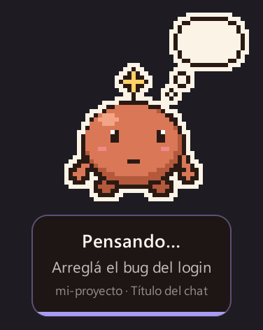
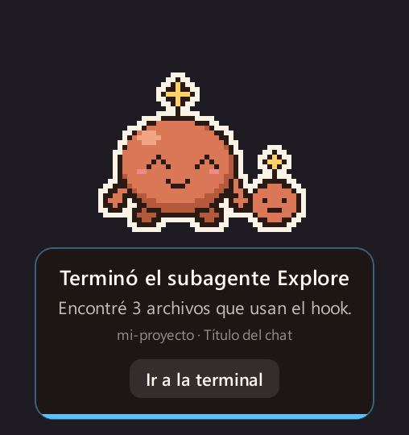
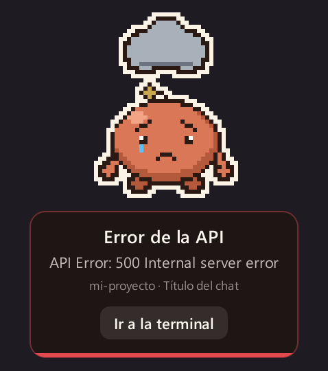
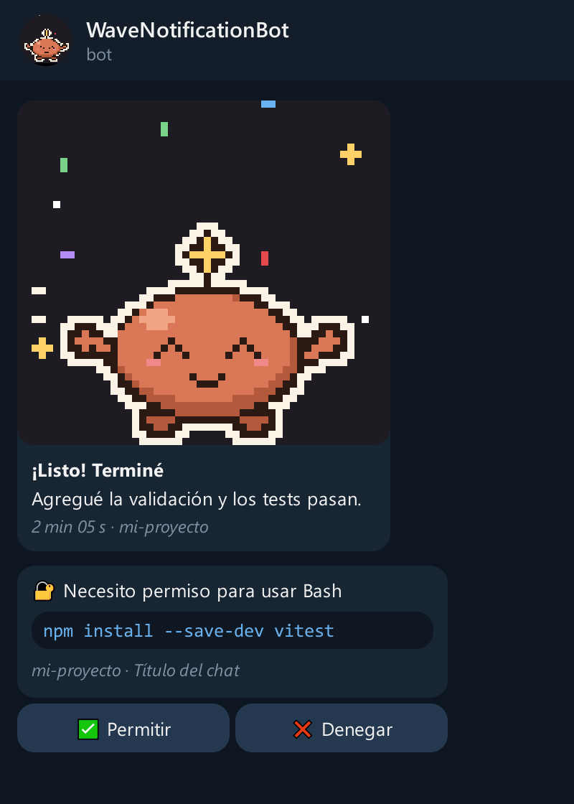
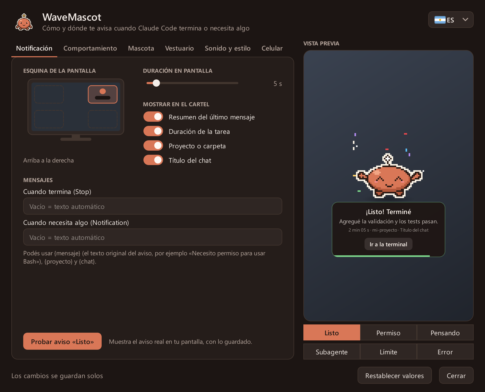
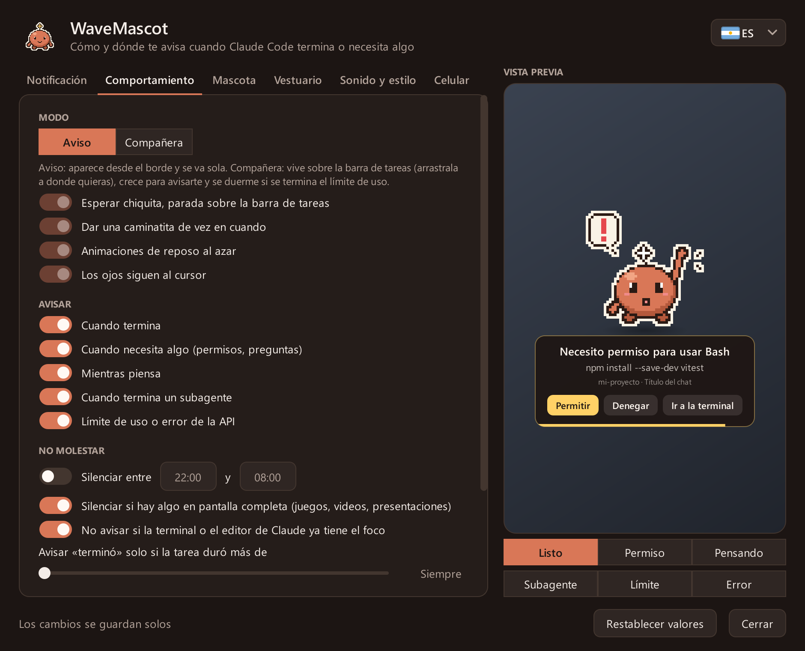
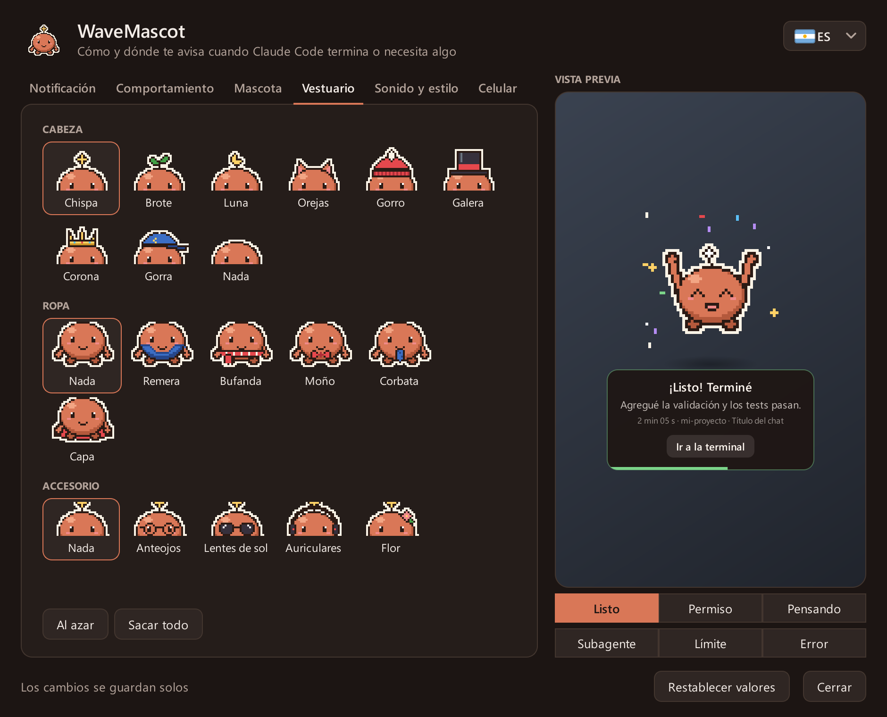
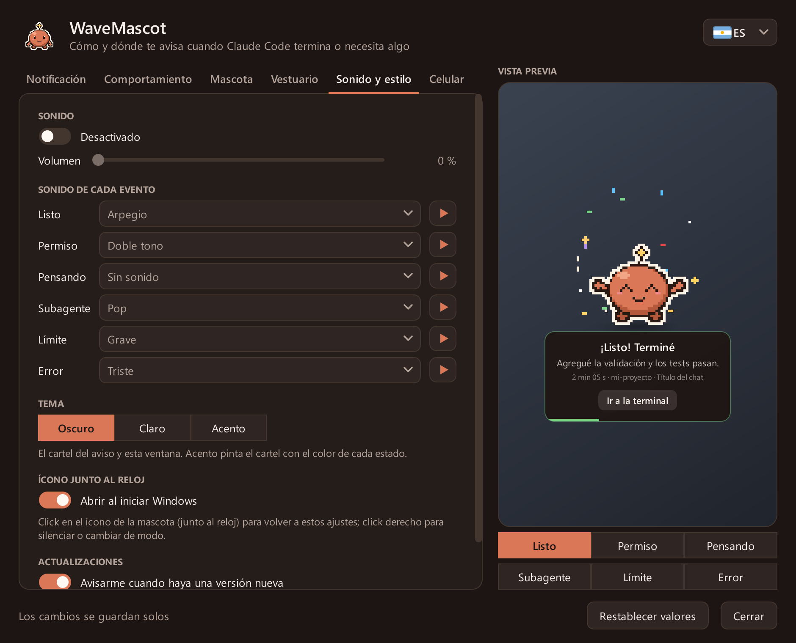
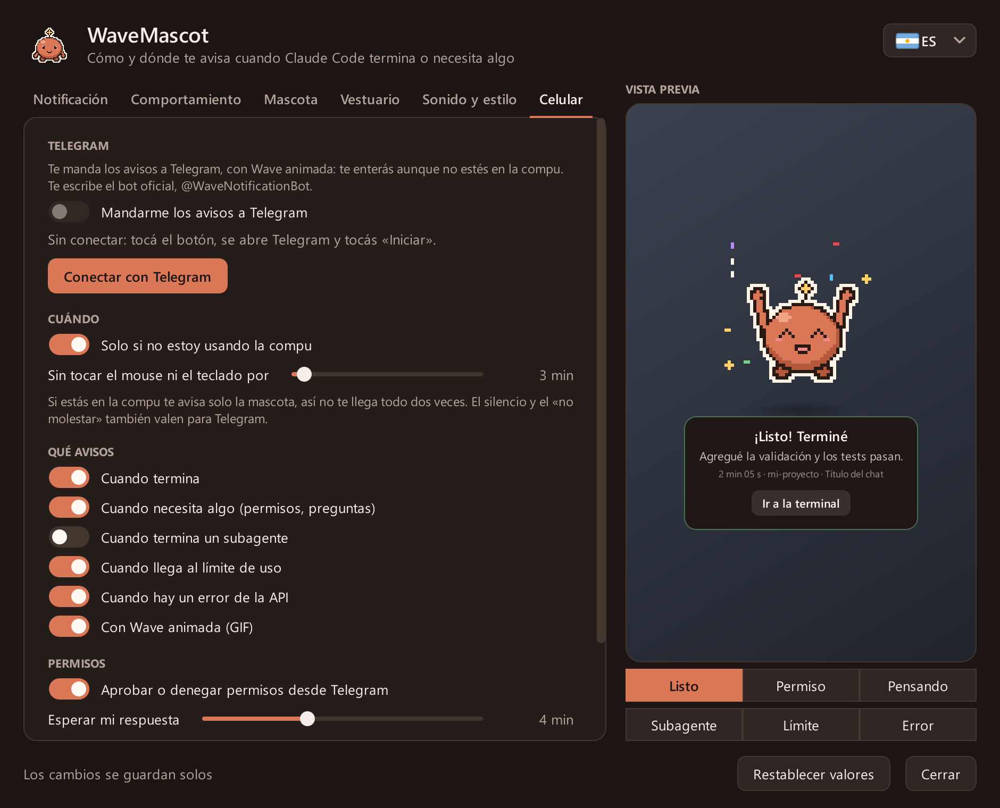

# WaveMascot

[English](README.md) · **Español** · [Português](README.pt.md)

<p align="center">
  
</p>

**Wave** es una mascota de escritorio en pixel art para Windows y macOS que te avisa cuando **Claude Code** termina,
necesita tu permiso o se queda sin uso disponible, en lugar de la notificación del sistema. Aparece desde el borde de
la pantalla, te dice de qué chat y proyecto viene el aviso, y se va sola. Si no estás en la compu, también te puede
escribir al celular por Telegram, y desde ahí podés **permitir o denegar** lo que pide Claude.

<p align="center">
  <a href="../../releases/latest/download/WaveMascot-Setup.exe"><b>⬇ Descargar para Windows</b></a>
  &nbsp;·&nbsp; <a href="../../releases/latest/download/WaveMascot-Mac-AppleSilicon.dmg"><b>⬇ Mac (chip Apple)</b></a>
  &nbsp;·&nbsp; <a href="../../releases/latest/download/WaveMascot-Mac-Intel.dmg"><b>⬇ Mac (Intel)</b></a>
  <br>
  <a href="#mirala-en-acción">Mirala en acción</a>
  &nbsp;·&nbsp; <a href="#instalación">Instalación</a>
  &nbsp;·&nbsp; <a href="../../discussions">Preguntas e ideas</a>
  &nbsp;·&nbsp; <a href="../../issues/new/choose">Reportar un problema</a>
</p>

> **Proyecto no oficial.** No está hecho, avalado ni mantenido por Anthropic. No usa logos, imágenes, sonidos ni
> ningún otro asset de Anthropic: la mascota, el ícono y los sonidos son originales y se generan por código
> (ver [THIRD_PARTY.md](THIRD_PARTY.md)).
>
> **Tus datos se quedan en tu compu.** El resumen del último mensaje se arma leyendo localmente el transcript que
> Claude Code ya guarda en tu disco. WaveMascot solo se conecta a internet para dos cosas, y las dos se pueden
> apagar: buscar en GitHub si hay una versión nueva (como mucho una vez por día) y, **solo si conectás Telegram**,
> mandarte el aviso al celular (ver [Avisos al celular](#avisos-al-celular-telegram)).

## Mirala en acción

### Un aviso para cada momento

Cada estado tiene su animación, su sonido y sus botones. Con varias sesiones a la vez, los avisos se encolan y cada
uno dice de qué proyecto viene.

<table>
  <tr>
    <td align="center"><br><b>Listo</b><br>cuánto tardó y un resumen</td>
    <td align="center"><br><b>Necesita permiso</b><br>permitís o denegás ahí mismo</td>
    <td align="center"><br><b>Pensando</b><br>Claude está trabajando</td>
  </tr>
  <tr>
    <td align="center"><br><b>Subagente</b><br>un ayudante terminó su parte</td>
    <td align="center"><br><b>Límite de uso</b><br>y cuándo se renueva</td>
    <td align="center"><br><b>Error</b><br>cuando falla la API</td>
  </tr>
</table>

### Cuatro estilos (beta)

El estilo cambia la cara de Wave y cómo aparece, festeja y se va.

<p align="center">
  
</p>

<table>
  <tr>
    <td align="center"><br><b>Clásico</b><br>se desliza desde el borde</td>
    <td align="center"><br><b>Sakura</b><br>llega flotando en una ráfaga de pétalos</td>
  </tr>
  <tr>
    <td align="center"><br><b>Ninja</b><br>llega escondido en humo y tira un shuriken</td>
    <td align="center"><br><b>Robot</b><br>llega volando con botas cohete y se enciende</td>
  </tr>
</table>

### Vestila como quieras

Colores, sombreros, ropa y accesorios (o tu propio PNG/GIF), y combinan con todos los estilos.

<p align="center">
  
</p>

### En tu celular

<p align="center">
  
  <br><sub>Ilustración del chat con @WaveNotificationBot (el aspecto de Telegram está recreado; el GIF y los textos son los reales).</sub>
</p>

### Los ajustes

<p align="center">
  
</p>

<details>
<summary><b>Ver todas las pestañas</b></summary>

| | |
|---|---|
| <br>**Notificación** | <br>**Comportamiento** |
| <br>**Mascota** | <br>**Vestuario** |
| <br>**Sonido y estilo** | <br>**Celular** |

</details>

Todas las imágenes salen de la app misma con [`tools/capturas.py`](tools/capturas.py); hay más en [`docs/`](docs).

## Qué hace

- **Avisa cuando Claude termina** (`listo`), **pide permiso** (`permiso`), está **pensando**, terminó un
  **subagente**, llegó al **límite de uso** o hubo un **error**: cada estado tiene su animación y su sonido.
- **Permitir / Denegar desde la mascota** (hook `PermissionRequest`): respondés sin ir a la terminal. Si no elegís
  a tiempo, decide el diálogo de siempre.
- **Avisos al celular** por Telegram, con Wave animada, y **Permitir / Denegar desde ahí** cuando no estás.
- **Muestra el contexto justo**: título del chat, proyecto, cuánto tardó y un resumen corto de la respuesta.
  Con **varias sesiones a la vez**, cada aviso dice de qué proyecto viene y los avisos se encolan en vez de pisarse.
- **No molesta**: horario de no molestar, nada en pantalla completa, nada si ya estás mirando la terminal, umbral de
  duración mínima y silencio rápido desde su ícono (junto al reloj en Windows, en la barra de menús en Mac).
- **Modo compañera**: en lugar de aparecer y desaparecer, se queda chiquita sobre la barra de tareas (o el Dock),
  pasea un poco y se duerme cuando te quedás sin uso hasta que se renueve.
- **Personalizable**: cuatro estilos (Clásico, Sakura, Ninja, Robot), colores, sombreros, ropa y accesorios, tu
  propia imagen (PNG/GIF), tamaño, esquina, temas oscuro/claro/acento y sonido por evento.
- **Te avisa cuando hay una versión nueva**: en Windows se actualiza sola con un click y mantiene tus ajustes.
- **En tu idioma**: inglés, español y portugués. Viene en inglés; se cambia con la banderita de arriba de los ajustes.
- **Varios monitores**: el aviso sale en el monitor donde está la ventana de Claude Code.
- **Nunca frena a Claude Code**: el hook vuelve en milisegundos, nunca sale con error y, si algo falla (sin audio,
  config rota, sin pantalla, sin internet), lo anota en el log y sigue.

## Instalación

Necesitás [Claude Code](https://docs.claude.com/en/docs/claude-code) (CLI, extensión o app de escritorio) y Windows
10 u 11, o macOS 13 (Ventura) o más nuevo.

### Windows

#### Opción A: instalador (recomendada, no necesita Python)

1. **[Descargá `WaveMascot-Setup.exe`](../../releases/latest/download/WaveMascot-Setup.exe)** (siempre la
   última versión; también está en [Releases](../../releases/latest)).
2. Abrilo y tocá **Sí**. Se instala en `%LOCALAPPDATA%\Programs\WaveMascot`, sin permisos de administrador.
3. Listo: la próxima vez que Claude Code termine, aparece la mascota. Si ya tenías Claude Code abierto, no hace falta
   reiniciarlo. Para verla en español, abrí los ajustes y elegí la banderita.

> Windows SmartScreen puede mostrar «Windows protegió su PC». Elegí **Más información → Ejecutar de todas formas**,
> o usá la opción B si preferís instalar desde el código. Podés verificar el archivo con el `SHA256SUMS.txt` del
> release.

#### Opción B: desde el código fuente (Python 3.10 o superior)

1. Descargá el código: [ZIP](../../archive/refs/heads/main.zip) (descomprimilo) o
   `git clone https://github.com/Marescaa/wavemascot.git`.
2. Abrí PowerShell en esa carpeta y corré:

   ```powershell
   powershell -ExecutionPolicy Bypass -File .\install.ps1
   ```

`install.ps1` instala PyQt6 y Pillow solo si faltan. Opciones: `-Python <ruta a python.exe>`, `-Destino <carpeta>`,
`-SinInicio` (sin ícono al iniciar Windows).

### Mac

#### Opción A: la app (recomendada, no necesita Python)

Necesitás macOS 13 (Ventura) o más nuevo, en cualquier Mac.

1. **Descargá el archivo de tu Mac.** Para saber cuál: menú Apple → **Acerca de esta Mac**.
   - Dice **Chip: Apple M1, M2, M3, M4…** → **[`WaveMascot-Mac-AppleSilicon.dmg`](../../releases/latest/download/WaveMascot-Mac-AppleSilicon.dmg)**
   - Dice **Procesador: Intel** → **[`WaveMascot-Mac-Intel.dmg`](../../releases/latest/download/WaveMascot-Mac-Intel.dmg)**
2. **Abrí el `.dmg`** (doble click en Descargas). Se abre una ventana con WaveMascot y la carpeta Aplicaciones:
   **arrastrá WaveMascot sobre Aplicaciones**. Después podés expulsar el disco WaveMascot desde el costado del Finder.
3. **Abrí WaveMascot** desde Aplicaciones (o con Spotlight: <kbd>⌘</kbd> <kbd>Espacio</kbd> y escribí *WaveMascot*).
   La primera vez macOS la bloquea porque la app no está notarizada por Apple (eso requiere una cuenta paga de
   desarrollador):
   - **macOS 15 (Sequoia) o más nuevo**: aparece *«Apple no pudo verificar que "WaveMascot" esté libre de malware…»*.
     Tocá **OK**, abrí **Ajustes del Sistema → Privacidad y seguridad**, bajá hasta **Seguridad** y tocá
     **Abrir de todos modos** al lado de *«Se bloqueó "WaveMascot"…»*. Confirmá con **Abrir de todos modos** y tu
     contraseña o Touch ID.
   - **macOS 13 o 14**: click derecho (o <kbd>Control</kbd> + click) en WaveMascot dentro de Aplicaciones → **Abrir**,
     y otra vez **Abrir**.

   Hace falta una sola vez; las actualizaciones y los hooks no lo vuelven a pedir.
4. WaveMascot pregunta **«¿Instalar WaveMascot?»**: tocá **Sí**. Se conecta con Claude Code y te cuenta qué hizo.
5. Listo: el ícono de Wave aparece en la **barra de menús** (arriba a la derecha). Tocalo → **Probar aviso** para
   verla. Desde ahora aparece cada vez que Claude Code termina o necesita algo, en la terminal, en VS Code o en la app
   de Claude. Si ya tenías Claude Code abierto, no hace falta reiniciarlo. Para verla en español, abrí los ajustes y
   elegí la banderita.

<p align="center">
  
</p>

Bueno saber:

- **No pide ningún permiso** (ni Accesibilidad, ni Grabación de pantalla, ni notificaciones).
- Si la abrís directo desde el `.dmg` sin arrastrarla, se copia sola a Aplicaciones.
- **Ajustes**: ícono de la barra de menús → **Abrir ajustes**, `/wavemascot` en Claude Code, o abriendo WaveMascot
  otra vez desde Aplicaciones.
- **Actualizar**: descargá el `.dmg` nuevo, arrastrá WaveMascot sobre Aplicaciones (**Reemplazar**) y abrila una vez.
- La primera vez macOS muestra *«Ítems en segundo plano añadidos»*: es el ícono de la barra de menús que se abre al
  iniciar sesión. Se apaga en los ajustes de WaveMascot o en **Ajustes del Sistema → General → Ítems de inicio**.
- Para verificar la descarga: `shasum -a 256 ~/Downloads/WaveMascot-Mac-*.dmg` tiene que coincidir con el
  `SHA256SUMS.txt` del release.

#### Opción B: desde el código fuente (Python 3.10 o superior)

```bash
git clone https://github.com/Marescaa/wavemascot.git
cd wavemascot
./install.sh
```

`install.sh` crea su propio entorno de Python con PyQt6 y Pillow (tu Python no se toca). Opciones:
`--python <ruta a python3>`, `--destination <carpeta>`, `--no-startup` (sin ícono en la barra de menús al iniciar
sesión).

### Qué hace el instalador en tu compu

- **Copia el programa** a `%LOCALAPPDATA%\Programs\WaveMascot` (Windows) o deja la app en **Aplicaciones** (Mac; si
  la abrís directo desde el `.dmg`, se copia sola ahí).
- **Conecta a Wave con Claude Code**: agrega unas líneas (los *hooks*) a `~/.claude/settings.json` para que Claude
  Code la llame cuando termina o necesita algo. Lo que ya tenías en ese archivo no se toca, y antes de cambiarlo se
  guarda una copia de seguridad.
- **Crea el comando `/wavemascot`**, que abre los ajustes desde Claude Code.
- **Pone el ícono de Wave junto al reloj** (Windows) o **en la barra de menús** (Mac, como ítem de inicio) cada vez
  que prendés la compu.

No pide permisos de administrador, y si la desinstalás, todo vuelve a quedar como estaba.

## Configuración

Abrí los ajustes con un click en el **ícono de Wave** (junto al reloj en Windows, en la barra de menús en Mac), con
**`/wavemascot`** en Claude Code o, en Mac, abriendo WaveMascot desde Aplicaciones. Los cambios se guardan solos y
valen desde el próximo aviso; la vista previa muestra el aviso completo tal como se va a ver. La **banderita** de
arriba a la derecha cambia el idioma.

| Pestaña | Qué cambiás |
|---|---|
| Notificación | Esquina, tiempo en pantalla, qué mostrar en el aviso (resumen, chat, proyecto, duración) y los mensajes |
| Comportamiento | Modo aviso o compañera (paseos, animaciones de espera, ojos), qué eventos avisan, no molestar (horario, pantalla completa, terminal enfocada), duración mínima, Permitir/Denegar desde la mascota |
| Mascota | Estilo (Clásico, Sakura, Ninja, Robot), color, tono de piel (Ninja), tamaño y tu propia imagen |
| Vestuario | Cabeza, ropa y accesorios (o al azar) |
| Sonido y estilo | Volumen, sonido de cada evento, tema oscuro / claro / acento, ícono junto al reloj / en la barra de menús, aviso de actualizaciones |
| Celular | Conectar Telegram, cuándo mandar (solo si no estás), qué avisos, con o sin GIF, Permitir/Denegar desde Telegram |

Todo se guarda en `~/.wavemascot/config.json`. Si el archivo no existe o tiene un error, la mascota usa los valores
por defecto. Desde el ícono de Wave también podés silenciar los avisos por una hora o hasta que los vuelvas a activar.

> Para que la mascota reemplace la notificación del sistema, apagá las notificaciones propias de Claude Code (en los
> ajustes de la app de escritorio o de tu terminal), así no te llegan dos avisos.

### Avisos al celular (Telegram)

1. En los ajustes, abrí la pestaña **Celular** y tocá **Conectar con Telegram**.
2. Telegram abre el chat con el bot oficial, **@WaveNotificationBot**, con un código de un solo uso. Tocá **Iniciar**.
   Listo: no hay nada que crear ni pegar.

Por defecto solo manda el aviso cuando hace 3 minutos que no tocás la compu (ni mouse ni teclado), así no te llega
todo dos veces; el silencio y el «no molestar» también valen. Cuando Claude pide permiso, el mensaje muestra el
comando completo con **Permitir** y **Denegar**: gana lo primero que respondas (el celular, los botones de Wave o la
terminal) y el otro lado se actualiza solo.

**Privacidad**: la clave del bot vive solo en un pequeño [Worker de Cloudflare](servidor/) que le pasa cada mensaje a
Telegram sin guardarlo. Cada instalación tiene su propia llave, que solo puede escribirle al chat que vinculó. Lo que
se manda es lo que muestra el aviso (mensaje, resumen, proyecto, título del chat, comando a aprobar). Mandale `/stop`
al bot o tocá **Desconectar** para cortarlo.

### Actualizaciones

WaveMascot revisa GitHub como mucho una vez por día. Cuando hay una versión nueva, Wave te avisa una vez
(**Actualizar** / **Ahora no**), aparece una pastillita «⬇ versión» junto a la banderita de los ajustes y el menú del
ícono ofrece **Actualizar a la versión…**. En Windows, **Actualizar** baja el instalador, lo comprueba con
`SHA256SUMS.txt` y lo instala sin preguntas, manteniendo tus ajustes; en Mac abre la página de descarga. Se apaga en
**Sonido y estilo → Actualizaciones**.

## Desinstalación

- **Windows, instalada con el `.exe`**: menú Inicio → *WaveMascot* → **Desinstalar WaveMascot**.
- **Windows, instalada con `install.ps1`** (o cualquiera de las dos):

  ```powershell
  powershell -ExecutionPolicy Bypass -File .\uninstall.ps1
  ```

- **Mac**: ícono de Wave en la barra de menús → **Desinstalar WaveMascot…** (o `./uninstall.sh`, de cualquiera de las
  dos formas). Si solo arrastrás la app a la papelera, Claude Code sigue andando normal: sus hooks no hacen nada
  mientras la app no esté.

La desinstalación cierra la mascota, quita **solo sus hooks** de `~/.claude/settings.json` (con backup previo; los
tuyos quedan exactamente como estaban), borra `/wavemascot`, los accesos directos y el programa. Tu configuración en
`~/.wavemascot` se conserva; para borrarla también: `uninstall.ps1 -BorrarConfig` o `uninstall.sh --delete-settings`.

## Problemas frecuentes

- **No aparece**: mirá `~/.wavemascot/mascota.log`; cada evento dice si se avisó o por qué no (pantalla completa,
  no molestar, terminal enfocada, evento apagado...). Con el ícono de Wave → *Probar aviso* se fuerza uno.
- **Los hooks no corren**: revisá en Claude Code con `/hooks` que estén los de la mascota.
- **Permitir/Denegar**: en la app de escritorio el diálogo propio sigue apareciendo; vale la primera respuesta.
- **Mac: «No se puede abrir WaveMascot» o «Apple no pudo verificar…»**: mirá el paso 3 de
  [Instalación → Mac](#mac).
- **Mac: no veo el ícono en la barra de menús**: en las Mac con notch, los íconos que no entran se esconden; cerrá
  alguna otra app de la barra o abrí los ajustes con `/wavemascot`. Si lo cerraste, abrí WaveMascot desde Aplicaciones.
- **Mac: me llegan dos avisos**: apagá las notificaciones de tu terminal o de la app de Claude en **Ajustes del
  Sistema → Notificaciones**, así te avisa solo Wave.
- **Telegram: no llega nada**: por defecto los avisos solo van al celular si hace 3 minutos que no usás la compu;
  apagá «Solo si no estoy usando la compu» para probar. Si bloqueaste el bot o le mandaste `/stop`, volvé a conectar
  desde la pestaña **Celular**.

## Preguntas, ideas y reportes

- **¿Tenés una pregunta o una idea?** Escribila en [Discussions](../../discussions): ahí se charla, se proponen
  vestuarios o estados nuevos y se comparten configuraciones.
- **¿Algo no funciona?** Abrí un [issue](../../issues/new/choose) con la plantilla de error (sumá las últimas
  líneas del log, sin datos privados).
- **¿Querés proponer algo concreto?** Usá la plantilla de idea en [issues](../../issues/new/choose).

Se puede escribir en español, inglés o portugués. Los pull requests son bienvenidos: antes de mandar uno, corré las
pruebas (`python -m unittest discover tests`).

## Desarrollo

```powershell
python -m unittest discover tests          # pruebas del instalador, traducciones, estilos, celular y actualizaciones
powershell -ExecutionPolicy Bypass -File .\build.ps1   # arma dist\WaveMascot-Setup.exe (en Windows)
./build-mac.sh                             # arma dist/WaveMascot-Mac-<chip>.dmg (en una Mac)
python tools/capturas.py                   # vuelve a dibujar las capturas y GIFs de docs/ desde la app real
```

Al pushear un tag `v*` (por ejemplo `v1.2.0`), GitHub Actions construye el instalador de Windows y los dos `.dmg` de
Mac y los adjunta al release, con la sección del CHANGELOG de esa versión como notas. Cada push a `main` corre las
pruebas en Windows y en macOS.

| Archivo | Qué es |
|---|---|
| `mascota.py` | El hook y la ventana de la mascota |
| `ajustes.py` | El centro de ajustes |
| `bandeja.py` | El ícono junto al reloj / en la barra de menús |
| `sprites.py` | El pixel art, los estilos, los íconos y los sonidos (todo generado por código) |
| `celular.py` | Avisos y permisos por Telegram (cliente del Worker) |
| `actualizacion.py` | Busca versiones nuevas en GitHub, las baja y las instala |
| `idiomas.py` | Los textos en inglés, español y portugués |
| `ventanas.py` | Ventanas de Windows y macOS: terminal anfitriona, foco, pantalla completa, monitores |
| `instalador.py` | Instalar / desinstalar (merge de hooks con backup); también es el instalador `.exe` y el primer arranque de la app de Mac |
| `principal.py` | Punto de entrada de `WaveMascot.exe` y `WaveMascot.app` |
| `servidor/` | El Worker de Cloudflare detrás de @WaveNotificationBot |
| `tools/capturas.py` | Arma las imágenes de `docs/` (fuera de pantalla, sin tocar tus ajustes) |

**Sumar un idioma**: agregalo a `IDIOMAS` en `idiomas.py` con una traducción por texto; `tests/test_idiomas.py` avisa
si falta alguna.

## Licencia

[MIT](LICENSE). El `.exe` y la app de Mac incluyen PyQt6 (GPL v3) y otras bibliotecas; ver
[THIRD_PARTY.md](THIRD_PARTY.md).
