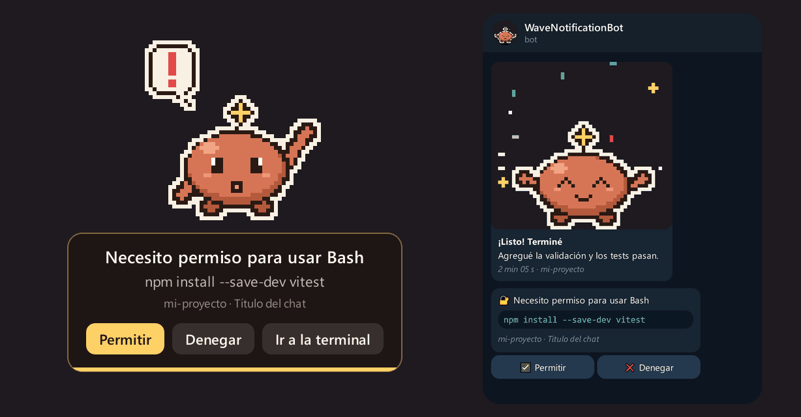
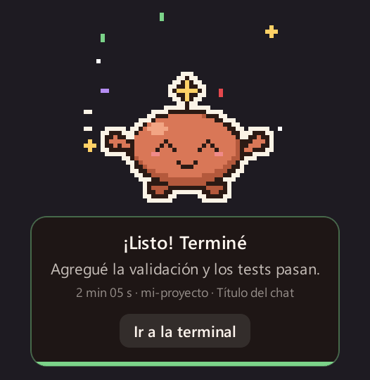
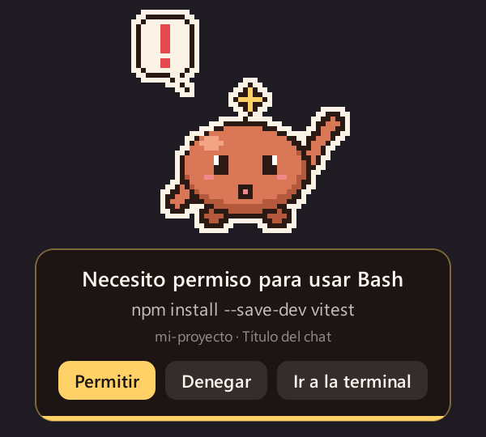
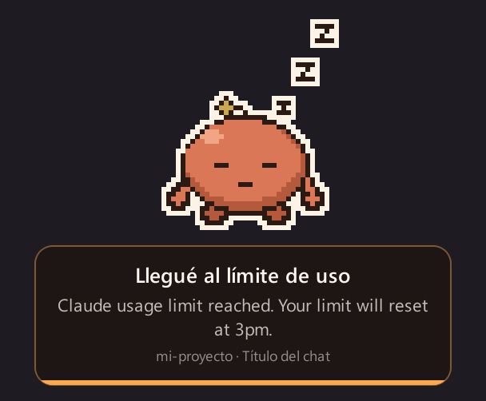
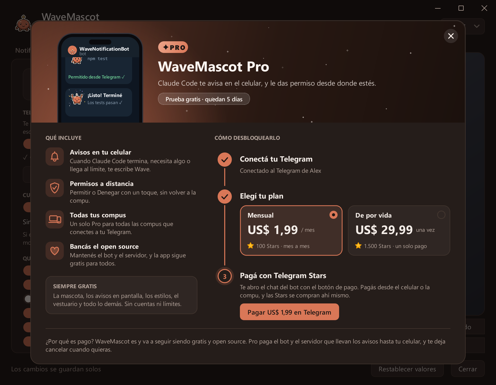
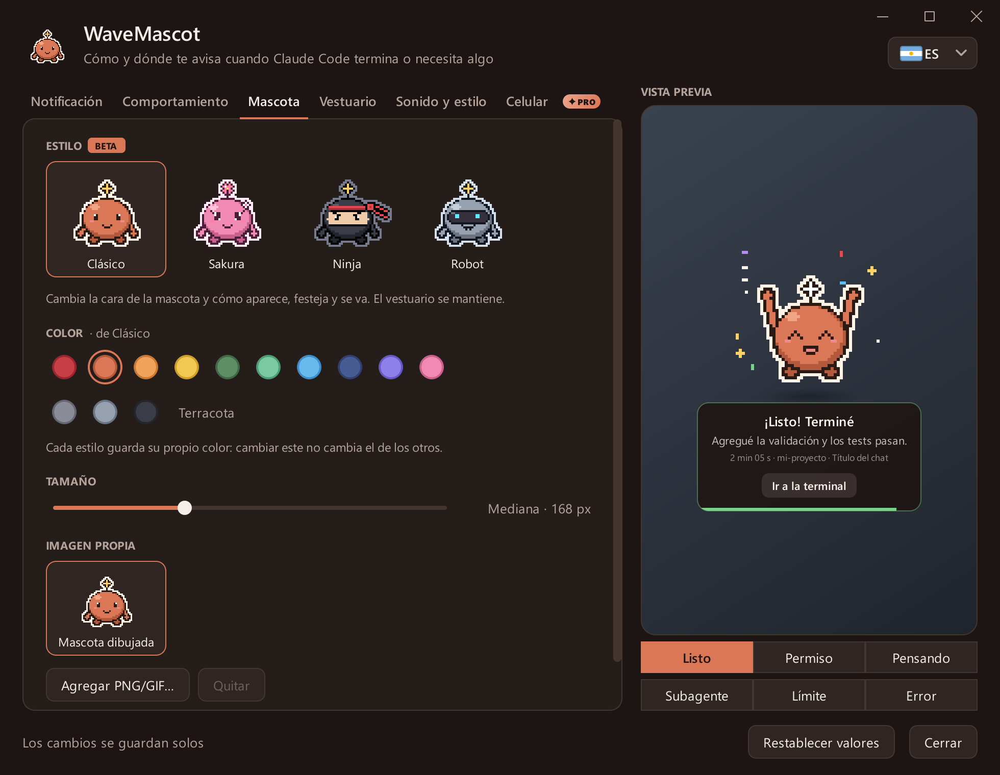

# WaveMascot

**Una mascota en pixel art que te avisa cuando Claude Code termina, o te necesita.** 
En tu escritorio, y en tu celular cuando no estás.

Gratis y open source · Windows 10/11 y macOS 13+ · [English](README.md) · **Español** · [Português](README.pt.md)

  

 

[Qué hace](#qué-hace) · [Instalación](#instalación) · [WaveMascot Pro](#wavemascot-pro) · [Ajustes](#ajustes) ·
[Galería](docs/README.es.md) · [Preguntas](#preguntas-frecuentes) · [Cambios](CHANGELOG.md)

> [!NOTE]
> **Nuevo en la 1.3:** [WaveMascot Pro](#wavemascot-pro) lleva los avisos y el Permitir/Denegar a tu celular por
> Telegram (7 días de prueba gratis), y suma cuatro estilos de mascota, el aviso de versión nueva y una barra de título
> nueva en Windows. [Ver todos los cambios →](CHANGELOG.md#130---2026-10-23)

## Qué hace

Le pedís algo a Claude Code y te vas a otra ventana. Cuando termina, pide permiso o se queda sin uso, **Wave aparece
desde el borde de la pantalla**, te dice de qué chat y proyecto se trata, y se va sola. Si no estás en la compu, te
escribe al celular.

<table>
  <tr>
    <td align="center" width="33%">
       
      <b>Sabe cuándo terminó</b> 
      Chat, proyecto, cuánto tardó y un resumen de una línea de lo que hizo.
    </td>
    <td align="center" width="33%">
       
      <b>Pregunta antes de actuar</b> 
      Permitir o Denegar ahí mismo, sin volver a la terminal.
    </td>
    <td align="center" width="33%">
       
      <b>Te avisa cuándo parar</b> 
      El límite de uso y los errores de la API tienen su aviso, su animación y su sonido.
    </td>
  </tr>
</table>

## Funciones

- **Un aviso para cada momento**: terminó, necesita permiso, está pensando, terminó un subagente, límite de uso y
  error de la API.
- **Permitir o denegar sin ir a la terminal**, desde los botones de Wave o desde el celular. Vale la primera respuesta.
- **El contexto justo**: chat, proyecto, cuánto tardó y un resumen leído en tu compu. Los avisos de varias sesiones se
  encolan.
- **No molesta**: horario de no molestar, y nada sobre apps en pantalla completa ni si ya estás mirando la terminal.
- **A tu gusto**: cuatro estilos (Clásico, Sakura, Ninja, Robot), colores, vestuario, tema claro u oscuro, tu propia
  imagen y sonidos.
- **Modo compañera**: Wave vive chiquita sobre la barra de tareas o el Dock, pasea y se duerme cuando llegás al límite.
- **En tu celular** con [WaveMascot Pro](#wavemascot-pro): avisos por Telegram con Wave animada, y Permitir/Denegar
  desde donde estés.
- **Siempre al día**: Wave te avisa cuando hay una versión nueva; en Windows se instala con un click.
- **Inglés, español y portugués**, varios monitores, Windows y macOS (chip Apple e Intel).

  
   
  Los cuatro estilos. Cada uno aparece, festeja y se va a su manera: <a href="docs/README.es.md#estilos">miralos moverse →</a>

## Instalación

Necesitás [Claude Code](https://docs.claude.com/en/docs/claude-code): la CLI, la extensión del editor o la app de
escritorio.

**Windows 10 / 11**

1. Bajá [`WaveMascot-Setup.exe`](../../releases/latest/download/WaveMascot-Setup.exe).
2. Abrilo y hacé click en **Sí**. No necesita permisos de administrador ni Python.

Si aparece SmartScreen, elegí **Más información → Ejecutar de todas formas**.

**macOS 13 o superior**

1. Bajá el `.dmg` de tu Mac: [chip Apple](../../releases/latest/download/WaveMascot-Mac-AppleSilicon.dmg) ·
   [Intel](../../releases/latest/download/WaveMascot-Mac-Intel.dmg).
2. Arrastrá WaveMascot a Aplicaciones y abrilo.

La primera vez macOS te pide confirmar porque la app no está notarizada: [así se hace](docs/install.es.md#mac).

Listo: la próxima vez que Claude Code termine, aparece Wave. No hace falta reiniciar nada. La
[guía de instalación](docs/install.es.md) explica cómo instalar desde el código, qué cambia el instalador, cómo
desinstalar y los problemas frecuentes.

## WaveMascot Pro

**WaveMascot es gratis y open source, y lo va a seguir siendo.** Pro suma tu celular: cuando no estás en la compu,
Wave te escribe por Telegram desde [@WaveNotificationBot](https://t.me/WaveNotificationBot), y los pedidos de permiso
llegan con los botones **Permitir** y **Denegar**, que le contestan a Claude Code al instante.

  

| | Gratis | Pro |
|---|:---:|:---:|
| Avisos en pantalla para cada evento, con Permitir/Denegar | ✓ | ✓ |
| Estilos, colores, vestuario, temas, tu propia imagen y sonidos | ✓ | ✓ |
| Modo compañera, no molestar, actualizaciones | ✓ | ✓ |
| Avisos por Telegram con Wave animada | | ✓ |
| Permitir o denegar desde el celular | | ✓ |
| Un solo plan para todas las compus de tu Telegram | | ✓ |
| **Precio** | **Gratis para siempre** | **US$ 1,99 por mes** o **US$ 29,99 una vez** |

**Cómo conseguirlo:** abrí la pestaña **Celular**, tocá **Conectar con Telegram** y después **Iniciar** en el bot. No
hay nada que crear ni pegar, y ahí arrancan tus **7 días de prueba gratis**, sin tarjeta. Para quedártelo, tocá el
cartel **PRO** y pagá con Telegram Stars dentro del bot (100 Stars por mes, lo cancelás cuando quieras con `/pro`, o
1.500 Stars una sola vez). Wave se da cuenta sola del pago.

Si termina la prueba, no se rompe nada: la mascota te sigue avisando en pantalla y los pedidos de permiso vuelven a la
terminal.

## Ajustes

Hacé click en el **ícono de Wave** (junto al reloj en Windows, en la barra de menús en Mac) o escribí
**`/wavemascot`** en Claude Code. Los cambios se guardan solos, y la vista previa muestra el aviso tal cual va a
aparecer.

  

<b>Qué tiene cada pestaña</b>

 

| Pestaña | Qué cambiás |
|---|---|
| Aviso | Esquina, tiempo en pantalla, qué muestra el aviso y sus mensajes |
| Comportamiento | Modo aviso o compañera, qué eventos avisan, no molestar, duración mínima, Permitir/Denegar |
| Mascota | Estilo, color, tono de piel, tamaño y tu propia imagen |
| Vestuario | Cabeza, ropa y accesorios |
| Sonido y estilo | Volumen, sonido por evento, tema, ícono junto al reloj, actualizaciones |
| Celular **PRO** | Telegram: cuándo mandar, qué avisos, Permitir/Denegar desde el celular, tu plan |

Todo se guarda en `~/.wavemascot/config.json`. Todas las pestañas están en la [galería](docs/README.es.md#ajustes).

## Privacidad

Todo corre en tu compu. El resumen se lee localmente del historial que Claude Code ya guarda en tu disco. WaveMascot
solo se conecta a internet para buscar en GitHub si hay una versión nueva (una vez por día como mucho) y, si lo
conectás, para mandar los avisos a Telegram. Las dos cosas se pueden apagar.

<b>Cómo funciona Telegram</b>

 

La clave del bot vive solo en un pequeño [Worker de Cloudflare](servidor/) que pasa cada mensaje sin guardarlo, y cada
instalación tiene su propia llave, que solo puede escribirle al chat que vinculó. Se manda lo que muestra el aviso
(mensaje, resumen, proyecto, título del chat, comando a aprobar). Mandale `/stop` al bot o tocá **Desconectar** para
cortar.

Para Pro, el servidor guarda solo tu id de chat de Telegram, tu plan y los ids de pago que manda Telegram. El cobro lo
hace Telegram, así que WaveMascot nunca ve datos de tarjetas.

## Preguntas frecuentes

<b>¿Cómo sabe qué está haciendo Claude Code?</b>

 

Con los [hooks](https://docs.claude.com/en/docs/claude-code/hooks) de Claude Code. El instalador agrega unas líneas a
`~/.claude/settings.json` (con una copia de respaldo antes, y sin tocar las tuyas), y Claude Code llama a Wave cuando
termina, necesita algo, termina un subagente o llega a un límite. Al desinstalar se borran solo esas líneas.

<b>Me llegan dos avisos cada vez</b>

 

Apagá las notificaciones propias de Claude Code (o las de tu terminal; en Mac, en **Ajustes del Sistema →
Notificaciones**), así te avisa solo Wave.

<b>¿Funciona con la extensión de VS Code o la app de escritorio?</b>

 

Sí: los hooks son los mismos en la CLI, las extensiones de los editores y la app de escritorio. En la app de escritorio
también sigue apareciendo su propio diálogo de permiso; vale la primera respuesta.

<b>Wave no apareció</b>

 

Mirá `~/.wavemascot/mascota.log`: cada evento dice si avisó o por qué no (pantalla completa, no molestar, terminal
enfocada, evento apagado…). Con el ícono de Wave → **Probar aviso** se fuerza uno. Más en
[problemas frecuentes](docs/install.es.md#problemas-frecuentes).

## Contribuir

Las preguntas e ideas van a [Discussions](../../discussions) y los errores a [Issues](../../issues/new/choose). Los
pull requests son bienvenidos, en español, inglés o portugués: mirá [CONTRIBUTING.md](CONTRIBUTING.md). Las imágenes
del README las dibuja la app misma con [`tools/capturas.py`](tools/capturas.py).

## Licencia

[MIT](LICENSE). Los instaladores incluyen PyQt6 (GPL v3) y otras bibliotecas; mirá [THIRD_PARTY.md](THIRD_PARTY.md).

WaveMascot es un proyecto no oficial: no lo hace, respalda ni mantiene Anthropic. La mascota, el ícono y los
sonidos son originales y están generados por código.
