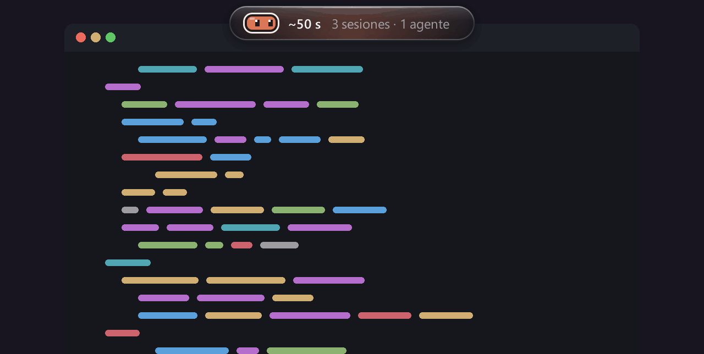
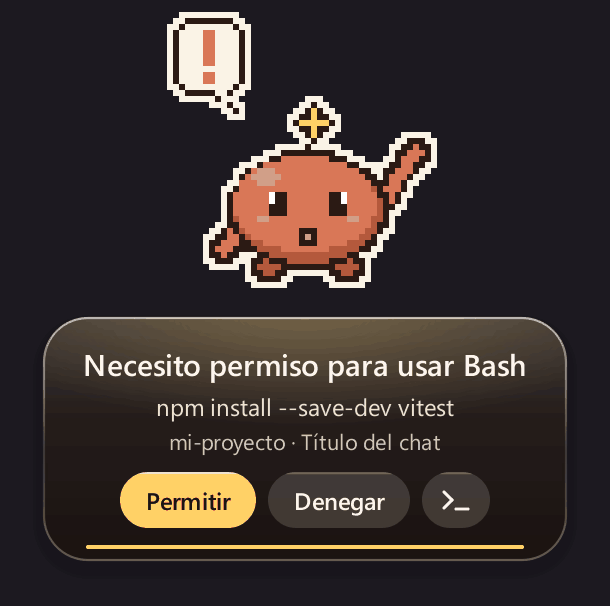
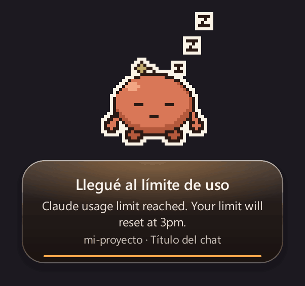
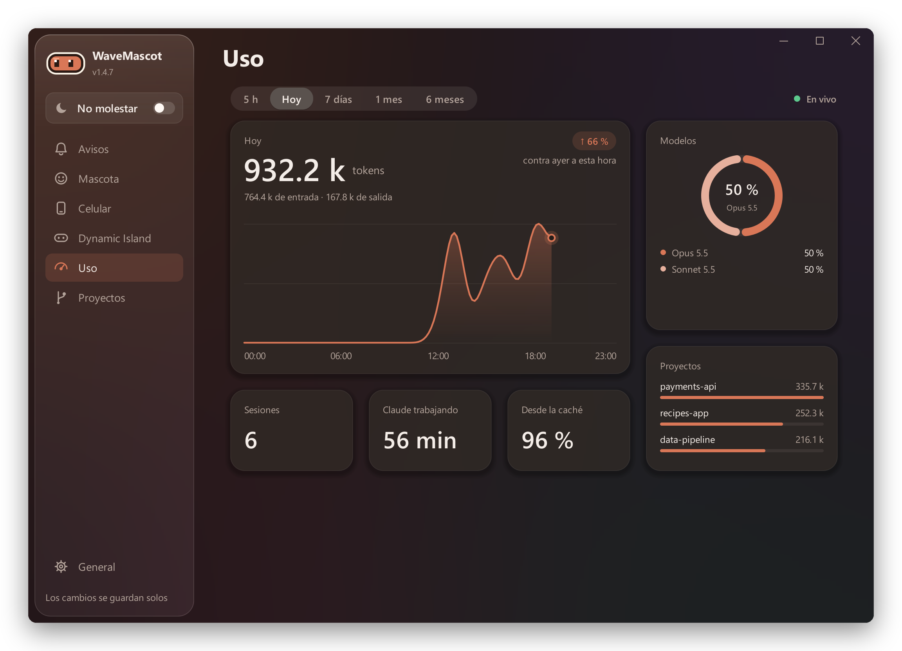
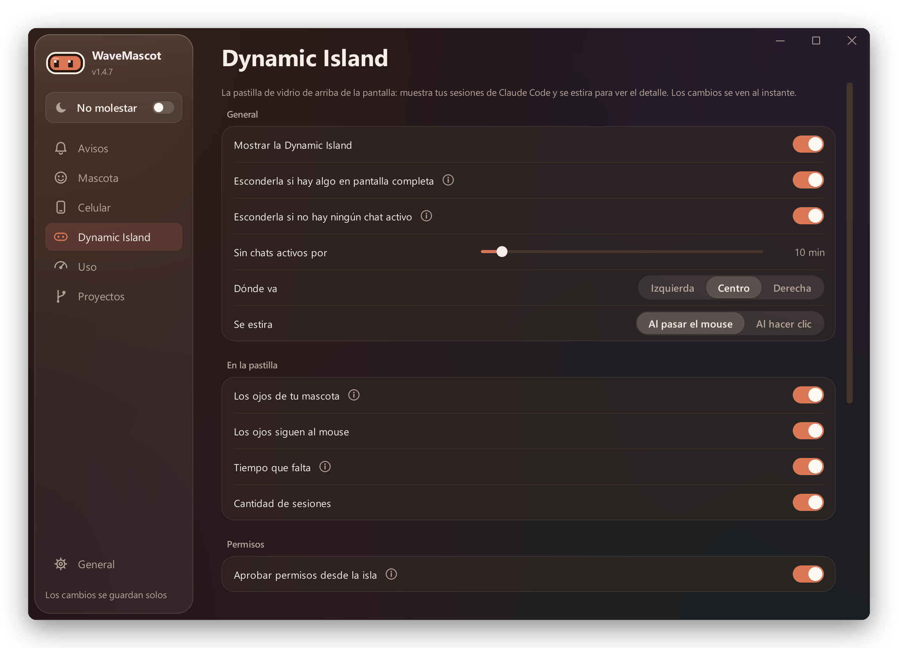

# WaveMascot

**Una mascota en pixel art para Claude Code.** 
Te avisa cuando Claude termina o te necesita, te muestra cada sesión en una Dynamic Island arriba de la pantalla,
y te escribe al celular cuando no estás.

Gratis y open source · Windows 10/11 y macOS 13+ · [English](README.md) · **Español** · [Português](README.pt.md)

  

 

[Avisos](#avisos) · [Dynamic Island](#dynamic-island) · [Funciones](#funciones) · [Instalación](#instalación) ·
[Ajustes](#ajustes) · [Celular](#en-tu-celular) · [Galería](docs/README.es.md) · [Preguntas](#preguntas-frecuentes) ·
[Cambios](CHANGELOG.md)

> [!NOTE]
> **Nuevo en la 1.4.0:** la Dynamic Island, las secciones Dashboard y Uso, los ajustes de vidrio (el desenfoque real
> es en Windows) y el estilo Hamburguesa. [Ver todos los cambios →](CHANGELOG.md#140---2026-11-17)

## Avisos

Le pedís algo a Claude Code y te vas a otra ventana. Cuando termina, pide permiso o se queda sin uso, **Wave aparece
desde el borde de la pantalla**, te dice de qué chat y proyecto se trata, y se va sola. Si no estás en la compu, te
escribe al celular.

<table>
  <tr>
    <td align="center" width="33%">
       
      <b>Sabe cuándo terminó</b> 
      Chat, proyecto, cuánto tardó y un resumen de una línea de lo que hizo.
    </td>
    <td align="center" width="33%">
       
      <b>Pregunta antes de actuar</b> 
      Permitir o Denegar ahí mismo, sin volver a la terminal.
    </td>
    <td align="center" width="33%">
       
      <b>Te avisa cuándo parar</b> 
      El límite de uso y los errores de la API tienen su aviso, su animación y su sonido.
    </td>
  </tr>
</table>

## Dynamic Island

Arriba al centro de la pantalla vive una pastillita de vidrio con **los ojos de tu mascota**: despiertos mientras
Claude trabaja, tranquilos mientras espera y dormidos cuando no hay nada andando. Al lado, cuánto falta y cuántas
sesiones hay abiertas. Le pasás el mouse y se estira, como un líquido, para mostrarte cada sesión.

<table>
  <tr>
    <td width="50%" valign="top">
       
      <b>De un vistazo</b> 
      Lo que le falta a la próxima sesión en terminar, cuántas sesiones y subagentes hay.
    </td>
    <td width="50%" valign="top">
       
      <b>Cada sesión</b> 
      Título, proyecto, tokens, por dónde va la lista de tareas, la herramienta que está usando y una barra de
      progreso. Con un click saltás a su ventana.
    </td>
  </tr>
</table>

Al pie: tus tokens de las últimas 5 horas y 7 días. El engranaje abre los ajustes. Se esconde sola cuando hay algo en
pantalla completa, y en **Ajustes → Dynamic Island** tenés 15 opciones para elegir dónde va, qué muestra y cómo se
mueve. En Windows el vidrio desenfoca de verdad lo que hay detrás.

## Funciones

- **Un aviso para cada momento**: terminó, necesita permiso, está pensando, terminó un subagente, límite de uso y
  error de la API.
- **Permitir o denegar sin ir a la terminal**, desde los botones de Wave o desde el celular. Vale la primera respuesta.
- **Dynamic Island**: todas tus sesiones de Claude Code en una pastilla de vidrio, con lo que le falta a cada una.
- **Uso**: tus tokens en una curva, de las últimas 5 horas a 6 meses, con cuánto trabajó Claude, modelos, proyectos y
  aciertos de caché. En vivo, y leído solo de tu compu.
- **El contexto justo**: chat, proyecto, cuánto tardó y un resumen leído en tu compu. Los avisos de varias sesiones se
  encolan.
- **No molesta**: **No molestar** con un click, silencio automático por horario, y nada sobre apps en pantalla
  completa ni si ya estás mirando la terminal.
- **A tu gusto**: cinco estilos (Clásico, Sakura, Ninja, Robot y Hamburguesa), colores, vestuario, tema claro u
  oscuro, tu propia imagen y sonidos.
- **Modo compañera**: Wave vive chiquita sobre la barra de tareas o el Dock, pasea y se duerme cuando llegás al límite.
- **En tu celular**: [avisos por Telegram](#en-tu-celular) con Wave animada, y Permitir/Denegar desde donde estés.
  Gratis.
- **Siempre al día**: Wave te avisa cuando hay una versión nueva; en Windows se instala con un click.
- **Inglés, español y portugués**, varios monitores, Windows y macOS (chip Apple e Intel).

  
   
  Los cinco estilos. Cada uno aparece, festeja y se va a su manera: <a href="docs/README.es.md#estilos">miralos moverse →</a>

## Instalación

Necesitás [Claude Code](https://docs.claude.com/en/docs/claude-code): la CLI, la extensión del editor o la app de
escritorio.

**Windows 10 / 11**

1. Bajá [`WaveMascot-Setup.exe`](../../releases/latest/download/WaveMascot-Setup.exe).
2. Abrilo y hacé click en **Sí**. No necesita permisos de administrador ni Python.

Si aparece SmartScreen, elegí **Más información → Ejecutar de todas formas**.

**macOS 13 o superior**

1. Bajá el `.dmg` de tu Mac: [chip Apple](../../releases/latest/download/WaveMascot-Mac-AppleSilicon.dmg) ·
   [Intel](../../releases/latest/download/WaveMascot-Mac-Intel.dmg).
2. Arrastrá WaveMascot a Aplicaciones y abrilo.

La primera vez macOS te pide confirmar porque la app no está notarizada: [así se hace](docs/install.es.md#mac).

Listo: la próxima vez que Claude Code termine, aparece Wave. No hace falta reiniciar nada. La
[guía de instalación](docs/install.es.md) explica cómo instalar desde el código, qué cambia el instalador, cómo
desinstalar y los problemas frecuentes.

## Ajustes

Hacé click en el **ícono de Wave** (junto al reloj en Windows, en la barra de menús en Mac), en el engranaje de la
Dynamic Island, o escribí **`/wavemascot`** en Claude Code. Todo se guarda solo, y la vista previa muestra cada aviso
tal cual va a aparecer.

  

<table>
  <tr>
    <td colspan="2" align="center">
       
      <b>Uso</b> 5 horas, hoy, una semana, un mes o seis meses, en vivo.
    </td>
  </tr>
  <tr>
    <td width="50%" align="center">
       
      <b>Dynamic Island</b> Dónde va, los ojos, qué muestra la pastilla, desenfoque, rebote.
    </td>
    <td width="50%" align="center">
       
      <b>Mascota</b> Estilo, color, vestuario, tamaño o tu propia imagen.
    </td>
  </tr>
</table>

<b>Qué tiene cada sección</b>

 

| Sección | Qué cambiás |
|---|---|
| **No molestar** | El interruptor de arriba: silencia todos los avisos hasta que lo apagues |
| Avisos | Modo aviso o compañera, esquina, tiempo en pantalla, silencio automático, y por cada evento: si aparece, su sonido y si va al celular |
| Mascota | Estilo, color, cabeza, ropa, accesorio, tamaño y tu propia imagen |
| Celular | Conectar Telegram, cuándo mandar (solo si no estás), Wave animada, Permitir/Denegar desde el celular |
| Dynamic Island | Mostrarla, dónde va, abrir al pasar el mouse o al hacer click, ojos, tiempo que falta, sesiones a la vista, uso de 5 h y 7 días, desenfoque, opacidad, rebote, latido |
| Uso | Tokens de 5 horas, hoy, 7 días, 1 mes o 6 meses: curva, entrada, salida, sesiones, cuánto trabajó Claude, aciertos de caché, modelos y proyectos |
| General | Idioma, tema (oscuro, claro o acento), abrir al iniciar, actualizaciones |

Todo se guarda en `~/.wavemascot/config.json`. Todas las secciones están en la [galería](docs/README.es.md#ajustes).

## En tu celular

Cuando no estás en la compu, Wave te escribe por Telegram desde
[@WaveNotificationBot](https://t.me/WaveNotificationBot), y los pedidos de permiso traen los botones **Permitir** y
**Denegar**, que le contestan a Claude Code al instante. Es gratis, como todo WaveMascot.

  

Abrí **Celular** en los ajustes, tocá **Conectar con Telegram** y después **Iniciar** en el bot. No hay nada que crear
ni pegar. Por defecto solo te escribe si no tocaste el mouse ni el teclado en unos minutos.

## Privacidad

Todo corre en tu compu. El resumen, la Dynamic Island y Uso se leen localmente de los transcripts que
Claude Code ya guarda en tu disco; son cuentas hechas con esos archivos, no los límites oficiales de tu cuenta.
WaveMascot solo se conecta a internet para buscar en GitHub si hay una versión nueva (una vez por día como mucho) y,
si lo conectás, para mandar los avisos a Telegram. Las dos cosas se pueden apagar.

<b>Cómo funciona Telegram</b>

 

La clave del bot vive solo en un pequeño [Worker de Cloudflare](servidor/) que pasa cada mensaje sin guardarlo, y cada
instalación tiene su propia llave, que solo puede escribirle al chat que vinculó. Se manda lo que muestra el aviso
(mensaje, resumen, proyecto, título del chat, comando a aprobar). Mandale `/stop` al bot o tocá **Desconectar** para
cortar.

## Preguntas frecuentes

<b>¿Cómo sabe qué está haciendo Claude Code?</b>

 

Con los [hooks](https://docs.claude.com/en/docs/claude-code/hooks) de Claude Code. El instalador agrega unas líneas a
`~/.claude/settings.json` (con una copia de respaldo antes, y sin tocar las tuyas), y Claude Code llama a Wave cuando
termina, necesita algo, termina un subagente o llega a un límite. Al desinstalar se borran solo esas líneas. La
Dynamic Island además lee los transcripts de las sesiones en `~/.claude/projects`.

<b>¿Cómo sabe cuánto falta?</b>

 

No hay forma de saberlo de verdad, así que lo estima: mira tus turnos anteriores que se parecen al de ahora (mismo
proyecto y sesión, herramientas usadas hasta el momento, qué tan largo fue tu mensaje, por dónde va la lista de tareas
de Claude) y toma lo que les faltaba. Cuanto más lo usás, mejor le sale.

<b>Me llegan dos avisos cada vez</b>

 

Apagá las notificaciones propias de Claude Code (o las de tu terminal; en Mac, en **Ajustes del Sistema →
Notificaciones**), así te avisa solo Wave.

<b>¿Funciona con la extensión de VS Code o la app de escritorio?</b>

 

Sí: los hooks son los mismos en la CLI, las extensiones de los editores y la app de escritorio. En la app de escritorio
también sigue apareciendo su propio diálogo de permiso; vale la primera respuesta.

<b>Wave no apareció</b>

 

Mirá `~/.wavemascot/mascota.log`: cada evento dice si avisó o por qué no (pantalla completa, no molestar, terminal
enfocada, evento apagado…). Con el ícono de Wave → **Probar aviso** se fuerza uno. Más en
[problemas frecuentes](docs/install.es.md#problemas-frecuentes).

## Contribuir

Las preguntas e ideas van a [Discussions](../../discussions) y los errores a [Issues](../../issues/new/choose). Los
pull requests son bienvenidos, en español, inglés o portugués: mirá [CONTRIBUTING.md](CONTRIBUTING.md). Las imágenes
del README las dibuja la app misma con [`tools/capturas.py`](tools/capturas.py), con sesiones inventadas en vez de las
tuyas.

## Licencia

[MIT](LICENSE). Los instaladores incluyen PyQt6 (GPL v3) y otras bibliotecas; mirá [THIRD_PARTY.md](THIRD_PARTY.md).

WaveMascot es un proyecto no oficial: no lo hace, respalda ni mantiene Anthropic. La mascota, el ícono y los
sonidos son originales y están generados por código.
