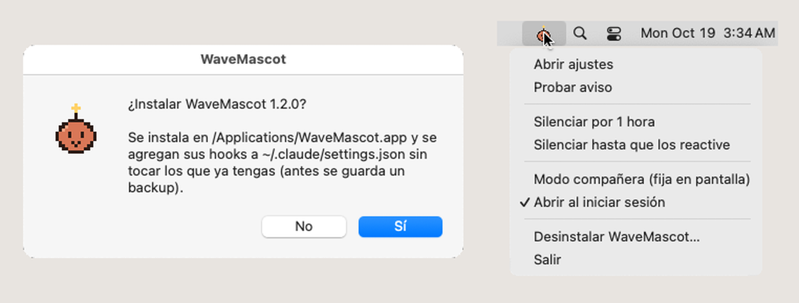
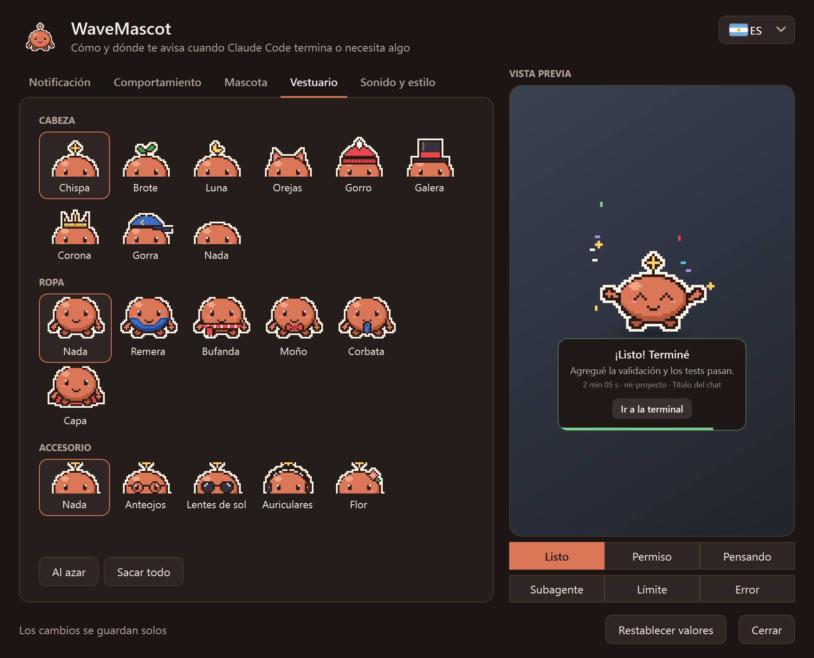

# WaveMascot

[English](README.md) · **Español** · [Português](README.pt.md)

<p align="center">
  
</p>

**Wave** es una mascota de escritorio en pixel art para Windows y macOS que te avisa cuando **Claude Code** termina,
necesita tu permiso o se queda sin uso disponible, en lugar de la notificación del sistema. Aparece desde el borde de
la pantalla, te dice de qué chat y proyecto viene el aviso, y se va sola.

<p align="center">
  <a href="../../releases/latest/download/WaveMascot-Setup.exe"><b>⬇ Descargar para Windows</b></a>
  &nbsp;·&nbsp; <a href="../../releases/latest/download/WaveMascot-Mac-AppleSilicon.dmg"><b>⬇ Mac (chip Apple)</b></a>
  &nbsp;·&nbsp; <a href="../../releases/latest/download/WaveMascot-Mac-Intel.dmg"><b>⬇ Mac (Intel)</b></a>
  <br>
  <a href="#instalación">Instalación</a>
  &nbsp;·&nbsp; <a href="../../discussions">Preguntas e ideas</a>
  &nbsp;·&nbsp; <a href="../../issues/new/choose">Reportar un problema</a>
</p>

> **Proyecto no oficial.** No está hecho, avalado ni mantenido por Anthropic. No usa logos, imágenes, sonidos ni
> ningún otro asset de Anthropic: la mascota, el ícono y los sonidos son originales y se generan por código
> (ver [THIRD_PARTY.md](THIRD_PARTY.md)).
>
> **Todo corre en tu equipo.** La mascota no se conecta a internet ni envía datos a ningún lado. El resumen del
> último mensaje se arma leyendo localmente el transcript que Claude Code ya guarda en tu disco, y no sale de ahí.

## Qué hace

- **Avisa cuando Claude termina** (`listo`), **pide permiso** (`permiso`), está **pensando**, terminó un
  **subagente**, llegó al **límite de uso** o hubo un **error**: cada estado tiene su animación y su sonido.
- **Permitir / Denegar desde la mascota** (hook `PermissionRequest`): respondés sin ir a la terminal. Si no elegís
  a tiempo, decide el diálogo de siempre.
- **Muestra el contexto justo**: título del chat, proyecto, cuánto tardó y un resumen corto de la respuesta.
  Con **varias sesiones a la vez**, cada aviso dice de qué proyecto viene y los avisos se encolan en vez de pisarse.
- **No molesta**: horario de no molestar, nada en pantalla completa, nada si ya estás mirando la terminal, umbral de
  duración mínima y silencio rápido desde su ícono (junto al reloj en Windows, en la barra de menús en Mac).
- **Modo compañera**: en lugar de aparecer y desaparecer, se queda chiquita sobre la barra de tareas (o el Dock),
  pasea un poco y se duerme cuando te quedás sin uso hasta que se renueve.
- **Personalizable**: colores, sombreros, ropa y accesorios, tu propia imagen (PNG/GIF), tamaño, esquina, temas
  oscuro/claro/acento y sonido por evento.
- **En tu idioma**: inglés, español y portugués. Viene en inglés; se cambia con la banderita de arriba de los ajustes.
- **Varios monitores**: el aviso sale en el monitor donde está la ventana de Claude Code.
- **Nunca frena a Claude Code**: el hook vuelve en milisegundos, nunca sale con error y, si algo falla (sin audio,
  config rota, sin pantalla), lo anota en el log y sigue.

## Instalación

Necesitás [Claude Code](https://docs.claude.com/en/docs/claude-code) (CLI, extensión o app de escritorio) y Windows
10 u 11, o macOS 13 (Ventura) o más nuevo.

### Windows

#### Opción A: instalador (recomendada, no necesita Python)

1. **[Descargá `WaveMascot-Setup.exe`](../../releases/latest/download/WaveMascot-Setup.exe)** (siempre la
   última versión; también está en [Releases](../../releases/latest)).
2. Abrilo y tocá **Sí**. Se instala en `%LOCALAPPDATA%\Programs\WaveMascot`, sin permisos de administrador.
3. Listo: la próxima vez que Claude Code termine, aparece la mascota. Si ya tenías Claude Code abierto, no hace falta
   reiniciarlo. Para verla en español, abrí los ajustes y elegí la banderita.

> Windows SmartScreen puede mostrar «Windows protegió su PC». Elegí **Más información → Ejecutar de todas formas**,
> o usá la opción B si preferís instalar desde el código. Podés verificar el archivo con el `SHA256SUMS.txt` del
> release.

#### Opción B: desde el código fuente (Python 3.10 o superior)

1. Descargá el código: [ZIP](../../archive/refs/heads/main.zip) (descomprimilo) o
   `git clone https://github.com/Marescaa/wavemascot.git`.
2. Abrí PowerShell en esa carpeta y corré:

   ```powershell
   powershell -ExecutionPolicy Bypass -File .\install.ps1
   ```

`install.ps1` instala PyQt6 y Pillow solo si faltan. Opciones: `-Python <ruta a python.exe>`, `-Destino <carpeta>`,
`-SinInicio` (sin ícono al iniciar Windows).

### Mac

#### Opción A: la app (recomendada, no necesita Python)

Necesitás macOS 13 (Ventura) o más nuevo, en cualquier Mac.

1. **Descargá el archivo de tu Mac.** Para saber cuál: menú Apple → **Acerca de esta Mac**.
   - Dice **Chip: Apple M1, M2, M3, M4…** → **[`WaveMascot-Mac-AppleSilicon.dmg`](../../releases/latest/download/WaveMascot-Mac-AppleSilicon.dmg)**
   - Dice **Procesador: Intel** → **[`WaveMascot-Mac-Intel.dmg`](../../releases/latest/download/WaveMascot-Mac-Intel.dmg)**
2. **Abrí el `.dmg`** (doble click en Descargas). Se abre una ventana con WaveMascot y la carpeta Aplicaciones:
   **arrastrá WaveMascot sobre Aplicaciones**. Después podés expulsar el disco WaveMascot desde el costado del Finder.
3. **Abrí WaveMascot** desde Aplicaciones (o con Spotlight: <kbd>⌘</kbd> <kbd>Espacio</kbd> y escribí *WaveMascot*).
   La primera vez macOS la bloquea porque la app no está notarizada por Apple (eso requiere una cuenta paga de
   desarrollador):
   - **macOS 15 (Sequoia) o más nuevo**: aparece *«Apple no pudo verificar que "WaveMascot" esté libre de malware…»*.
     Tocá **OK**, abrí **Ajustes del Sistema → Privacidad y seguridad**, bajá hasta **Seguridad** y tocá
     **Abrir de todos modos** al lado de *«Se bloqueó "WaveMascot"…»*. Confirmá con **Abrir de todos modos** y tu
     contraseña o Touch ID.
   - **macOS 13 o 14**: click derecho (o <kbd>Control</kbd> + click) en WaveMascot dentro de Aplicaciones → **Abrir**,
     y otra vez **Abrir**.

   Hace falta una sola vez; las actualizaciones y los hooks no lo vuelven a pedir.
4. WaveMascot pregunta **«¿Instalar WaveMascot?»**: tocá **Sí**. Se conecta con Claude Code y te cuenta qué hizo.
5. Listo: el ícono de Wave aparece en la **barra de menús** (arriba a la derecha). Tocalo → **Probar aviso** para
   verla. Desde ahora aparece cada vez que Claude Code termina o necesita algo, en la terminal, en VS Code o en la app
   de Claude. Si ya tenías Claude Code abierto, no hace falta reiniciarlo. Para verla en español, abrí los ajustes y
   elegí la banderita.

<p align="center">
  
</p>

Bueno saber:

- **No pide ningún permiso** (ni Accesibilidad, ni Grabación de pantalla, ni notificaciones).
- Si la abrís directo desde el `.dmg` sin arrastrarla, se copia sola a Aplicaciones.
- **Ajustes**: ícono de la barra de menús → **Abrir ajustes**, `/wavemascot` en Claude Code, o abriendo WaveMascot
  otra vez desde Aplicaciones.
- **Actualizar**: descargá el `.dmg` nuevo, arrastrá WaveMascot sobre Aplicaciones (**Reemplazar**) y abrila una vez.
- La primera vez macOS muestra *«Ítems en segundo plano añadidos»*: es el ícono de la barra de menús que se abre al
  iniciar sesión. Se apaga en los ajustes de WaveMascot o en **Ajustes del Sistema → General → Ítems de inicio**.
- Para verificar la descarga: `shasum -a 256 ~/Downloads/WaveMascot-Mac-*.dmg` tiene que coincidir con el
  `SHA256SUMS.txt` del release.

#### Opción B: desde el código fuente (Python 3.10 o superior)

```bash
git clone https://github.com/Marescaa/wavemascot.git
cd wavemascot
./install.sh
```

`install.sh` crea su propio entorno de Python con PyQt6 y Pillow (tu Python no se toca). Opciones:
`--python <ruta a python3>`, `--destination <carpeta>`, `--no-startup` (sin ícono en la barra de menús al iniciar
sesión).

### Qué hace el instalador en tu compu

- **Copia el programa** a `%LOCALAPPDATA%\Programs\WaveMascot` (Windows) o deja la app en **Aplicaciones** (Mac; si
  la abrís directo desde el `.dmg`, se copia sola ahí).
- **Conecta a Wave con Claude Code**: agrega unas líneas (los *hooks*) a `~/.claude/settings.json` para que Claude
  Code la llame cuando termina o necesita algo. Lo que ya tenías en ese archivo no se toca, y antes de cambiarlo se
  guarda una copia de seguridad.
- **Crea el comando `/wavemascot`**, que abre los ajustes desde Claude Code.
- **Pone el ícono de Wave junto al reloj** (Windows) o **en la barra de menús** (Mac, como ítem de inicio) cada vez
  que prendés la compu.

No pide permisos de administrador, y si la desinstalás, todo vuelve a quedar como estaba.

## Configuración

Abrí los ajustes con un click en el **ícono de Wave** (junto al reloj en Windows, en la barra de menús en Mac), con
**`/wavemascot`** en Claude Code o, en Mac, abriendo WaveMascot desde Aplicaciones. Los cambios se guardan solos y
valen desde el próximo aviso; la vista previa muestra cómo va a quedar. La **banderita** de arriba a la derecha cambia
el idioma.

<p align="center">
  
</p>

| Pestaña | Qué se ajusta |
|---|---|
| Notificación | Esquina, duración en pantalla, qué mostrar en el cartel (resumen, chat, proyecto, duración) y los mensajes |
| Comportamiento | Modo aviso o compañera (paseos, animaciones en reposo, mirada), qué eventos avisan, no molestar (horario, pantalla completa, terminal enfocada), duración mínima, Permitir/Denegar desde la mascota |
| Mascota | Color, tamaño e imagen propia |
| Vestuario | Cabeza, ropa y accesorios (o al azar) |
| Sonido y estilo | Volumen, sonido de cada evento, tema oscuro / claro / acento, ícono junto al reloj / en la barra de menús |

Todo queda en `~/.wavemascot/config.json`. Si el archivo no existe o tiene un error, la mascota usa los valores
por defecto. Desde el ícono de Wave también podés silenciar los avisos por una hora o hasta reactivarlos.

> Para que la mascota reemplace la notificación del sistema, desactivá las notificaciones propias de Claude Code
> (en la configuración de la app de escritorio o de tu terminal), así no te llegan dos avisos.

## Desinstalación

- **Windows, instalada con el `.exe`**: menú Inicio → *WaveMascot* → **Desinstalar WaveMascot**.
- **Windows, instalada con `install.ps1`** (o cualquiera de las dos):

  ```powershell
  powershell -ExecutionPolicy Bypass -File .\uninstall.ps1
  ```

- **Mac**: ícono de Wave en la barra de menús → **Desinstalar WaveMascot…** (o `./uninstall.sh`, de cualquiera de las
  dos formas). Si solo arrastrás la app a la papelera, Claude Code sigue andando normal: sus hooks no hacen nada
  mientras la app no esté.

La desinstalación cierra la mascota, quita **solo sus hooks** de `~/.claude/settings.json` (con backup previo; los
tuyos quedan exactamente como estaban), borra `/wavemascot`, los accesos directos y el programa. Tu configuración en
`~/.wavemascot` se conserva; para borrarla también: `uninstall.ps1 -BorrarConfig` o `uninstall.sh --delete-settings`.

## Problemas frecuentes

- **No aparece**: mirá `~/.wavemascot/mascota.log`; cada evento dice si se avisó o por qué no (pantalla completa,
  no molestar, terminal enfocada, evento apagado...). Con el ícono de Wave → *Probar aviso* se fuerza uno.
- **Los hooks no corren**: revisá en Claude Code con `/hooks` que estén los de la mascota.
- **Permitir/Denegar**: en la app de escritorio el diálogo propio sigue apareciendo; vale la primera respuesta.
- **Mac: «No se puede abrir WaveMascot» o «Apple no pudo verificar…»**: mirá el paso 3 de
  [Instalación → Mac](#mac).
- **Mac: no veo el ícono en la barra de menús**: en las Mac con notch, los íconos que no entran se esconden; cerrá
  alguna otra app de la barra o abrí los ajustes con `/wavemascot`. Si lo cerraste, abrí WaveMascot desde Aplicaciones.
- **Mac: me llegan dos avisos**: apagá las notificaciones de tu terminal o de la app de Claude en **Ajustes del
  Sistema → Notificaciones**, así te avisa solo Wave.

## Preguntas, ideas y reportes

- **¿Tenés una pregunta o una idea?** Escribila en [Discussions](../../discussions): ahí se charla, se proponen
  vestuarios o estados nuevos y se comparten configuraciones.
- **¿Algo no funciona?** Abrí un [issue](../../issues/new/choose) con la plantilla de error (sumá las últimas
  líneas del log, sin datos privados).
- **¿Querés proponer algo concreto?** Usá la plantilla de idea en [issues](../../issues/new/choose).

Se puede escribir en español, inglés o portugués. Los pull requests son bienvenidos: antes de mandar uno, corré las
pruebas (`python -m unittest discover tests`).

## Desarrollo

```powershell
python -m unittest discover tests          # pruebas del instalador (merge de hooks), traducciones y sistemas
powershell -ExecutionPolicy Bypass -File .\build.ps1   # arma dist\WaveMascot-Setup.exe (en Windows)
./build-mac.sh                             # arma dist/WaveMascot-Mac-<chip>.dmg (en una Mac)
```

Al pushear un tag `v*` (por ejemplo `v1.2.0`), GitHub Actions construye el instalador de Windows y los dos `.dmg` de
Mac y los adjunta al release. Cada push a `main` corre las pruebas en Windows y en macOS.

| Archivo | Qué es |
|---|---|
| `mascota.py` | El hook y la ventana de la mascota |
| `ajustes.py` | El centro de ajustes |
| `bandeja.py` | El ícono junto al reloj / en la barra de menús |
| `sprites.py` | El pixel art, los íconos y los sonidos (todo generado por código) |
| `idiomas.py` | Los textos en inglés, español y portugués |
| `ventanas.py` | Ventanas de Windows y macOS: terminal anfitriona, foco, pantalla completa, monitores |
| `instalador.py` | Instalar / desinstalar (merge de hooks con backup); también es el instalador `.exe` y el primer arranque de la app de Mac |
| `principal.py` | Punto de entrada de `WaveMascot.exe` y `WaveMascot.app` |

**Sumar un idioma**: agregalo a `IDIOMAS` en `idiomas.py` con una traducción por texto; `tests/test_idiomas.py` avisa
si falta alguna.

## Licencia

[MIT](LICENSE). El `.exe` y la app de Mac incluyen PyQt6 (GPL v3) y otras bibliotecas; ver
[THIRD_PARTY.md](THIRD_PARTY.md).
