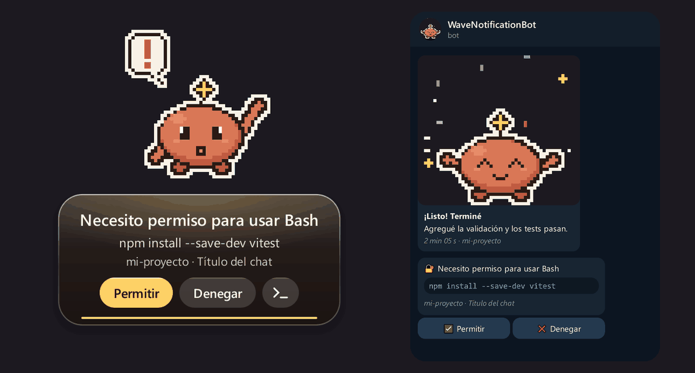
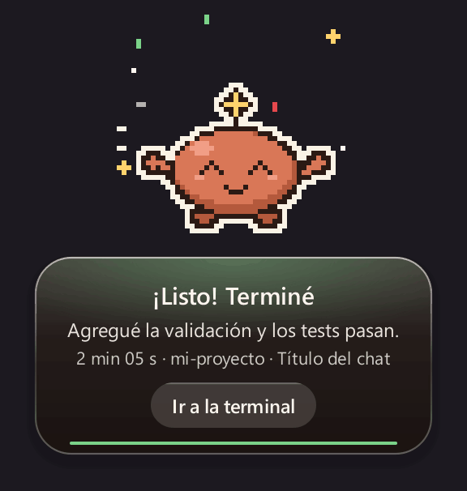
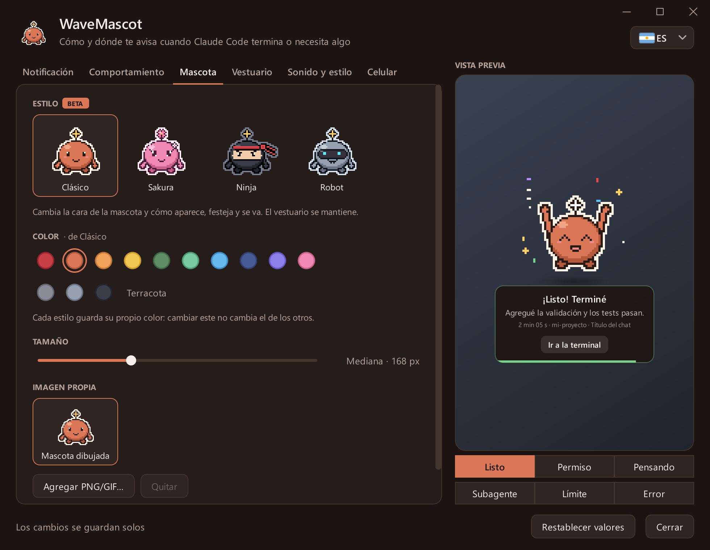

# WaveMascot

**Una mascota en pixel art que te avisa cuando Claude Code termina, o te necesita.** 
En tu escritorio, y en tu celular cuando no estás.

Gratis y open source · Windows 10/11 y macOS 13+ · [English](README.md) · **Español** · [Português](README.pt.md)

  

 

[Qué hace](#qué-hace) · [Instalación](#instalación) · [Dynamic Island](#dynamic-island) · [Celular](#en-tu-celular) ·
[Ajustes](#ajustes) ·
[Galería](docs/README.es.md) · [Preguntas](#preguntas-frecuentes) · [Cambios](CHANGELOG.md)

> [!NOTE]
> **Nuevo en la 1.4.0:** la [Dynamic Island](#dynamic-island), una pastilla de vidrio arriba de la pantalla con tus
> sesiones de Claude Code; las secciones **Dashboard** y **Uso** en los ajustes; un botón rápido de **No molestar**, y
> el estilo **Hamburguesa** (beta). [Ver todos los cambios →](CHANGELOG.md)

## Qué hace

Le pedís algo a Claude Code y te vas a otra ventana. Cuando termina, pide permiso o se queda sin uso, **Wave aparece
desde el borde de la pantalla**, te dice de qué chat y proyecto se trata, y se va sola. Si no estás en la compu, te
escribe al celular.

<table>
  <tr>
    <td align="center" width="33%">
       
      <b>Sabe cuándo terminó</b> 
      Chat, proyecto, cuánto tardó y un resumen de una línea de lo que hizo.
    </td>
    <td align="center" width="33%">
       
      <b>Pregunta antes de actuar</b> 
      Permitir o Denegar ahí mismo, sin volver a la terminal.
    </td>
    <td align="center" width="33%">
       
      <b>Te avisa cuándo parar</b> 
      El límite de uso y los errores de la API tienen su aviso, su animación y su sonido.
    </td>
  </tr>
</table>

## Funciones

- **Un aviso para cada momento**: terminó, necesita permiso, está pensando, terminó un subagente, límite de uso y
  error de la API.
- **Permitir o denegar sin ir a la terminal**, desde los botones de Wave o desde el celular. Vale la primera respuesta.
- **El contexto justo**: chat, proyecto, cuánto tardó y un resumen leído en tu compu. Los avisos de varias sesiones se
  encolan.
- **Dynamic Island**: [una pastilla de vidrio](#dynamic-island) arriba de la pantalla con tus sesiones de Claude Code,
  cuánto le falta a cada una y tu uso de las últimas 5 horas y 7 días.
- **Cuánto usaste Claude Code**: las secciones Dashboard y Uso muestran tokens, sesiones, modelos y proyectos, leídos
  de tu compu.
- **No molesta**: un botón de No molestar, silencio automático por horario, y nada sobre apps en pantalla completa ni
  si ya estás mirando la terminal.
- **A tu gusto**: cuatro estilos (Clásico, Sakura, Ninja, Robot) más Hamburguesa en beta, colores, vestuario, tema
  claro u oscuro, tu propia imagen y 9 sonidos nuevos.
- **Modo compañera**: Wave vive chiquita sobre la barra de tareas o el Dock, pasea y se duerme cuando llegás al límite.
- **En tu celular**: [avisos por Telegram](#en-tu-celular) con Wave animada, y Permitir/Denegar desde donde estés.
  Gratis.
- **Siempre al día**: Wave te avisa cuando hay una versión nueva; en Windows se instala con un click.
- **Inglés, español y portugués**, varios monitores, Windows y macOS (chip Apple e Intel).

  
   
  Los cuatro estilos. Cada uno aparece, festeja y se va a su manera: <a href="docs/README.es.md#estilos">miralos moverse →</a>

## Instalación

Necesitás [Claude Code](https://docs.claude.com/en/docs/claude-code): la CLI, la extensión del editor o la app de
escritorio.

**Windows 10 / 11**

1. Bajá [`WaveMascot-Setup.exe`](../../releases/latest/download/WaveMascot-Setup.exe).
2. Abrilo y hacé click en **Sí**. No necesita permisos de administrador ni Python.

Si aparece SmartScreen, elegí **Más información → Ejecutar de todas formas**.

**macOS 13 o superior**

1. Bajá el `.dmg` de tu Mac: [chip Apple](../../releases/latest/download/WaveMascot-Mac-AppleSilicon.dmg) ·
   [Intel](../../releases/latest/download/WaveMascot-Mac-Intel.dmg).
2. Arrastrá WaveMascot a Aplicaciones y abrilo.

La primera vez macOS te pide confirmar porque la app no está notarizada: [así se hace](docs/install.es.md#mac).

Listo: la próxima vez que Claude Code termine, aparece Wave. No hace falta reiniciar nada. La
[guía de instalación](docs/install.es.md) explica cómo instalar desde el código, qué cambia el instalador, cómo
desinstalar y los problemas frecuentes.

## Dynamic Island

Una pastilla de vidrio arriba de la pantalla, al estilo del iPhone, que te muestra qué está haciendo Claude Code sin
cambiar de ventana. Chica, tiene los ojos de tu mascota (despiertos mientras Claude trabaja, tranquilos mientras
espera, cerrados si no hay sesiones), el tiempo que falta y cuántas sesiones hay. Al pasar el mouse se estira y lista
cada sesión con su avance, tus tokens de las últimas 5 horas y 7 días, y un botón a los ajustes. Un click en una
sesión trae su ventana al frente.

En Windows el vidrio desenfoca de verdad lo que hay atrás. Se esconde sola cuando algo está en pantalla completa, y
en **Ajustes → Dynamic Island** elegís dónde va, si se abre con el mouse o con un click, qué muestra y cómo se mueve.

## En tu celular

Cuando no estás en la compu, Wave te escribe por Telegram desde
[@WaveNotificationBot](https://t.me/WaveNotificationBot), y los pedidos de permiso traen los botones **Permitir** y
**Denegar**, que le contestan a Claude Code al instante. Es gratis, como todo WaveMascot.

Abrí la pestaña **Celular**, tocá **Conectar con Telegram** y después **Iniciar** en el bot. No hay nada que crear ni
pegar. Por defecto solo te escribe si no tocaste el mouse ni el teclado en unos minutos.

## Ajustes

Hacé click en el **ícono de Wave** (junto al reloj en Windows, en la barra de menús en Mac), en el engranaje de la
Dynamic Island, o escribí **`/wavemascot`** en Claude Code. Los cambios se guardan solos, y la vista previa muestra el
aviso tal cual va a aparecer. Arriba de la barra lateral está el botón de **No molestar**, que silencia todo hasta que
lo apagues.

  

<b>Qué tiene cada sección</b>

 

| Sección | Qué cambiás |
|---|---|
| Avisos | Modo aviso o compañera, esquina y tiempo en pantalla; por cada evento, si aparece, qué sonido usa y si llega al celular; qué muestra el cartel, Permitir/Denegar y silencio automático |
| Mascota | Un probador con la mascota grande: estilo, color, cabeza, ropa, accesorio y tu propia imagen |
| Celular | Telegram: cuándo mandar, qué avisos, Permitir/Denegar desde el celular |
| Dynamic Island | Dónde va, cómo se abre, los ojos, qué muestra la pastilla, cuántas sesiones, desenfoque, opacidad y movimiento |
| Dashboard | Tokens de hoy y de los últimos 14 días, sesiones, tiempo trabajando, proyectos de la semana y qué tan bien estima el tiempo |
| Uso | Tokens de las últimas 5 horas, el día, 7 días, el mes o 6 meses: entrada, salida, caché, modelos y proyectos |
| General | Idioma, tema, el ícono junto al reloj y las actualizaciones |

Todo se guarda en `~/.wavemascot/config.json`. Todas las secciones están en la [galería](docs/README.es.md#ajustes).

## Privacidad

Todo corre en tu compu. El resumen, la Dynamic Island, el Dashboard y Uso se leen localmente del historial que
Claude Code ya guarda en tu disco. WaveMascot
solo se conecta a internet para buscar en GitHub si hay una versión nueva (una vez por día como mucho) y, si lo
conectás, para mandar los avisos a Telegram. Las dos cosas se pueden apagar.

<b>Cómo funciona Telegram</b>

 

La clave del bot vive solo en un pequeño [Worker de Cloudflare](servidor/) que pasa cada mensaje sin guardarlo, y cada
instalación tiene su propia llave, que solo puede escribirle al chat que vinculó. Se manda lo que muestra el aviso
(mensaje, resumen, proyecto, título del chat, comando a aprobar). Mandale `/stop` al bot o tocá **Desconectar** para
cortar.

## Preguntas frecuentes

<b>¿Cómo sabe qué está haciendo Claude Code?</b>

 

Con los [hooks](https://docs.claude.com/en/docs/claude-code/hooks) de Claude Code. El instalador agrega unas líneas a
`~/.claude/settings.json` (con una copia de respaldo antes, y sin tocar las tuyas), y Claude Code llama a Wave cuando
termina, necesita algo, termina un subagente o llega a un límite. Al desinstalar se borran solo esas líneas.

<b>Me llegan dos avisos cada vez</b>

 

Apagá las notificaciones propias de Claude Code (o las de tu terminal; en Mac, en **Ajustes del Sistema →
Notificaciones**), así te avisa solo Wave.

<b>¿Funciona con la extensión de VS Code o la app de escritorio?</b>

 

Sí: los hooks son los mismos en la CLI, las extensiones de los editores y la app de escritorio. En la app de escritorio
también sigue apareciendo su propio diálogo de permiso; vale la primera respuesta.

<b>Wave no apareció</b>

 

Mirá `~/.wavemascot/mascota.log`: cada evento dice si avisó o por qué no (pantalla completa, no molestar, terminal
enfocada, evento apagado…). Con el ícono de Wave → **Probar aviso** se fuerza uno. Más en
[problemas frecuentes](docs/install.es.md#problemas-frecuentes).

## Contribuir

Las preguntas e ideas van a [Discussions](../../discussions) y los errores a [Issues](../../issues/new/choose). Los
pull requests son bienvenidos, en español, inglés o portugués: mirá [CONTRIBUTING.md](CONTRIBUTING.md). Las imágenes
del README las dibuja la app misma con [`tools/capturas.py`](tools/capturas.py).

## Licencia

[MIT](LICENSE). Los instaladores incluyen PyQt6 (GPL v3) y otras bibliotecas; mirá [THIRD_PARTY.md](THIRD_PARTY.md).

WaveMascot es un proyecto no oficial: no lo hace, respalda ni mantiene Anthropic. La mascota, el ícono y los
sonidos son originales y están generados por código.
