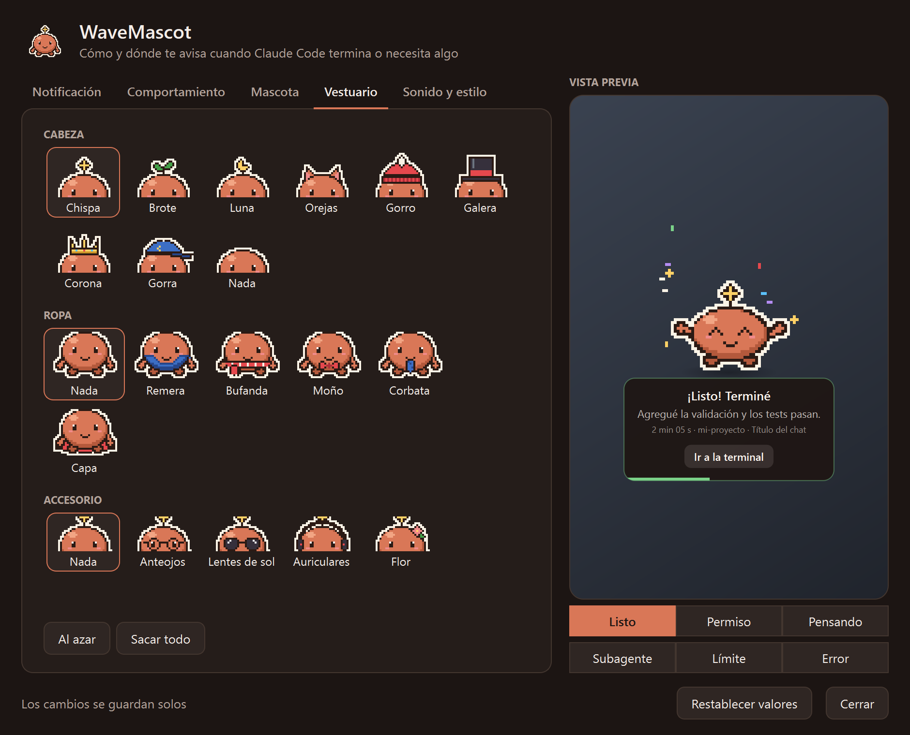

# WaveMascot

<!-- Demo: reemplazá docs/demo.gif por una grabación de pantalla (≈ 800 px de ancho, < 5 MB). -->
<p align="center">
  
</p>

**Wave** es una mascota de escritorio en pixel art para Windows que te avisa cuando **Claude Code** termina, necesita tu permiso
o se queda sin uso disponible, en lugar de la notificación de Windows. Aparece desde el borde de la pantalla, te dice
de qué chat y proyecto viene el aviso, y se va sola.

<p align="center">
  <a href="../../releases/latest/download/WaveMascot-Setup.exe"><b>⬇ Descargar para Windows</b></a>
  &nbsp;·&nbsp; <a href="#instalación">Instalación</a>
  &nbsp;·&nbsp; <a href="../../discussions">Preguntas e ideas</a>
  &nbsp;·&nbsp; <a href="../../issues/new/choose">Reportar un problema</a>
</p>

> **Proyecto no oficial.** No está hecho, avalado ni mantenido por Anthropic. No usa logos, imágenes, sonidos ni
> ningún otro asset de Anthropic: la mascota, el ícono y los sonidos son originales y se generan por código
> (ver [TERCEROS.md](TERCEROS.md)).
>
> **Todo corre en tu equipo.** La mascota no se conecta a internet ni envía datos a ningún lado. El resumen del
> último mensaje se arma leyendo localmente el transcript que Claude Code ya guarda en tu disco, y no sale de ahí.

## Qué hace

- **Avisa cuando Claude termina** (`listo`), **pide permiso** (`permiso`), está **pensando**, terminó un
  **subagente**, llegó al **límite de uso** o hubo un **error**: cada estado tiene su animación y su sonido.
- **Permitir / Denegar desde la mascota** (hook `PermissionRequest`): respondés sin ir a la terminal. Si no elegís
  a tiempo, decide el diálogo de siempre.
- **Muestra el contexto justo**: título del chat, proyecto, cuánto tardó y un resumen corto de la respuesta.
  Con **varias sesiones a la vez**, cada aviso dice de qué proyecto viene y los avisos se encolan en vez de pisarse.
- **No molesta**: horario de no molestar, nada en pantalla completa, nada si ya estás mirando la terminal, umbral de
  duración mínima y silencio rápido desde el ícono junto al reloj.
- **Modo compañera**: en lugar de aparecer y desaparecer, se queda chiquita sobre la barra de tareas, pasea un poco
  y se duerme cuando te quedás sin uso hasta que se renueve.
- **Personalizable**: colores, sombreros, ropa y accesorios, tu propia imagen (PNG/GIF), tamaño, esquina, temas
  oscuro/claro/acento y sonido por evento.
- **Varios monitores**: el aviso sale en el monitor donde está la ventana de Claude Code.
- **Nunca frena a Claude Code**: el hook vuelve en milisegundos, nunca sale con error y, si algo falla (sin audio,
  config rota, sin pantalla), lo anota en el log y sigue.

## Instalación

Requisitos: Windows 10 u 11 y [Claude Code](https://docs.claude.com/en/docs/claude-code) (CLI, extensión o app de
escritorio).

### Opción A: instalador (recomendada, no necesita Python)

1. **[Descargá `WaveMascot-Setup.exe`](../../releases/latest/download/WaveMascot-Setup.exe)** (siempre la
   última versión; también está en [Releases](../../releases/latest)).
2. Abrilo y tocá **Sí**. Se instala en `%LOCALAPPDATA%\Programs\WaveMascot`, sin permisos de administrador.
3. Listo: la próxima vez que Claude Code termine, aparece la mascota. Si ya tenías Claude Code abierto, no hace falta
   reiniciarlo.

> Windows SmartScreen puede mostrar «Windows protegió su PC». Elegí **Más información → Ejecutar de todas formas**,
> o usá la opción B si preferís instalar desde el código. Podés verificar el archivo con el `SHA256SUMS.txt` del
> release.

### Opción B: desde el código fuente (Python 3.10 o superior)

1. Descargá el código: [ZIP](../../archive/refs/heads/main.zip) (descomprimilo) o
   `git clone https://github.com/Marescaa/wavemascot.git`.
2. Abrí PowerShell en esa carpeta y corré:

   ```powershell
   powershell -ExecutionPolicy Bypass -File .\install.ps1
   ```

`install.ps1` instala PyQt6 y Pillow solo si faltan. Opciones: `-Python <ruta a python.exe>`, `-Destino <carpeta>`,
`-SinInicio` (sin ícono al iniciar Windows).

### Qué hace el instalador en tu PC

- **Copia el programa** a `%LOCALAPPDATA%\Programs\WaveMascot`.
- **Conecta a Wave con Claude Code**: agrega unas líneas (los *hooks*) a `~/.claude/settings.json` para que Claude
  Code la llame cuando termina o necesita algo. Lo que ya tenías en ese archivo no se toca, y antes de cambiarlo se
  guarda una copia de seguridad.
- **Crea el comando `/wavemascot`**, que abre los ajustes desde Claude Code.
- **Pone el ícono de Wave junto al reloj** cada vez que prendés la compu.

No pide permisos de administrador, y si la desinstalás, todo vuelve a quedar como estaba.

## Configuración

Abrí los ajustes con un click en el **ícono junto al reloj** o con **`/wavemascot`** en Claude Code. Los cambios se
guardan solos y valen desde el próximo aviso; la vista previa muestra cómo va a quedar.

<p align="center">
  
</p>

| Pestaña | Qué se ajusta |
|---|---|
| Notificación | Esquina, duración en pantalla, qué mostrar en el cartel (resumen, chat, proyecto, duración) y los mensajes |
| Comportamiento | Modo aviso o compañera (paseos, animaciones en reposo, mirada), qué eventos avisan, no molestar (horario, pantalla completa, terminal enfocada), duración mínima, Permitir/Denegar desde la mascota |
| Mascota | Color, tamaño e imagen propia |
| Vestuario | Cabeza, ropa y accesorios (o al azar) |
| Sonido y estilo | Volumen, sonido de cada evento, tema oscuro / claro / acento, ícono junto al reloj |

Todo queda en `~/.wavemascot/config.json`. Si el archivo no existe o tiene un error, la mascota usa los valores
por defecto. Desde el ícono junto al reloj también podés silenciar los avisos por una hora o hasta reactivarlos.

> Para que la mascota reemplace la notificación de Windows, desactivá las notificaciones propias de Claude Code
> (en la configuración de la app de escritorio o de tu terminal), así no te llegan dos avisos.

## Desinstalación

- **Instalada con el `.exe`**: menú Inicio → *WaveMascot* → **Desinstalar WaveMascot**.
- **Instalada con `install.ps1`** (o cualquiera de las dos):

  ```powershell
  powershell -ExecutionPolicy Bypass -File .\uninstall.ps1
  ```

La desinstalación cierra la mascota, quita **solo sus hooks** de `~/.claude/settings.json` (con backup previo; los
tuyos quedan exactamente como estaban), borra `/wavemascot`, los accesos directos y la carpeta del programa. Tu
configuración en `~/.wavemascot` se conserva; para borrarla también: `uninstall.ps1 -BorrarConfig`.

## Problemas frecuentes

- **No aparece**: mirá `~/.wavemascot/mascota.log`; cada evento dice si se avisó o por qué no (pantalla completa,
  no molestar, terminal enfocada, evento apagado...). Con el ícono junto al reloj → *Probar aviso* se fuerza uno.
- **Los hooks no corren**: revisá en Claude Code con `/hooks` que estén los de la mascota.
- **Permitir/Denegar**: en la app de escritorio el diálogo propio sigue apareciendo; vale la primera respuesta.

## Preguntas, ideas y reportes

- **¿Tenés una pregunta o una idea?** Escribila en [Discussions](../../discussions): ahí se charla, se proponen
  vestuarios o estados nuevos y se comparten configuraciones.
- **¿Algo no funciona?** Abrí un [issue](../../issues/new/choose) con la plantilla de error (sumá las últimas
  líneas del log, sin datos privados).
- **¿Querés proponer algo concreto?** Usá la plantilla de idea en [issues](../../issues/new/choose).

Los pull requests son bienvenidos: antes de mandar uno, corré las pruebas (`python -m unittest discover tests`).

## Desarrollo

```powershell
python -m unittest discover tests          # pruebas del instalador (merge de hooks)
powershell -ExecutionPolicy Bypass -File .\build.ps1   # arma dist\WaveMascot-Setup.exe
```

Al pushear un tag `v*` (por ejemplo `v1.0.0`), GitHub Actions construye el instalador y lo adjunta al release.

| Archivo | Qué es |
|---|---|
| `mascota.py` | El hook y la ventana de la mascota |
| `ajustes.py` | El centro de ajustes |
| `bandeja.py` | El ícono junto al reloj |
| `sprites.py` | El pixel art y los sonidos (todo generado por código) |
| `ventanas.py` | Ventanas de Windows: foco, pantalla completa, monitores |
| `instalador.py` | Instalar / desinstalar (merge de hooks con backup); también es el instalador `.exe` |
| `principal.py` | Punto de entrada de `WaveMascot.exe` |

## Licencia

[MIT](LICENSE). El `.exe` incluye PyQt6 (GPL v3) y otras bibliotecas; ver [TERCEROS.md](TERCEROS.md).
