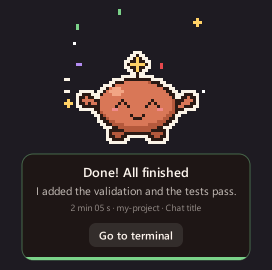
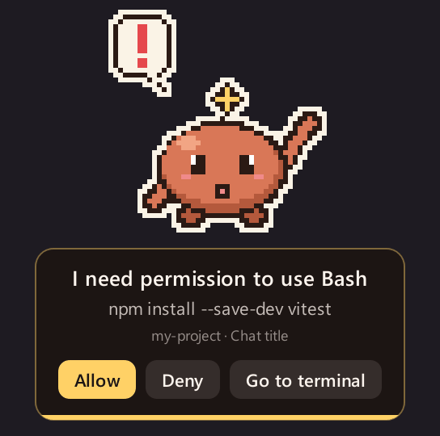
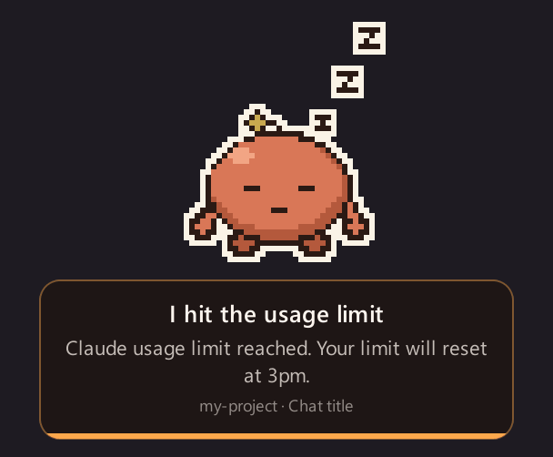
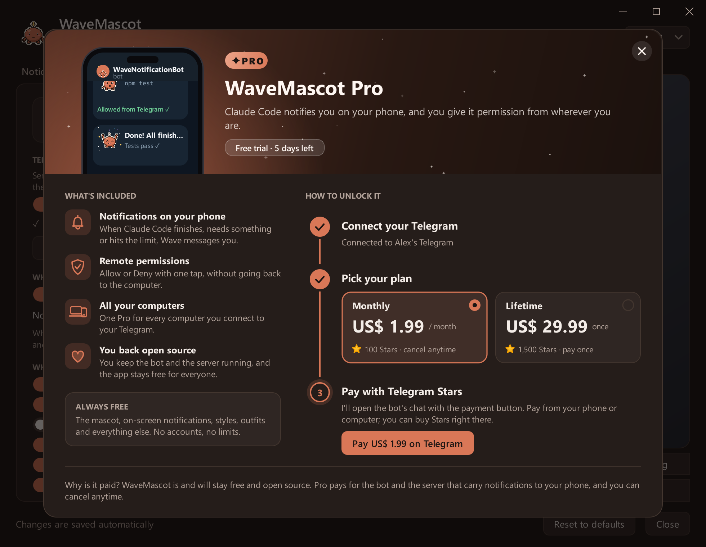

# WaveMascot

**A pixel-art mascot that tells you when Claude Code is done, or needs you.** 
On your desktop, and on your phone when you're away.

Free and open source · Windows 10/11 and macOS 13+ · **English** · [Español](README.es.md) · [Português](README.pt.md)

  

 

[Features](#features) · [Install](#install) · [WaveMascot Pro](#wavemascot-pro) · [Settings](#settings) ·
[Gallery](docs/README.md) · [FAQ](#faq) · [Changelog](CHANGELOG.md)

> [!NOTE]
> **New in 1.3:** [WaveMascot Pro](#wavemascot-pro) brings notifications and Allow/Deny to your phone through Telegram
> (7-day free trial), plus four mascot styles, an update notice and a new title bar on Windows.
> [See everything that changed →](CHANGELOG.md#130---2026-10-23)

## What it does

You ask Claude Code for something and switch to another window. When it finishes, asks for permission or runs out of
usage, **Wave slides in from the edge of the screen**, tells you which chat and project it's about, and leaves on its
own. If you're away from the computer, it messages your phone instead.

<table>
  <tr>
    <td align="center" width="33%">
       
      <b>Knows when it's done</b> 
      Chat, project, how long it took and a one-line summary of what changed.
    </td>
    <td align="center" width="33%">
       
      <b>Asks before acting</b> 
      Allow or Deny right on the notice, without going back to the terminal.
    </td>
    <td align="center" width="33%">
       
      <b>Tells you when to stop</b> 
      Usage limit and API errors get their own notice, animation and sound.
    </td>
  </tr>
</table>

## Features

- **A notice for every moment**: done, needs permission, thinking, sub-agent finished, usage limit and API error.
- **Allow or deny without the terminal**, from Wave's buttons or from your phone. The first answer wins.
- **The right context**: chat, project, duration and a summary read locally. Notices from several sessions queue up.
- **Stays out of the way**: do-not-disturb hours, and nothing over full-screen apps or when you're already looking at
  the terminal.
- **Make it yours**: four styles (Classic, Sakura, Ninja, Robot), colors, outfits, light or dark theme, your own image
  and sounds.
- **Companion mode**: Wave lives small on your taskbar or Dock, wanders around and naps when you hit the limit.
- **On your phone** with [WaveMascot Pro](#wavemascot-pro): Telegram notifications with Wave animated, and Allow/Deny
  from anywhere.
- **Always up to date**: Wave tells you when there's a new version; on Windows it installs it in one click.
- **English, Spanish and Portuguese**, multiple monitors, Windows and macOS (Apple chip and Intel).

  
   
  The four styles. Each one shows up, celebrates and leaves in its own way: <a href="docs/README.md#styles">see them move →</a>

## Install

Requires [Claude Code](https://docs.claude.com/en/docs/claude-code): the CLI, the IDE extension or the desktop app.

**Windows 10 / 11**

1. Download [`WaveMascot-Setup.exe`](../../releases/latest/download/WaveMascot-Setup.exe).
2. Open it and click **Yes**. No administrator rights or Python needed.

If SmartScreen shows up, choose **More info → Run anyway**.

**macOS 13 or newer**

1. Download the `.dmg` for your Mac: [Apple chip](../../releases/latest/download/WaveMascot-Mac-AppleSilicon.dmg) ·
   [Intel](../../releases/latest/download/WaveMascot-Mac-Intel.dmg).
2. Drag WaveMascot to Applications and open it.

The first time, macOS asks you to confirm because the app isn't notarized: [here's how](docs/install.md#mac).

That's it: the next time Claude Code finishes, Wave shows up. No restart needed. The
[installation guide](docs/install.md) covers installing from source, what the installer changes, uninstalling and
troubleshooting.

## WaveMascot Pro

**WaveMascot is free and open source, and it stays that way.** Pro adds your phone: when you're away from the
computer, Wave messages you on Telegram from [@WaveNotificationBot](https://t.me/WaveNotificationBot), and permission
requests come with **Allow** and **Deny** buttons that answer Claude Code right away.

  

| | Free | Pro |
|---|:---:|:---:|
| On-screen notices for every event, with Allow/Deny | ✓ | ✓ |
| Styles, colors, outfits, themes, your own image and sounds | ✓ | ✓ |
| Companion mode, do not disturb, updates | ✓ | ✓ |
| Telegram notifications with Wave animated | | ✓ |
| Allow or deny permissions from your phone | | ✓ |
| One plan for every computer linked to your Telegram | | ✓ |
| **Price** | **Free forever** | **US$ 1.99 / month** or **US$ 29.99 once** |

**How to get it:** open the **Phone** tab, tap **Connect Telegram** and then **Start** in the bot. Nothing to create
or paste, and your **7-day free trial** starts right there, no card needed. To keep it, tap the **PRO** badge and pay
with Telegram Stars inside the bot (100 Stars a month, cancel anytime with `/pro`, or 1,500 Stars once). Wave notices
the payment by itself.

If the trial ends, nothing breaks: the mascot keeps notifying you on screen and permission requests go back to the
terminal.

## Settings

Click **Wave's icon** (next to the clock on Windows, in the menu bar on Mac) or type **`/wavemascot`** in Claude Code.
Changes save on their own, and the preview shows exactly how the notice will look.

  

<b>What each tab does</b>

 

| Tab | What you can change |
|---|---|
| Notice | Corner, time on screen, what the notice shows and its messages |
| Behavior | Notice or companion mode, which events notify, do not disturb, minimum duration, Allow/Deny |
| Mascot | Style, color, skin tone, size and your own image |
| Outfits | Head, clothes and accessories |
| Sound and style | Volume, sound per event, theme, tray icon, updates |
| Phone **PRO** | Telegram: when to send, which notices, Allow/Deny from the phone, your plan |

Everything is stored in `~/.wavemascot/config.json`. Every tab is in the [gallery](docs/README.md#settings).

## Privacy

Everything runs on your computer. The summary is read locally from the transcript Claude Code already keeps on your
disk. WaveMascot only goes online to check GitHub for a new version (at most once a day) and, if you connect it, to
send notices to Telegram. Both can be turned off.

<b>How Telegram works</b>

 

The bot's token lives only on a small [Cloudflare Worker](servidor/) that relays each message without storing it, and
each installation gets its own key that can only message the chat it linked. What gets sent is what the notice shows
(message, summary, project, chat title, command to approve). Send `/stop` to the bot or tap **Disconnect** to stop.

For Pro, the server only keeps your Telegram chat id, your plan and the payment ids Telegram sends. Payments are
handled by Telegram, so WaveMascot never sees card details.

## FAQ

<b>How does it know what Claude Code is doing?</b>

 

Through Claude Code's [hooks](https://docs.claude.com/en/docs/claude-code/hooks). The installer adds a few entries to
`~/.claude/settings.json` (with a backup first, and without touching yours), and Claude Code calls Wave when it
finishes, needs something, a sub-agent ends or it hits a limit. Uninstalling removes only those entries.

<b>I get two notifications every time</b>

 

Turn off Claude Code's own notifications (or your terminal's, on Mac in **System Settings → Notifications**), so only
Wave tells you.

<b>Does it work with the VS Code extension or the desktop app?</b>

 

Yes: the hooks are the same for the CLI, the IDE extensions and the desktop app. In the desktop app its own
permission dialog still appears too; whichever answer comes first wins.

<b>Wave didn't show up</b>

 

Check `~/.wavemascot/mascota.log`: each event says whether it notified or why not (full screen, do not disturb,
focused terminal, event turned off…). Wave's icon → **Test notice** forces one. More in
[troubleshooting](docs/install.md#troubleshooting).

## Contributing

Questions and ideas go to [Discussions](../../discussions), bugs to [Issues](../../issues/new/choose). Pull requests
are welcome, in English, Spanish or Portuguese: see [CONTRIBUTING.md](CONTRIBUTING.md). The README images are drawn
by the app itself with [`tools/capturas.py`](tools/capturas.py).

## License

[MIT](LICENSE). The installers bundle PyQt6 (GPL v3) and other libraries; see [THIRD_PARTY.md](THIRD_PARTY.md).

WaveMascot is an unofficial project, not made, endorsed or maintained by Anthropic. The mascot, icon and sounds
are original and generated in code.
