

# WaveMascot

**A pixel-art mascot for Claude Code.** 
It tells you when Claude is done or needs you, shows every session in a Dynamic Island at the top of your screen,
and reaches your phone when you're away.

Free and open source · Windows 10/11 and macOS 13+ · **English** · [Español](README.es.md) · [Português](README.pt.md)

  

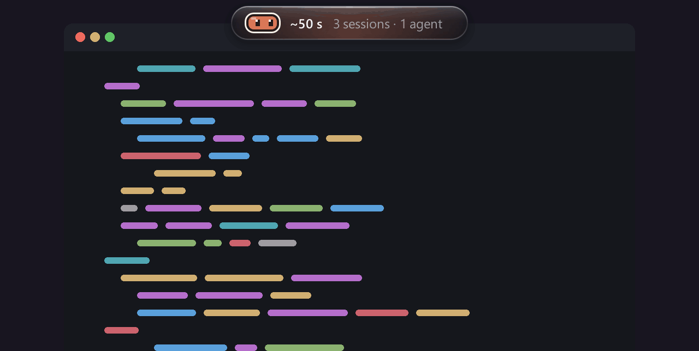

 

[Notices](#notices) · [Dynamic Island](#dynamic-island) · [Features](#features) · [Install](#install) ·
[Settings](#settings) · [Phone](#on-your-phone) · [Gallery](docs/README.md) · [FAQ](#faq) · [Changelog](CHANGELOG.md)

> [!NOTE]
> **New in 1.4.0:** the Dynamic Island, the Dashboard and Usage sections, the glass settings window (the real blur is
> on Windows) and the Burger style. [See everything that changed →](CHANGELOG.md#140---2026-11-17)

## Notices

You ask Claude Code for something and switch to another window. When it finishes, asks for permission or runs out of
usage, **Wave slides in from the edge of the screen**, tells you which chat and project it's about, and leaves on its
own. If you're away from the computer, it messages your phone instead.

<table>
  <tr>
    <td align="center" width="33%">
      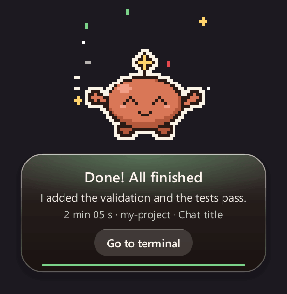 
      <b>Knows when it's done</b> 
      Chat, project, how long it took and a one-line summary of what changed.
    </td>
    <td align="center" width="33%">
      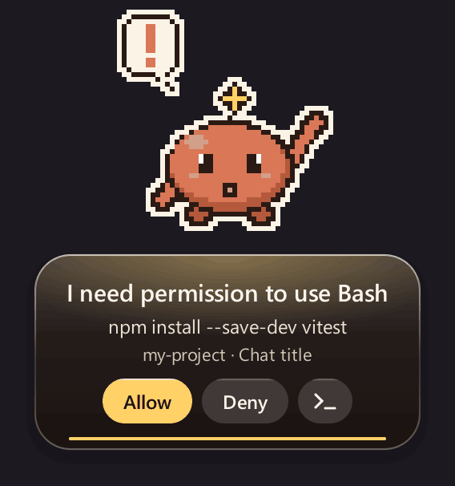 
      <b>Asks before acting</b> 
      Allow or Deny right on the notice, without going back to the terminal.
    </td>
    <td align="center" width="33%">
      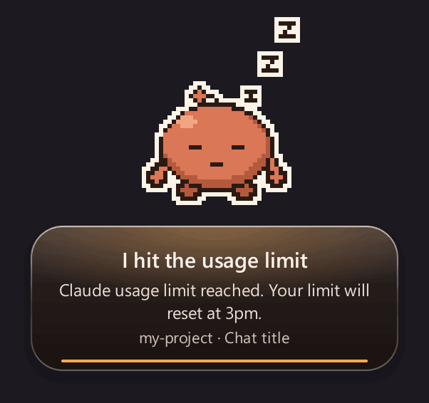 
      <b>Tells you when to stop</b> 
      Usage limit and API errors get their own notice, animation and sound.
    </td>
  </tr>
</table>

## Dynamic Island

A small glass pill sits at the top center of your screen with **your mascot's eyes**: awake while Claude works, calm
while it waits, asleep when there's nothing running. Next to them, the estimated time left and how many sessions are
open. Hover it and it stretches open, like a liquid, to show each session.

<table>
  <tr>
    <td width="50%" valign="top">
      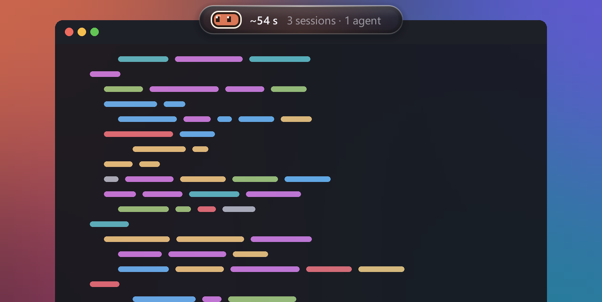 
      <b>At a glance</b> 
      Time left for the next session to finish, sessions and sub-agents running.
    </td>
    <td width="50%" valign="top">
      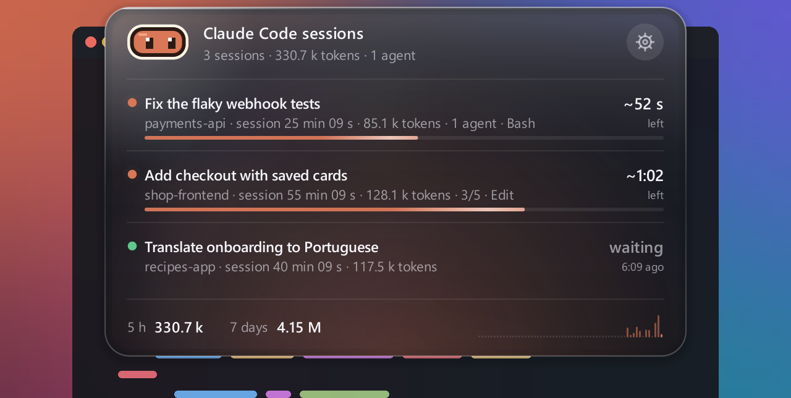 
      <b>Every session</b> 
      Title, project, tokens, task-list progress, the tool in use and a progress bar. Click one to jump to
      its window.
    </td>
  </tr>
</table>

At the bottom: your tokens for the last 5 hours and 7 days. The gear opens the settings. It hides by itself while
something is full screen, and 15 options in **Settings → Dynamic Island** change where it goes, what it shows and how
it moves. On Windows the glass really blurs what's behind it.

## Features

- **A notice for every moment**: done, needs permission, thinking, sub-agent finished, usage limit and API error.
- **Allow or deny without the terminal**, from Wave's buttons or from your phone. The first answer wins.
- **Dynamic Island**: all your Claude Code sessions in a glass pill, with the time each one has left.
- **Usage**: your tokens on a curve, from the last 5 hours up to 6 months, with time Claude worked, models, projects
  and cache hit rate. Live, and read only from your own computer.
- **The right context**: chat, project, duration and a summary read locally. Notices from several sessions queue up.
- **Stays out of the way**: a one-click **Do not disturb**, automatic silence by schedule, and nothing over
  full-screen apps or when you're already looking at the terminal.
- **Make it yours**: five styles (Classic, Sakura, Ninja, Robot and Burger), colors, outfits, light or dark theme,
  your own image and sounds.
- **Companion mode**: Wave lives small on your taskbar or Dock, wanders around and naps when you hit the limit.
- **On your phone**: [Telegram notifications](#on-your-phone) with Wave animated, and Allow/Deny from anywhere.
  Free.
- **Always up to date**: Wave tells you when there's a new version; on Windows it installs it in one click.
- **English, Spanish and Portuguese**, multiple monitors, Windows and macOS (Apple chip and Intel).

  
   
  The five styles. Each one shows up, celebrates and leaves in its own way: <a href="docs/README.md#styles">see them move →</a>

## Install

Requires [Claude Code](https://docs.claude.com/en/docs/claude-code): the CLI, the IDE extension or the desktop app.

**Windows 10 / 11**

1. Download [`WaveMascot-Setup.exe`](../../releases/latest/download/WaveMascot-Setup.exe).
2. Open it and click **Yes**. No administrator rights or Python needed.

If SmartScreen shows up, choose **More info → Run anyway**.

**macOS 13 or newer**

1. Download the `.dmg` for your Mac: [Apple chip](../../releases/latest/download/WaveMascot-Mac-AppleSilicon.dmg) ·
   [Intel](../../releases/latest/download/WaveMascot-Mac-Intel.dmg).
2. Drag WaveMascot to Applications and open it.

The first time, macOS asks you to confirm because the app isn't notarized: [here's how](docs/install.md#mac).

That's it: the next time Claude Code finishes, Wave shows up. No restart needed. The
[installation guide](docs/install.md) covers installing from source, what the installer changes, uninstalling and
troubleshooting.

## Settings

Click **Wave's icon** (next to the clock on Windows, in the menu bar on Mac), the gear on the Dynamic Island, or type
**`/wavemascot`** in Claude Code. Everything saves on its own, and the preview shows exactly how each notice will
look.

  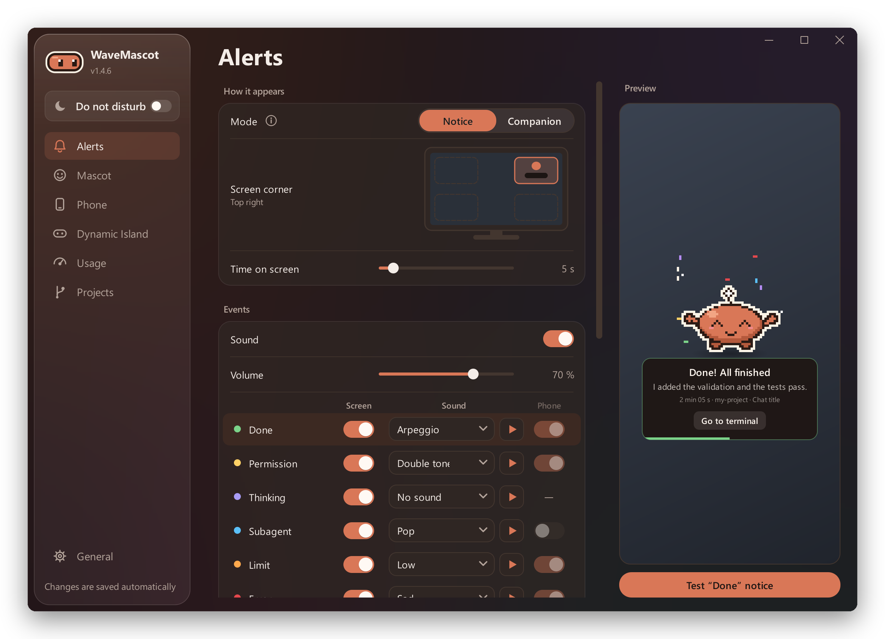

<table>
  <tr>
    <td colspan="2" align="center">
      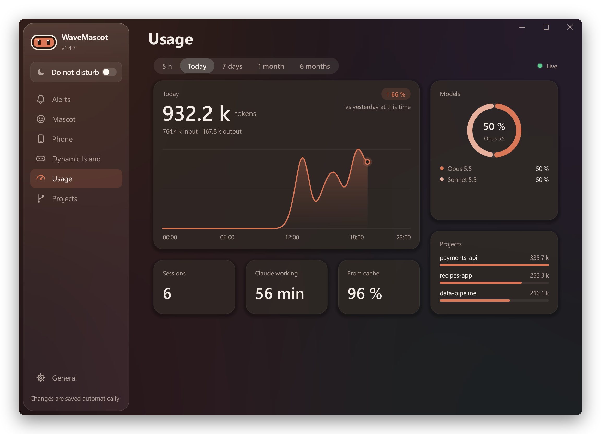 
      <b>Usage</b> 5 hours, today, a week, a month or six months, updated live.
    </td>
  </tr>
  <tr>
    <td width="50%" align="center">
      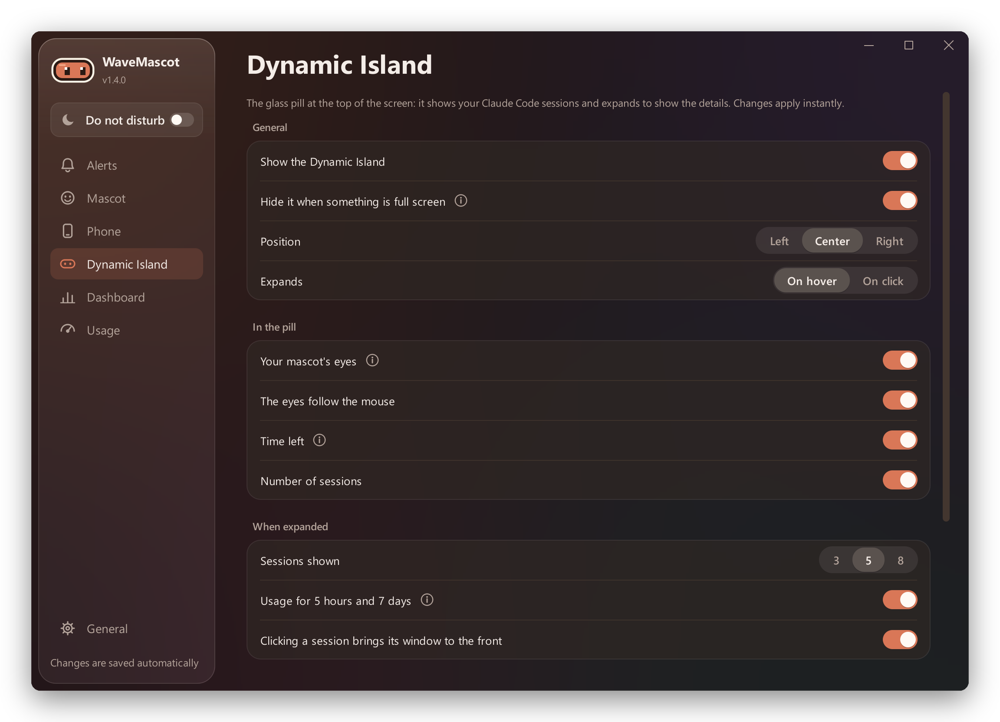 
      <b>Dynamic Island</b> Position, eyes, what the pill shows, blur, bounce.
    </td>
    <td width="50%" align="center">
      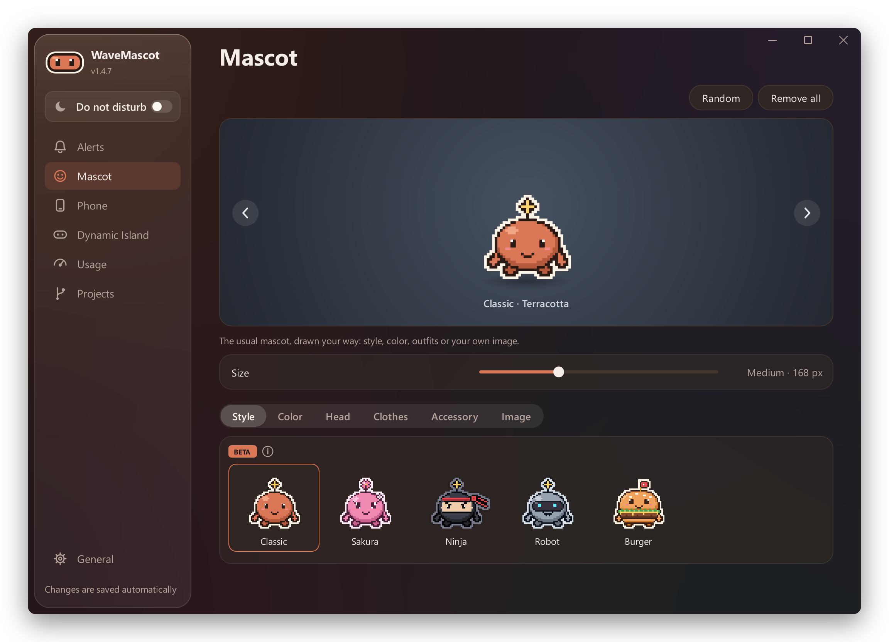 
      <b>Mascot</b> Style, color, outfit, size or your own image.
    </td>
  </tr>
</table>

<b>What each section does</b>

 

| Section | What you can change |
|---|---|
| **Do not disturb** | The switch at the top: mutes every notice until you turn it off |
| Alerts | Notice or companion mode, screen corner, time on screen, automatic silence, and for each event: show it, its sound, send it to the phone |
| Mascot | Style, color, head, clothes, accessory, size and your own image |
| Phone | Connect Telegram, when to send (only when you're away), Wave animated, Allow/Deny from the phone |
| Dynamic Island | Show it, position, open on hover or click, eyes, time left, sessions listed, 5 h / 7 day usage, blur, opacity, bounce, pulse |
| Usage | Tokens for 5 hours, today, 7 days, 1 month or 6 months: curve, input, output, sessions, time Claude worked, cache hit rate, models and projects |
| General | Language, theme (dark, light or accent), open at startup, updates |

Everything is stored in `~/.wavemascot/config.json`. Every section is in the [gallery](docs/README.md#settings).

## On your phone

When you're away from the computer, Wave messages you on Telegram from
[@WaveNotificationBot](https://t.me/WaveNotificationBot), and permission requests come with **Allow** and **Deny**
buttons that answer Claude Code right away. It's free, like the rest of WaveMascot.

  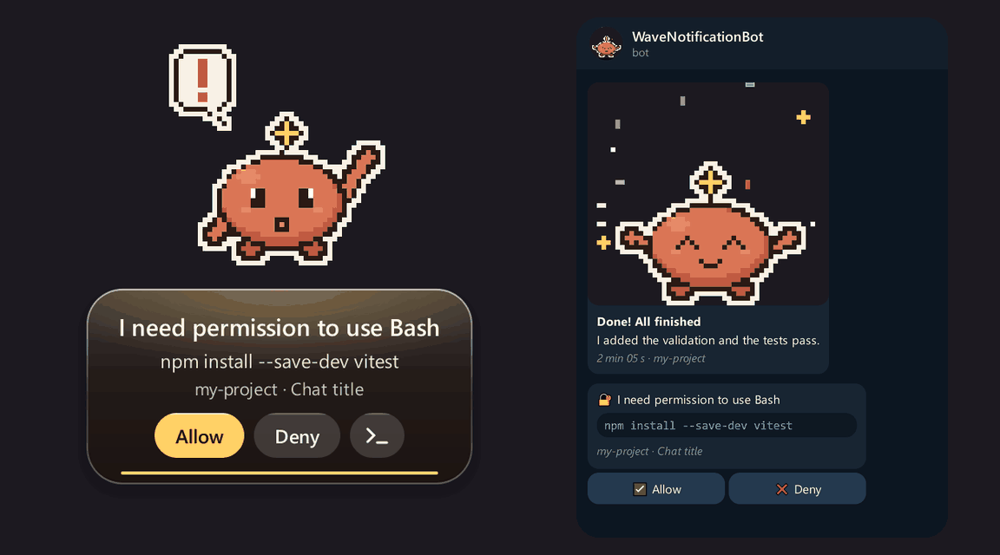

Open **Phone** in the settings, tap **Connect Telegram** and then **Start** in the bot. Nothing to create or paste. By
default it only messages you when there's been no mouse or keyboard activity for a few minutes.

## Privacy

Everything runs on your computer. The summary, the Dynamic Island and Usage are read locally from the
transcripts Claude Code already keeps on your disk; they're estimates from those files, not your account's official
limits. WaveMascot only goes online to check GitHub for a new version (at most once a day) and, if you connect it, to
send notices to Telegram. Both can be turned off.

<b>How Telegram works</b>

 

The bot's token lives only on a small [Cloudflare Worker](servidor/) that relays each message without storing it, and
each installation gets its own key that can only message the chat it linked. What gets sent is what the notice shows
(message, summary, project, chat title, command to approve). Send `/stop` to the bot or tap **Disconnect** to stop.

## FAQ

<b>How does it know what Claude Code is doing?</b>

 

Through Claude Code's [hooks](https://docs.claude.com/en/docs/claude-code/hooks). The installer adds a few entries to
`~/.claude/settings.json` (with a backup first, and without touching yours), and Claude Code calls Wave when it
finishes, needs something, a sub-agent ends or it hits a limit. Uninstalling removes only those entries. The Dynamic
Island also reads the session transcripts in `~/.claude/projects`.

<b>How does it know how much time is left?</b>

 

It can't know for sure, so it estimates: it looks at your past turns that resemble the current one (same project and
session, tools used so far, how long your message was, how far along Claude's task list is) and takes what they had
left. The more you use it, the better it gets.

<b>I get two notifications every time</b>

 

Turn off Claude Code's own notifications (or your terminal's, on Mac in **System Settings → Notifications**), so only
Wave tells you.

<b>Does it work with the VS Code extension or the desktop app?</b>

 

Yes: the hooks are the same for the CLI, the IDE extensions and the desktop app. In the desktop app its own
permission dialog still appears too; whichever answer comes first wins.

<b>Wave didn't show up</b>

 

Check `~/.wavemascot/mascota.log`: each event says whether it notified or why not (full screen, do not disturb,
focused terminal, event turned off…). Wave's icon → **Test notice** forces one. More in
[troubleshooting](docs/install.md#troubleshooting).

## Contributing

Questions and ideas go to [Discussions](../../discussions), bugs to [Issues](../../issues/new/choose). Pull requests
are welcome, in English, Spanish or Portuguese: see [CONTRIBUTING.md](CONTRIBUTING.md). The README images are drawn
by the app itself with [`tools/capturas.py`](tools/capturas.py), using made-up sessions instead of yours.

## License

[MIT](LICENSE). The installers bundle PyQt6 (GPL v3) and other libraries; see [THIRD_PARTY.md](THIRD_PARTY.md).

WaveMascot is an unofficial project, not made, endorsed or maintained by Anthropic. The mascot, icon and sounds
are original and generated in code.
