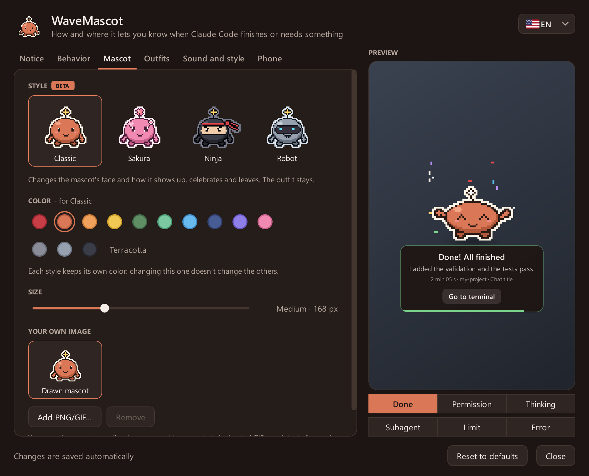

**English** · [Español](README.es.md) · [Português](README.pt.md)

 

# WaveMascot

**A pixel-art desktop mascot that tells you when Claude Code is done, or needs you.**

 

Wave slides in from the edge of the screen when **Claude Code** finishes, asks for permission or runs out of usage,
tells you which chat and project it's about, and leaves on its own. When you're away from the computer, it messages
your phone on Telegram, and you can **allow or deny** right from there.

## Features

- **A notice for every moment**: done, needs permission, thinking, sub-agent finished, usage limit and API errors,
  each with its own animation and sound.
- **Allow or deny without the terminal**, from Wave's buttons or from your phone.
- **The right context**: chat, project, how long it took and a one-line summary. Notices from several sessions queue up.
- **Stays out of the way**: do-not-disturb hours, nothing over full-screen apps or when you're looking at the terminal.
- **Make it yours**: four styles (Classic, Sakura, Ninja, Robot), colors, outfits, your own image and sounds.
- **Companion mode**: Wave lives small on your taskbar or Dock, wanders around and naps when you hit the limit.
- **English, Spanish and Portuguese**, multiple monitors, and automatic updates on Windows.

  
   
  <a href="docs/README.md"><b>See the gallery →</b></a>

## Install

Requires [Claude Code](https://docs.claude.com/en/docs/claude-code) (CLI, IDE extension or desktop app).

**Windows 10 / 11**: download [`WaveMascot-Setup.exe`](../../releases/latest/download/WaveMascot-Setup.exe), open it
and click **Yes**. No administrator rights or Python needed. If SmartScreen appears, choose
**More info → Run anyway**.

**macOS 13 or newer**: download the `.dmg` for your Mac
([Apple chip](../../releases/latest/download/WaveMascot-Mac-AppleSilicon.dmg) ·
[Intel](../../releases/latest/download/WaveMascot-Mac-Intel.dmg)), drag WaveMascot to Applications and open it. The
first time, macOS asks you to confirm because the app isn't notarized: [here's how](docs/install.md#mac).

That's it: the next time Claude Code finishes, Wave shows up. No restart needed.

The [installation guide](docs/install.md) covers installing from source, what the installer changes, uninstalling
and troubleshooting.

## Settings

Click **Wave's icon** (next to the clock on Windows, in the menu bar on Mac) or type **`/wavemascot`** in Claude Code.
Changes save on their own and the preview shows exactly how the notice will look.

  

<b>What each tab does</b>

| Tab | What you can change |
|---|---|
| Notice | Corner, time on screen, what the notice shows and its messages |
| Behavior | Notice or companion mode, which events notify, do not disturb, minimum duration, Allow/Deny |
| Mascot | Style, color, skin tone, size and your own image |
| Outfits | Head, clothes and accessories |
| Sound and style | Volume, sound per event, theme, tray icon, updates |
| Phone | Telegram: when to send, which notices, Allow/Deny from the phone |

Everything is stored in `~/.wavemascot/config.json`. Tip: turn off Claude Code's own notifications so you don't get
two.

## On your phone

Open the **Phone** tab, tap **Connect Telegram** and then **Start** in the chat with
[@WaveNotificationBot](https://t.me/WaveNotificationBot). Nothing to create or paste.

By default it only writes when you've been away for 3 minutes. Permission requests come with **Allow** and **Deny**,
and whichever answer comes first wins: the phone, Wave or the terminal.

**Telegram is part of WaveMascot Pro**, with a 7-day free trial that starts when you connect. Everything else (the
mascot, on-screen notices, styles, outfits) is free forever. Tap the **PRO** badge on the Phone tab to see how to
unlock it: you pay with Telegram Stars inside the bot (monthly, cancel anytime with `/pro`, or once for life), and
it works on every computer you connect to your Telegram. If the trial ends, the mascot keeps notifying you on screen
and permission requests go back to the terminal.

## Privacy

Everything runs on your computer. The summary is read locally from the transcript Claude Code already keeps on your
disk. WaveMascot only goes online to check GitHub for a new version (at most once a day) and, if you connect it,
to send notices to Telegram. Both can be turned off.

For Telegram, the bot's token lives only on a small [Cloudflare Worker](servidor/) that relays each message without
storing it, and each installation gets its own key that can only message the chat it linked. What gets sent is what
the notice shows (message, summary, project, chat title, command to approve). Send `/stop` to the bot or tap
**Disconnect** to stop. For Pro, the server only keeps your Telegram chat id, your plan and the payment ids Telegram
sends; payments are handled by Telegram, so WaveMascot never sees card details.

## Contributing

Questions and ideas go to [Discussions](../../discussions), bugs to [Issues](../../issues/new/choose). Pull requests
are welcome, in English, Spanish or Portuguese: see [CONTRIBUTING.md](CONTRIBUTING.md).

## License

[MIT](LICENSE). The installers bundle PyQt6 (GPL v3) and other libraries; see [THIRD_PARTY.md](THIRD_PARTY.md).

WaveMascot is an unofficial project, not made, endorsed or maintained by Anthropic. The mascot, icon and sounds
are original and generated in code.
