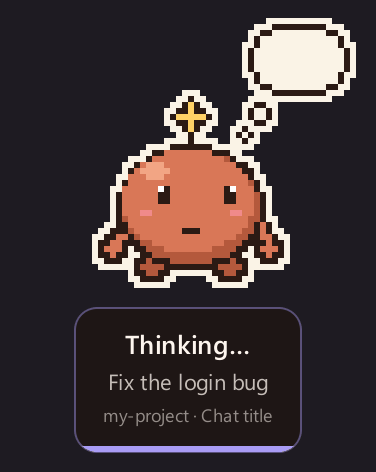
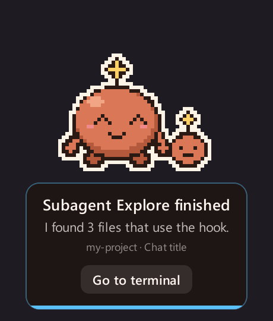
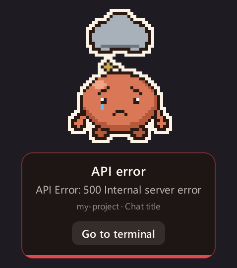
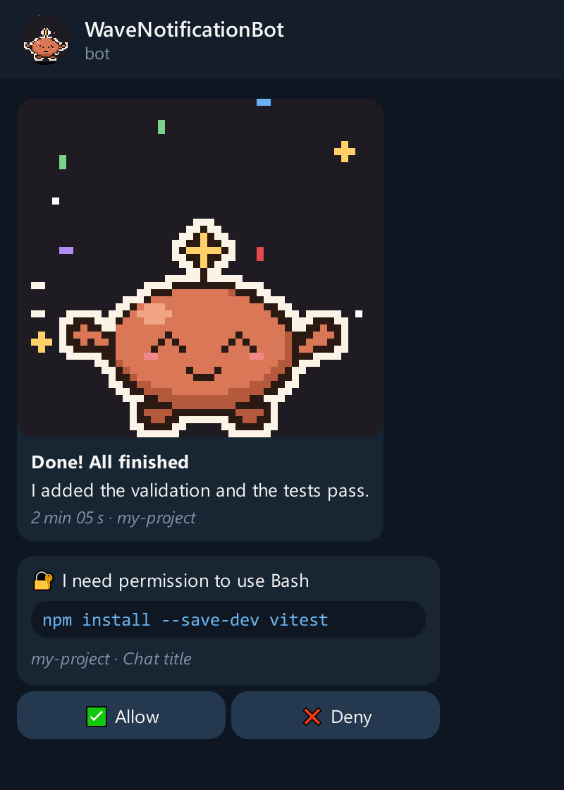
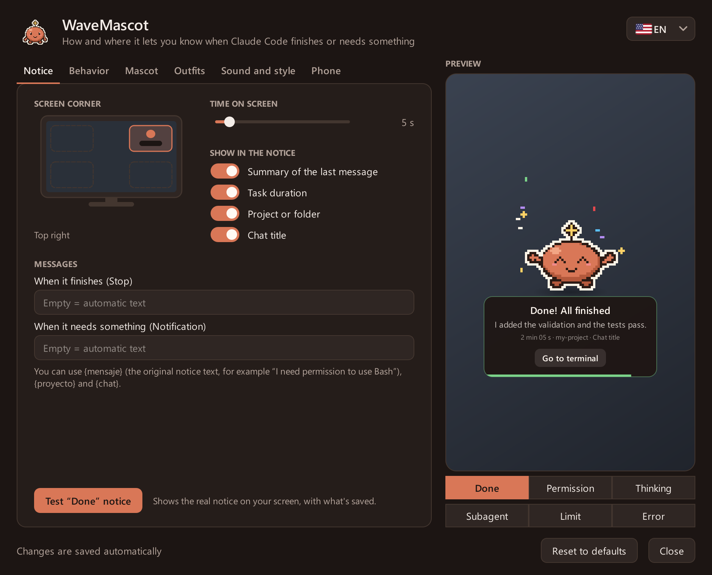
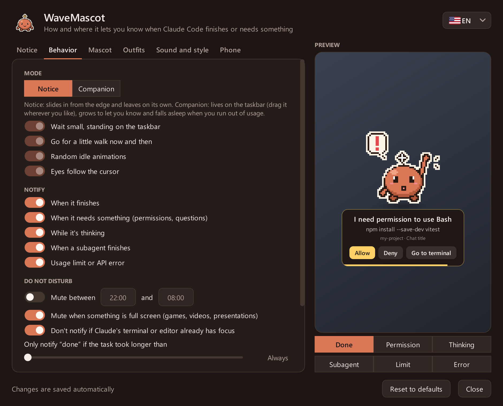
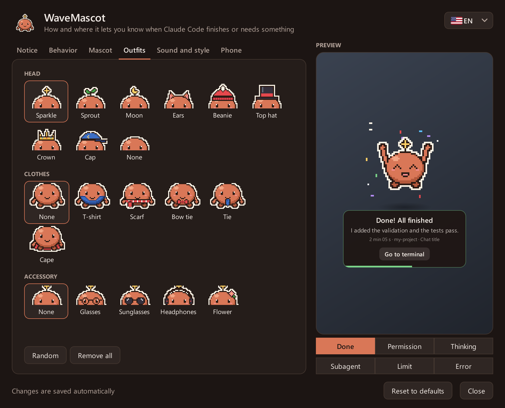
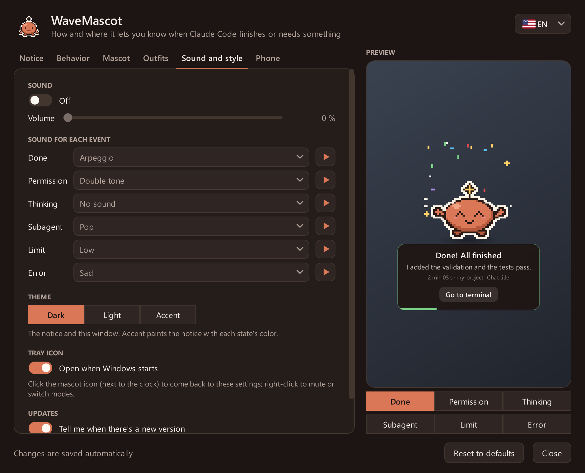
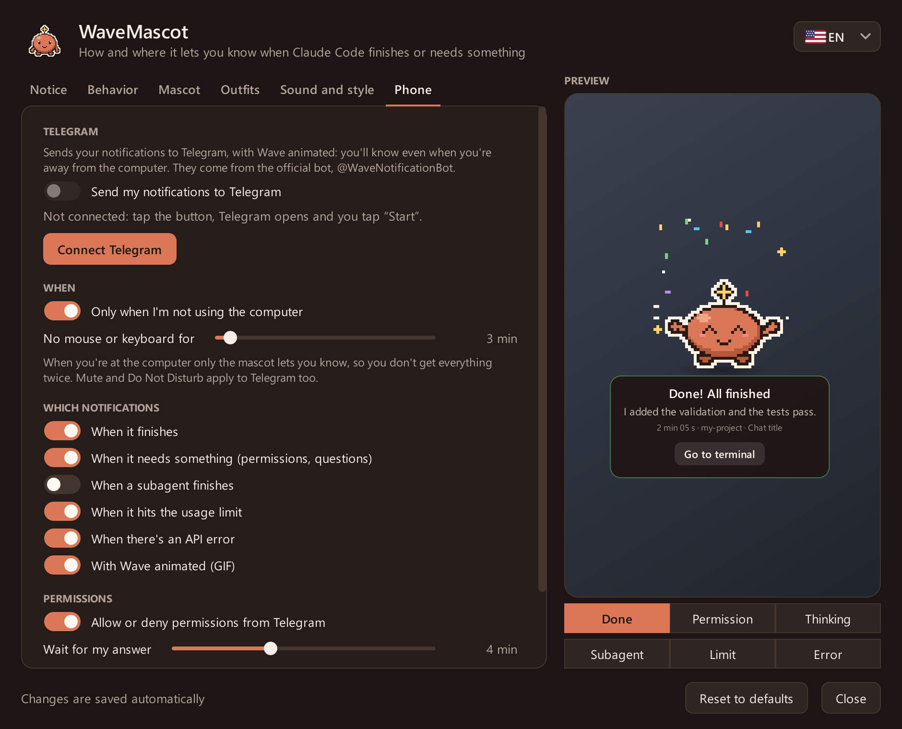

# WaveMascot

**English** · [Español](README.es.md) · [Português](README.pt.md)

<p align="center">
  
</p>

**Wave** is a pixel-art desktop mascot for Windows and macOS that lets you know when **Claude Code** finishes, needs
your permission or runs out of usage, instead of the system notification. It slides in from the edge of the screen,
tells you which chat and project the notice is about, and leaves on its own. If you're away from the computer, it can
also message your phone on Telegram, where you can **allow or deny** what Claude asks for.

<p align="center">
  <a href="../../releases/latest/download/WaveMascot-Setup.exe"><b>⬇ Download for Windows</b></a>
  &nbsp;·&nbsp; <a href="../../releases/latest/download/WaveMascot-Mac-AppleSilicon.dmg"><b>⬇ Mac (Apple chip)</b></a>
  &nbsp;·&nbsp; <a href="../../releases/latest/download/WaveMascot-Mac-Intel.dmg"><b>⬇ Mac (Intel)</b></a>
  <br>
  <a href="#see-it-in-action">See it in action</a>
  &nbsp;·&nbsp; <a href="#install">Install</a>
  &nbsp;·&nbsp; <a href="../../discussions">Questions &amp; ideas</a>
  &nbsp;·&nbsp; <a href="../../issues/new/choose">Report a problem</a>
</p>

> **Unofficial project.** It is not made, endorsed or maintained by Anthropic. It uses no logos, images, sounds or
> any other Anthropic assets: the mascot, the icon and the sounds are original and generated in code
> (see [THIRD_PARTY.md](THIRD_PARTY.md)).
>
> **Your data stays on your computer.** The summary of the last message is built by reading, locally, the transcript
> Claude Code already keeps on your disk. WaveMascot only goes online for two things, and you can turn both off:
> checking GitHub for a new version (at most once a day) and, **only if you connect Telegram**, sending the notice
> to your phone (see [Notices on your phone](#notices-on-your-phone-telegram)).

## See it in action

### A notice for each moment

Each state has its own animation, sound and buttons. With several sessions at once, notices queue up and each one
says which project it comes from.

<table>
  <tr>
    <td align="center"><br><b>Done</b><br>how long it took and a summary</td>
    <td align="center"><br><b>Needs permission</b><br>allow or deny right there</td>
    <td align="center"><br><b>Thinking</b><br>Claude is working on it</td>
  </tr>
  <tr>
    <td align="center"><br><b>Sub-agent done</b><br>a helper finished its part</td>
    <td align="center"><br><b>Usage limit</b><br>and when it resets</td>
    <td align="center"><br><b>Error</b><br>when the API fails</td>
  </tr>
</table>

### Four styles (beta)

A style changes Wave's face and how it shows up, celebrates and leaves.

<p align="center">
  
</p>

<table>
  <tr>
    <td align="center"><br><b>Classic</b><br>slides in from the edge</td>
    <td align="center"><br><b>Sakura</b><br>floats in on a gust of petals</td>
  </tr>
  <tr>
    <td align="center"><br><b>Ninja</b><br>rolls in hidden in smoke, throws a shuriken</td>
    <td align="center"><br><b>Robot</b><br>flies in on rocket boots and boots up</td>
  </tr>
</table>

### Dress it up

Colors, hats, clothes and accessories (or your own PNG/GIF), and they work with every style.

<p align="center">
  
</p>

### On your phone

<p align="center">
  
  <br><sub>Illustration of the chat with @WaveNotificationBot (Telegram's look recreated; the GIF and the texts are the real ones).</sub>
</p>

### The settings

<p align="center">
  
</p>

<details>
<summary><b>See every tab</b></summary>

| | |
|---|---|
| <br>**Notice** | <br>**Behavior** |
| <br>**Mascot** | <br>**Outfits** |
| <br>**Sound and style** | <br>**Phone** |

</details>

All the images are made from the app itself with [`tools/capturas.py`](tools/capturas.py); there are more in
[`docs/`](docs).

## What it does

- **Tells you when Claude finishes** (`done`), **asks for permission**, is **thinking**, a **subagent** finished,
  you hit the **usage limit** or there was an **error**: each state has its own animation and sound.
- **Allow / Deny from the mascot** (`PermissionRequest` hook): answer without going to the terminal. If you don't
  choose in time, the usual dialog decides.
- **Notices on your phone** through Telegram, with Wave animated, and **Allow / Deny from there** when you're away.
- **Shows just the right context**: chat title, project, how long it took and a short summary of the answer.
  With **several sessions at once**, each notice says which project it comes from and notices queue up instead of
  overwriting each other.
- **Doesn't get in the way**: do-not-disturb hours, nothing over full-screen apps, nothing if you're already looking
  at the terminal, a minimum duration, and quick mute from its icon (next to the clock on Windows, in the menu bar on
  Mac).
- **Companion mode**: instead of popping in and out, it stays small on the taskbar (or the Dock), wanders a bit and
  falls asleep when you run out of usage until it resets.
- **Customizable**: four styles (Classic, Sakura, Ninja, Robot), colors, hats, clothes and accessories, your own
  image (PNG/GIF), size, corner, dark/light/accent themes and a sound per event.
- **Tells you when there's a new version**: on Windows it updates itself with one click and keeps your settings.
- **In your language**: English, Spanish and Portuguese. English by default; change it with the flag at the top of the
  settings.
- **Multiple monitors**: the notice shows up on the monitor where the Claude Code window is.
- **Never slows Claude Code down**: the hook returns in milliseconds, never exits with an error and, if something
  fails (no audio, broken settings, no screen, no internet), it writes it to the log and moves on.

## Install

You need [Claude Code](https://docs.claude.com/en/docs/claude-code) (CLI, extension or desktop app) and Windows 10 or
11, or macOS 13 (Ventura) or newer.

### Windows

#### Option A: installer (recommended, no Python needed)

1. **[Download `WaveMascot-Setup.exe`](../../releases/latest/download/WaveMascot-Setup.exe)** (always the latest
   version; it's also in [Releases](../../releases/latest)).
2. Open it and click **Yes**. It installs into `%LOCALAPPDATA%\Programs\WaveMascot`, no administrator rights needed.
3. Done: the next time Claude Code finishes, the mascot shows up. If Claude Code was already open, there's no need to
   restart it.

> Windows SmartScreen may show "Windows protected your PC". Choose **More info → Run anyway**, or use option B if you'd
> rather install from source. You can verify the file with the release's `SHA256SUMS.txt`.

#### Option B: from source (Python 3.10 or newer)

1. Get the code: [ZIP](../../archive/refs/heads/main.zip) (unzip it) or
   `git clone https://github.com/Marescaa/wavemascot.git`.
2. Open PowerShell in that folder and run:

   ```powershell
   powershell -ExecutionPolicy Bypass -File .\install.ps1
   ```

`install.ps1` installs PyQt6 and Pillow only if they're missing. Options: `-Python <path to python.exe>`,
`-Destination <folder>`, `-NoStartup` (no tray icon when Windows starts).

### Mac

#### Option A: the app (recommended, no Python needed)

You need macOS 13 (Ventura) or newer, on any Mac.

1. **Download the file for your Mac.** To know which one: Apple menu → **About This Mac**.
   - It says **Chip: Apple M1, M2, M3, M4…** → **[`WaveMascot-Mac-AppleSilicon.dmg`](../../releases/latest/download/WaveMascot-Mac-AppleSilicon.dmg)**
   - It says **Processor: Intel** → **[`WaveMascot-Mac-Intel.dmg`](../../releases/latest/download/WaveMascot-Mac-Intel.dmg)**
2. **Open the `.dmg`** (double-click it in Downloads). A window shows WaveMascot and the Applications folder:
   **drag WaveMascot onto Applications**. You can then eject the WaveMascot disk in the Finder sidebar.
3. **Open WaveMascot** from Applications (or with Spotlight: <kbd>⌘</kbd> <kbd>Space</kbd>, type *WaveMascot*).
   The first time, macOS blocks it because the app isn't notarized by Apple (that needs a paid developer account):
   - **macOS 15 (Sequoia) or newer**: a window says *"Apple could not verify 'WaveMascot' is free of malware…"*.
     Click **Done**, open **System Settings → Privacy & Security**, scroll down to **Security** and click
     **Open Anyway** next to *"WaveMascot was blocked…"*. Confirm with **Open Anyway** and your password or Touch ID.
   - **macOS 13 or 14**: right-click (or <kbd>Control</kbd>-click) WaveMascot in Applications → **Open**, and
     **Open** again.

   It's only needed once; updates and the hooks don't ask again.
4. WaveMascot asks **"Install WaveMascot?"**: click **Yes**. It connects to Claude Code and tells you what it did.
5. Done: Wave's icon appears in the **menu bar** (top right). Click it → **Test notice** to see it. From now on it shows
   up whenever Claude Code finishes or needs something, in the terminal, VS Code or the Claude app. If Claude Code was
   already open, there's no need to restart it. To see it in Spanish or Portuguese, open the settings and pick the
   flag.

Good to know:

- **It doesn't ask for any permission** (no Accessibility, no Screen Recording, no notifications).
- If you open it straight from the `.dmg` without dragging it, it copies itself to Applications.
- **Settings**: menu bar icon → **Open settings**, `/wavemascot` in Claude Code, or open WaveMascot again from
  Applications.
- **Update**: download the new `.dmg`, drag WaveMascot onto Applications (**Replace**) and open it once.
- macOS shows *"Background Items Added"* the first time: that's the menu bar icon opening at login. You can turn it
  off in WaveMascot's settings or in **System Settings → General → Login Items**.
- To check the download: `shasum -a 256 ~/Downloads/WaveMascot-Mac-*.dmg` must match the release's
  `SHA256SUMS.txt`.

#### Option B: from source (Python 3.10 or newer)

```bash
git clone https://github.com/Marescaa/wavemascot.git
cd wavemascot
./install.sh
```

`install.sh` creates its own Python environment with PyQt6 and Pillow (your Python stays untouched). Options:
`--python <path to python3>`, `--destination <folder>`, `--no-startup` (no menu bar icon at login).

### What the installer does on your computer

- **Copies the program** to `%LOCALAPPDATA%\Programs\WaveMascot` (Windows) or leaves the app in **Applications** (Mac;
  if you open it straight from the `.dmg`, it copies itself there).
- **Connects Wave to Claude Code**: it adds a few lines (the *hooks*) to `~/.claude/settings.json` so Claude Code calls
  it when it finishes or needs something. What you already had in that file is left alone, and a backup is saved
  before changing it.
- **Creates the `/wavemascot` command**, which opens the settings from Claude Code.
- **Puts Wave's icon next to the clock** (Windows) or **in the menu bar** (Mac, as a login item) every time you turn
  on your computer.

It doesn't need administrator rights, and if you uninstall it, everything goes back to how it was.

## Settings

Open the settings by clicking **Wave's icon** (next to the clock on Windows, in the menu bar on Mac), with
**`/wavemascot`** in Claude Code or, on Mac, by opening WaveMascot from Applications. Changes are saved automatically
and apply from the next notice; the preview shows the whole notice as it will look. The **flag** at the top right
changes the language.

| Tab | What you can change |
|---|---|
| Notice | Corner, time on screen, what to show in the notice (summary, chat, project, duration) and the messages |
| Behavior | Notice or companion mode (walks, idle animations, eyes), which events notify, do not disturb (hours, full screen, focused terminal), minimum duration, Allow/Deny from the mascot |
| Mascot | Style (Classic, Sakura, Ninja, Robot), color, skin tone (Ninja), size and your own image |
| Outfits | Head, clothes and accessories (or random) |
| Sound and style | Volume, sound for each event, dark / light / accent theme, tray / menu bar icon, update notice |
| Phone | Connect Telegram, when to send (only when you're away), which notices, with or without the GIF, Allow/Deny from Telegram |

Everything is stored in `~/.wavemascot/config.json`. If the file doesn't exist or has an error, the mascot uses the
defaults. From Wave's icon you can also mute notices for an hour or until you turn them back on.

> For the mascot to replace the system notification, turn off Claude Code's own notifications (in the desktop app's
> settings or your terminal's), so you don't get two notices.

### Notices on your phone (Telegram)

1. In the settings, open the **Phone** tab and tap **Connect Telegram**.
2. Telegram opens the chat with the official bot, **@WaveNotificationBot**, with a one-time code. Tap **Start**.
   That's it: nothing to create or paste.

By default it only sends a notice when you've been away from the computer for 3 minutes (no mouse or keyboard), so you
don't get everything twice; mute and do-not-disturb apply too. When Claude asks for permission, the message shows the
full command with **Allow** and **Deny**: whatever comes first wins (the phone, Wave's buttons or the terminal) and the
other side updates itself.

**Privacy**: the bot's token lives only on a small [Cloudflare Worker](servidor/) that relays each message to Telegram
without storing it. Each installation gets its own key, which can only message the chat it linked. What gets sent is
what the notice shows (message, summary, project, chat title, command to approve). Send `/stop` to the bot or tap
**Disconnect** to stop.

### Updates

WaveMascot checks GitHub at most once a day. When there's a new version, Wave tells you once (**Update** /
**Not now**), a small "⬇ version" pill shows up next to the flag in the settings and the tray menu offers
**Update to version…**. On Windows, **Update** downloads the installer, checks it against `SHA256SUMS.txt` and
installs it silently, keeping your settings; on Mac it opens the download page. You can turn this off in
**Sound and style → Updates**.

## Uninstall

- **Windows, installed with the `.exe`**: Start menu → *WaveMascot* → **Uninstall WaveMascot**.
- **Windows, installed with `install.ps1`** (or either way):

  ```powershell
  powershell -ExecutionPolicy Bypass -File .\uninstall.ps1
  ```

- **Mac**: Wave's icon in the menu bar → **Uninstall WaveMascot…** (or `./uninstall.sh`, either way). If you just drag
  the app to the Trash, Claude Code keeps working normally: its hooks do nothing while the app isn't there.

Uninstalling closes the mascot, removes **only its hooks** from `~/.claude/settings.json` (with a backup first; yours
stay exactly as they were), and deletes `/wavemascot`, the shortcuts and the program. Your settings in `~/.wavemascot`
are kept; to delete them too: `uninstall.ps1 -DeleteSettings` or `uninstall.sh --delete-settings`.

## Troubleshooting

- **It doesn't show up**: check `~/.wavemascot/mascota.log`; each event says whether it notified or why not (full
  screen, do not disturb, focused terminal, event turned off...). Wave's icon → *Test notice* forces one.
- **The hooks don't run**: check with `/hooks` in Claude Code that the mascot's hooks are there.
- **Allow/Deny**: in the desktop app its own dialog still appears; the first answer wins.
- **Mac: "WaveMascot can't be opened" or "Apple could not verify…"**: see step 3 of [Install → Mac](#mac).
- **Mac: I don't see the icon in the menu bar**: on Macs with a notch, icons that don't fit are hidden; close a few
  other menu bar apps or open the settings with `/wavemascot`. If you quit it, open WaveMascot from Applications.
- **Mac: two notices**: turn off the notifications of your terminal or of the Claude app in **System Settings →
  Notifications**, so only Wave tells you.
- **Telegram: nothing arrives**: by default notices only go to the phone when you've been away for 3 minutes; turn
  off "Only when I'm not using the computer" to test it. If you blocked the bot or sent `/stop`, connect again from
  the **Phone** tab.

## Questions, ideas and reports

- **Got a question or an idea?** Post it in [Discussions](../../discussions): chat, propose new outfits or states and
  share your setups.
- **Something doesn't work?** Open an [issue](../../issues/new/choose) with the bug template (add the last lines of
  the log, without private data).
- **Want to propose something specific?** Use the idea template in [issues](../../issues/new/choose).

English, Spanish and Portuguese are all welcome. Pull requests too: before sending one, run the tests
(`python -m unittest discover tests`).

## Development

```powershell
python -m unittest discover tests          # installer, translations, styles, phone and update tests
powershell -ExecutionPolicy Bypass -File .\build.ps1   # builds dist\WaveMascot-Setup.exe (on Windows)
./build-mac.sh                             # builds dist/WaveMascot-Mac-<chip>.dmg (on a Mac)
python tools/capturas.py                   # redraws the screenshots and GIFs in docs/ from the real app
```

Pushing a `v*` tag (for example `v1.2.0`) makes GitHub Actions build the Windows installer and both Mac `.dmg` files
and attach them to the release, with that version's CHANGELOG section as the notes. Every push to `main` runs the
tests on Windows and macOS.

| File | What it is |
|---|---|
| `mascota.py` | The hook and the mascot window |
| `ajustes.py` | The settings window |
| `bandeja.py` | The tray / menu bar icon |
| `sprites.py` | The pixel art, the styles, the icons and the sounds (all generated in code) |
| `celular.py` | Notices and permissions on Telegram (client of the Worker) |
| `actualizacion.py` | Checks GitHub for a new version, downloads it and installs it |
| `idiomas.py` | The texts in English, Spanish and Portuguese |
| `ventanas.py` | Windows and macOS windows: host terminal, focus, full screen, monitors |
| `instalador.py` | Install / uninstall (hook merge with backup); also the `.exe` installer and the Mac app's first run |
| `principal.py` | Entry point of `WaveMascot.exe` and `WaveMascot.app` |
| `servidor/` | The Cloudflare Worker behind @WaveNotificationBot |
| `tools/capturas.py` | Makes the images in `docs/` (offscreen, without touching your settings) |

**Adding a language**: add it to `IDIOMAS` in `idiomas.py` and one translation per text; `tests/test_idiomas.py` tells
you if any is missing.

## License

[MIT](LICENSE). The `.exe` and the Mac app include PyQt6 (GPL v3) and other libraries; see
[THIRD_PARTY.md](THIRD_PARTY.md).
