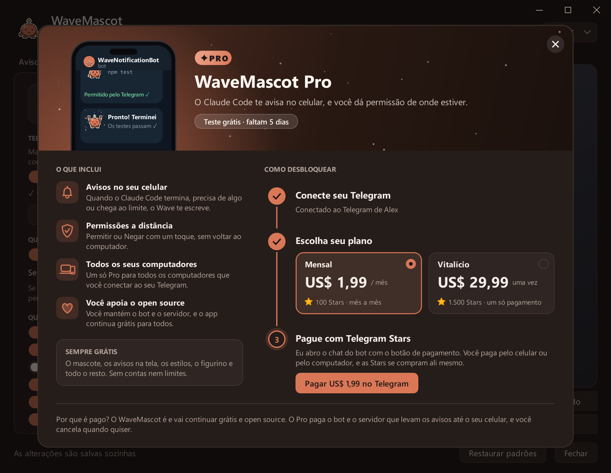

# WaveMascot

**Um mascote em pixel art que avisa quando o Claude Code termina, ou precisa de você.** 
Na sua área de trabalho, e no seu celular quando você não está no computador.

Grátis e open source · Windows 10/11 e macOS 13+ · [English](README.md) · [Español](README.es.md) · **Português**

  

 

[O que faz](#o-que-faz) · [Instalação](#instalação) · [WaveMascot Pro](#wavemascot-pro) ·
[Configurações](#configurações) · [Galeria](docs/README.pt.md) · [Perguntas](#perguntas-frequentes) ·
[Mudanças](CHANGELOG.md)

> [!NOTE]
> **Novo na 1.3:** o [WaveMascot Pro](#wavemascot-pro) leva os avisos e o Permitir/Negar para o seu celular pelo
> Telegram (7 dias de teste grátis), e traz quatro estilos de mascote, o aviso de versão nova e uma barra de título nova
> no Windows. [Ver todas as mudanças →](CHANGELOG.md#130---2026-10-23)

## O que faz

Você pede algo ao Claude Code e vai para outra janela. Quando ele termina, pede permissão ou fica sem uso, **o Wave
aparece pela borda da tela**, diz de qual chat e projeto se trata e vai embora sozinho. Se você não estiver no
computador, ele manda mensagem no seu celular.

<table>
  <tr>
    <td align="center" valign="top" width="33%">
       
      <b>Sabe quando terminou</b> 
      Chat, projeto, quanto demorou e um resumo de uma linha do que ele fez.
    </td>
    <td align="center" valign="top" width="33%">
       
      <b>Pergunta antes de agir</b> 
      Permitir ou Negar no próprio aviso, sem voltar ao terminal.
    </td>
    <td align="center" valign="top" width="33%">
       
      <b>Avisa quando parar</b> 
      O limite de uso e os erros da API têm seu próprio aviso, animação e som.
    </td>
  </tr>
</table>

## Recursos

- **Um aviso para cada momento**: terminou, precisa de permissão, está pensando, um subagente terminou, limite de uso
  e erro da API.
- **Permitir ou negar sem ir ao terminal**, pelos botões do Wave ou pelo celular. Vale a primeira resposta.
- **O contexto certo**: chat, projeto, quanto demorou e um resumo lido no seu computador. Avisos de várias sessões
  entram na fila.
- **Não atrapalha**: horário de não perturbe, e nada sobre apps em tela cheia nem se você já está olhando o terminal.
- **Do seu jeito**: quatro estilos (Clássico, Sakura, Ninja, Robô), cores, roupas, tema claro ou escuro, sua própria
  imagem e sons.
- **Modo companheira**: o Wave fica pequeno na barra de tarefas ou no Dock, passeia e dorme quando o uso acaba.
- **No seu celular** com o [WaveMascot Pro](#wavemascot-pro): avisos pelo Telegram com o Wave animado, e
  Permitir/Negar de onde você estiver.
- **Sempre atualizado**: o Wave avisa quando há uma versão nova; no Windows ela é instalada com um clique.
- **Inglês, espanhol e português**, vários monitores, Windows e macOS (chip Apple e Intel).

  
   
  Os quatro estilos. Cada um aparece, comemora e vai embora do seu jeito: <a href="docs/README.pt.md#estilos">veja eles em movimento →</a>

## Instalação

Precisa do [Claude Code](https://docs.claude.com/en/docs/claude-code): a CLI, a extensão do editor ou o app de
desktop.

**Windows 10 / 11**

1. Baixe o [`WaveMascot-Setup.exe`](../../releases/latest/download/WaveMascot-Setup.exe).
2. Abra e clique em **Sim**. Não precisa de administrador nem de Python.

Se aparecer o SmartScreen, escolha **Mais informações → Executar assim mesmo**.

**macOS 13 ou mais recente**

1. Baixe o `.dmg` do seu Mac: [chip Apple](../../releases/latest/download/WaveMascot-Mac-AppleSilicon.dmg) ·
   [Intel](../../releases/latest/download/WaveMascot-Mac-Intel.dmg).
2. Arraste o WaveMascot para Aplicativos e abra.

Na primeira vez o macOS pede confirmação porque o app não é notarizado: [veja como](docs/install.pt.md#mac).

Pronto: na próxima vez que o Claude Code terminar, o Wave aparece. Não precisa reiniciar nada. O
[guia de instalação](docs/install.pt.md) explica como instalar pelo código-fonte, o que o instalador muda, como
desinstalar e os problemas frequentes.

## WaveMascot Pro

**O WaveMascot é grátis e open source, e vai continuar assim.** O Pro acrescenta o seu celular: quando você não está
no computador, o Wave escreve pelo Telegram a partir do [@WaveNotificationBot](https://t.me/WaveNotificationBot), e os
pedidos de permissão chegam com os botões **Permitir** e **Negar**, que respondem ao Claude Code na hora.

  

| | Grátis | Pro |
|---|:---:|:---:|
| Avisos na tela para cada evento, com Permitir/Negar | ✓ | ✓ |
| Estilos, cores, roupas, temas, sua própria imagem e sons | ✓ | ✓ |
| Modo companheira, não perturbe, atualizações | ✓ | ✓ |
| Avisos pelo Telegram com o Wave animado | | ✓ |
| Permitir ou negar pelo celular | | ✓ |
| Um só plano para todos os computadores do seu Telegram | | ✓ |
| **Preço** | **Grátis para sempre** | **US$ 1,99** por mês ou **US$ 29,99** uma vez |

**Como conseguir:** abra a aba **Celular**, toque em **Conectar com o Telegram** e depois em **Começar** no bot. Não
há nada para criar nem colar, e ali começam os seus **7 dias de teste grátis**, sem cartão. Para continuar, toque no
selo **PRO** e pague com Telegram Stars dentro do bot (100 Stars por mês, cancele quando quiser com `/pro`, ou 1.500
Stars uma vez só). O Wave percebe o pagamento sozinho.

Se o teste terminar, nada quebra: o mascote continua avisando na tela e os pedidos de permissão voltam para o
terminal.

## Configurações

Clique no **ícone do Wave** (ao lado do relógio no Windows, na barra de menus no Mac) ou digite **`/wavemascot`** no
Claude Code. As mudanças são salvas sozinhas, e a pré-visualização mostra o aviso exatamente como vai aparecer.

  

<b>O que tem em cada aba</b>

 

| Aba | O que você muda |
|---|---|
| Aviso | Canto, tempo na tela, o que o aviso mostra e as mensagens |
| Comportamento | Modo aviso ou companheira, quais eventos avisam, não perturbe, duração mínima, Permitir/Negar |
| Mascote | Estilo, cor, tom de pele, tamanho e sua própria imagem |
| Roupas | Cabeça, roupas e acessórios |
| Som e estilo | Volume, som por evento, tema, ícone ao lado do relógio, atualizações |
| Celular **PRO** | Telegram: quando mandar, quais avisos, Permitir/Negar pelo celular, o seu plano |

Tudo fica em `~/.wavemascot/config.json`. Todas as abas estão na [galeria](docs/README.pt.md#configurações).

## Privacidade

Tudo roda no seu computador. O resumo é lido localmente do histórico que o Claude Code já guarda no seu disco. O
WaveMascot só se conecta à internet para procurar no GitHub uma versão nova (no máximo uma vez por dia) e, se você
conectar, para mandar avisos ao Telegram. Dá para desligar as duas coisas.

<b>Como funciona o Telegram</b>

 

A chave do bot fica só num pequeno [Worker da Cloudflare](servidor/) que repassa cada mensagem sem guardá-la, e cada
instalação tem sua própria chave, que só pode escrever para o chat que vinculou. É enviado o que o aviso mostra
(mensagem, resumo, projeto, título do chat, comando a aprovar). Mande `/stop` ao bot ou toque em **Desconectar** para
parar.

Para o Pro, o servidor guarda só o seu id de chat do Telegram, o seu plano e os ids de pagamento que o Telegram manda.
Quem cobra é o Telegram, então o WaveMascot nunca vê dados de cartão.

## Perguntas frequentes

<b>Como ele sabe o que o Claude Code está fazendo?</b>

 

Pelos [hooks](https://docs.claude.com/en/docs/claude-code/hooks) do Claude Code. O instalador acrescenta algumas
linhas ao `~/.claude/settings.json` (com um backup antes, e sem mexer nas suas), e o Claude Code chama o Wave quando
termina, precisa de algo, um subagente termina ou chega a um limite. Ao desinstalar, só essas linhas são removidas.

<b>Recebo dois avisos toda vez</b>

 

Desligue as notificações do próprio Claude Code (ou as do seu terminal; no Mac, em **Ajustes do Sistema →
Notificações**), assim só o Wave avisa.

<b>Funciona com a extensão do VS Code ou com o app de desktop?</b>

 

Sim: os hooks são os mesmos na CLI, nas extensões dos editores e no app de desktop. No app de desktop o diálogo de
permissão dele continua aparecendo; vale a primeira resposta.

<b>O Wave não apareceu</b>

 

Veja `~/.wavemascot/mascota.log`: cada evento diz se avisou ou por que não (tela cheia, não perturbe, terminal em
foco, evento desligado…). Ícone do Wave → **Testar aviso** força um. Mais em
[problemas frequentes](docs/install.pt.md#problemas-frequentes).

## Contribuir

Perguntas e ideias vão para as [Discussions](../../discussions) e erros para as [Issues](../../issues/new/choose).
Pull requests são bem-vindos, em português, inglês ou espanhol: veja o [CONTRIBUTING.md](CONTRIBUTING.md). As imagens
do README são desenhadas pelo próprio app com [`tools/capturas.py`](tools/capturas.py).

## Licença

[MIT](LICENSE). Os instaladores incluem o PyQt6 (GPL v3) e outras bibliotecas; veja [THIRD_PARTY.md](THIRD_PARTY.md).

O WaveMascot é um projeto não oficial: não é feito, endossado nem mantido pela Anthropic. O mascote, o ícone e os
sons são originais e gerados por código.
