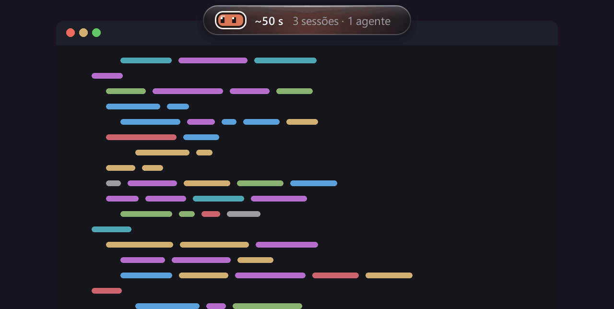
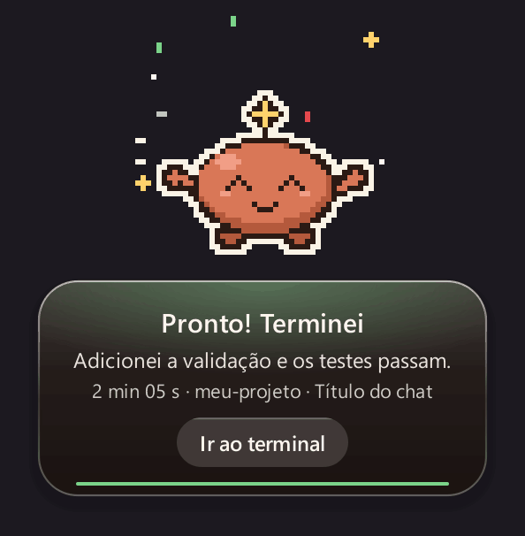
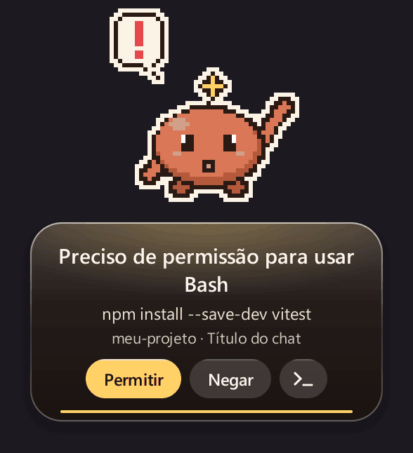
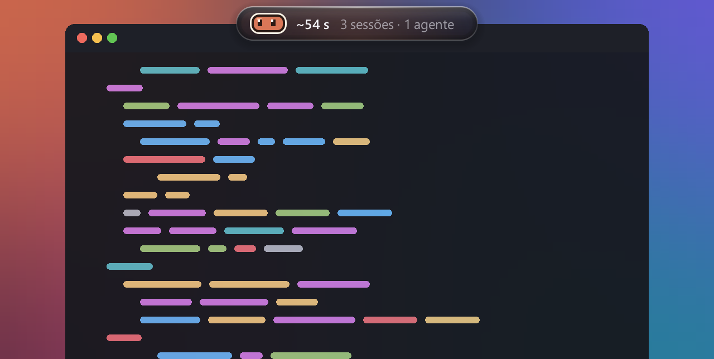
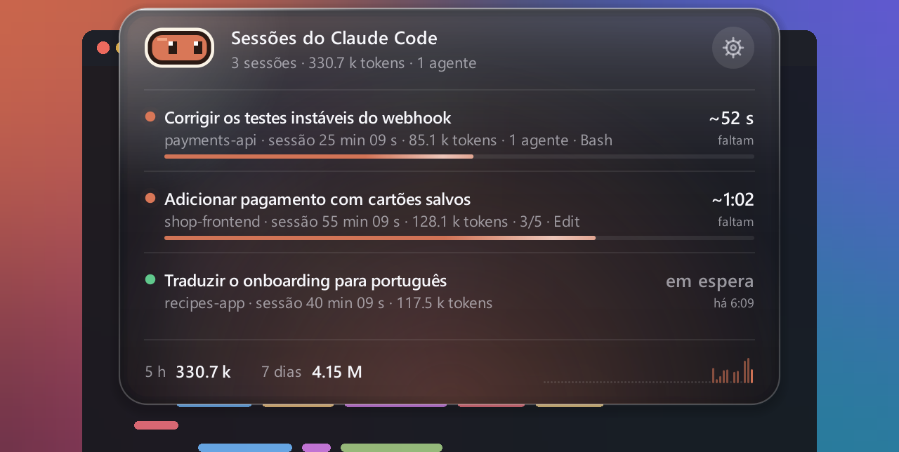
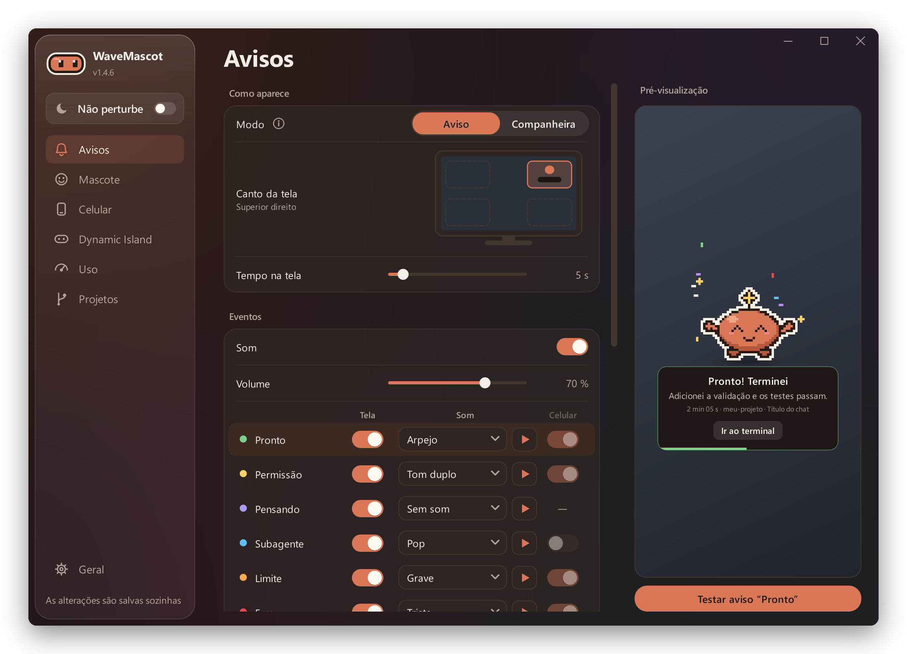
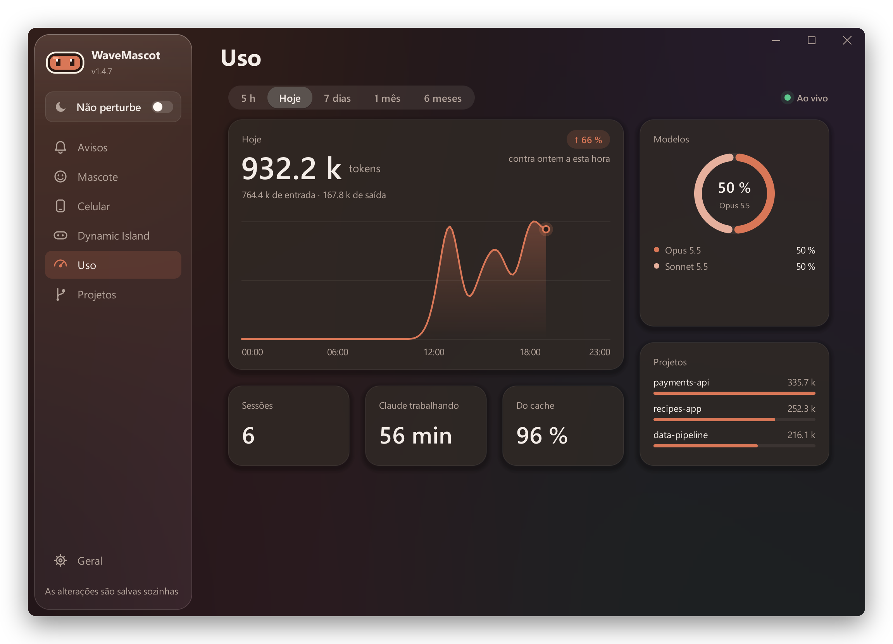
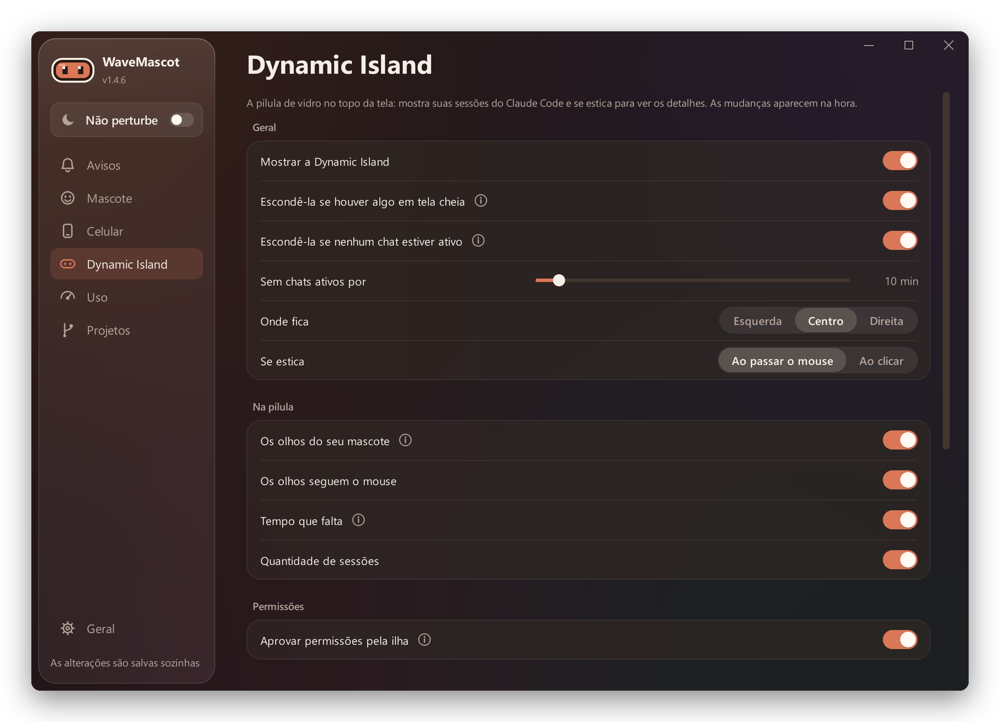
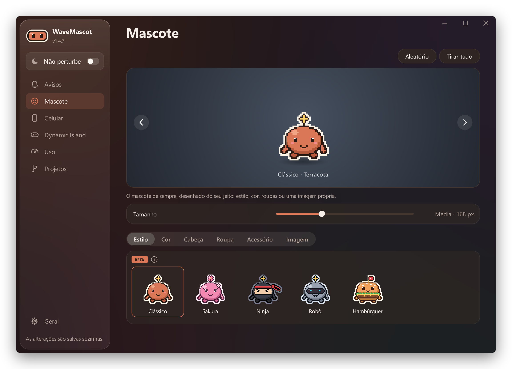
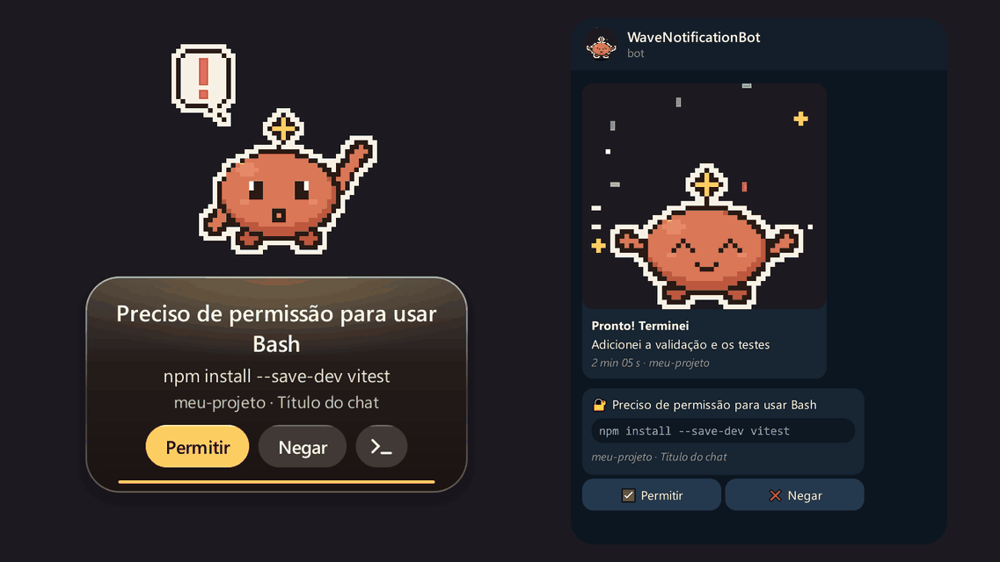

# WaveMascot

**Um mascote em pixel art para o Claude Code.** 
Avisa quando o Claude termina ou precisa de você, mostra cada sessão numa Dynamic Island no topo da tela
e manda mensagem no seu celular quando você não está.

Grátis e open source · Windows 10/11 e macOS 13+ · [English](README.md) · [Español](README.es.md) · **Português**

  

 

[Avisos](#avisos) · [Dynamic Island](#dynamic-island) · [Recursos](#recursos) · [Instalação](#instalação) ·
[Configurações](#configurações) · [Celular](#no-seu-celular) · [Galeria](docs/README.pt.md) ·
[Perguntas](#perguntas-frequentes) · [Mudanças](CHANGELOG.md)

> [!NOTE]
> **Novo na 1.4.0:** a Dynamic Island, as seções Dashboard e Uso, as configurações de vidro (o desfoque real é no
> Windows) e o estilo Hambúrguer. [Ver todas as mudanças →](CHANGELOG.md#140---2026-11-17)

## Avisos

Você pede algo ao Claude Code e vai para outra janela. Quando ele termina, pede permissão ou fica sem uso, **o Wave
aparece pela borda da tela**, diz de qual chat e projeto se trata e vai embora sozinho. Se você não estiver no
computador, ele manda mensagem no seu celular.

<table>
  <tr>
    <td align="center" width="33%">
       
      <b>Sabe quando terminou</b> 
      Chat, projeto, quanto demorou e um resumo de uma linha do que ele fez.
    </td>
    <td align="center" width="33%">
       
      <b>Pergunta antes de agir</b> 
      Permitir ou Negar no próprio aviso, sem voltar ao terminal.
    </td>
    <td align="center" width="33%">
       
      <b>Avisa quando parar</b> 
      O limite de uso e os erros da API têm seu próprio aviso, animação e som.
    </td>
  </tr>
</table>

## Dynamic Island

No topo da tela, no centro, fica uma pequena pílula de vidro com **os olhos do seu mascote**: acordados enquanto o
Claude trabalha, tranquilos enquanto ele espera e dormindo quando não há nada rodando. Ao lado, quanto falta e
quantas sessões estão abertas. Passe o mouse e ela se estica, como um líquido, para mostrar cada sessão.

<table>
  <tr>
    <td width="50%" valign="top">
       
      <b>Num relance</b> 
      Quanto falta para a próxima sessão terminar, quantas sessões e subagentes estão rodando.
    </td>
    <td width="50%" valign="top">
       
      <b>Cada sessão</b> 
      Título, projeto, tokens, o andamento da lista de tarefas, a ferramenta em uso e uma barra de progresso.
      Com um clique você vai para a janela dela.
    </td>
  </tr>
</table>

Embaixo: seus tokens das últimas 5 horas e 7 dias. A engrenagem abre as configurações. Ela se esconde sozinha quando
há algo em tela cheia, e em **Configurações → Dynamic Island** há 15 opções para escolher onde fica, o que mostra e
como se mexe. No Windows o vidro desfoca de verdade o que está atrás.

## Recursos

- **Um aviso para cada momento**: terminou, precisa de permissão, está pensando, um subagente terminou, limite de uso
  e erro da API.
- **Permitir ou negar sem ir ao terminal**, pelos botões do Wave ou pelo celular. Vale a primeira resposta.
- **Dynamic Island**: todas as suas sessões do Claude Code numa pílula de vidro, com quanto falta para cada uma.
- **Uso**: seus tokens numa curva, das últimas 5 horas até 6 meses, com quanto o Claude trabalhou, modelos, projetos
  e acertos de cache. Ao vivo, e lido só do seu computador.
- **O contexto certo**: chat, projeto, quanto demorou e um resumo lido no seu computador. Avisos de várias sessões
  entram na fila.
- **Não atrapalha**: **Não perturbe** com um clique, silêncio automático por horário, e nada sobre apps em tela cheia
  nem se você já está olhando o terminal.
- **Do seu jeito**: cinco estilos (Clássico, Sakura, Ninja, Robô e Hambúrguer), cores, roupas, tema claro ou escuro,
  sua própria imagem e sons.
- **Modo companheira**: o Wave fica pequeno na barra de tarefas ou no Dock, passeia e dorme quando o uso acaba.
- **No seu celular**: [avisos pelo Telegram](#no-seu-celular) com o Wave animado, e Permitir/Negar de onde você
  estiver. Grátis.
- **Sempre atualizado**: o Wave avisa quando há uma versão nova; no Windows ela é instalada com um clique.
- **Inglês, espanhol e português**, vários monitores, Windows e macOS (chip Apple e Intel).

  
   
  Os cinco estilos. Cada um aparece, comemora e vai embora do seu jeito: <a href="docs/README.pt.md#estilos">veja eles em movimento →</a>

## Instalação

Precisa do [Claude Code](https://docs.claude.com/en/docs/claude-code): a CLI, a extensão do editor ou o app de
desktop.

**Windows 10 / 11**

1. Baixe o [`WaveMascot-Setup.exe`](../../releases/latest/download/WaveMascot-Setup.exe).
2. Abra e clique em **Sim**. Não precisa de administrador nem de Python.

Se aparecer o SmartScreen, escolha **Mais informações → Executar assim mesmo**.

**macOS 13 ou mais recente**

1. Baixe o `.dmg` do seu Mac: [chip Apple](../../releases/latest/download/WaveMascot-Mac-AppleSilicon.dmg) ·
   [Intel](../../releases/latest/download/WaveMascot-Mac-Intel.dmg).
2. Arraste o WaveMascot para Aplicativos e abra.

Na primeira vez o macOS pede confirmação porque o app não é notarizado: [veja como](docs/install.pt.md#mac).

Pronto: na próxima vez que o Claude Code terminar, o Wave aparece. Não precisa reiniciar nada. O
[guia de instalação](docs/install.pt.md) explica como instalar pelo código-fonte, o que o instalador muda, como
desinstalar e os problemas frequentes.

## Configurações

Clique no **ícone do Wave** (ao lado do relógio no Windows, na barra de menus no Mac), na engrenagem da Dynamic Island,
ou digite **`/wavemascot`** no Claude Code. Tudo é salvo sozinho, e a pré-visualização mostra cada aviso exatamente
como vai aparecer.

  

<table>
  <tr>
    <td colspan="2" align="center">
       
      <b>Uso</b> 5 horas, hoje, uma semana, um mês ou seis meses, ao vivo.
    </td>
  </tr>
  <tr>
    <td width="50%" align="center">
       
      <b>Dynamic Island</b> Onde fica, os olhos, o que a pílula mostra, desfoque, rebote.
    </td>
    <td width="50%" align="center">
       
      <b>Mascote</b> Estilo, cor, roupas, tamanho ou sua própria imagem.
    </td>
  </tr>
</table>

<b>O que tem em cada seção</b>

 

| Seção | O que você muda |
|---|---|
| **Não perturbe** | O interruptor no topo: silencia todos os avisos até você desligar |
| Avisos | Modo aviso ou companheira, canto, tempo na tela, silêncio automático, e para cada evento: se aparece, o som e se vai para o celular |
| Mascote | Estilo, cor, cabeça, roupa, acessório, tamanho e sua própria imagem |
| Celular | Conectar o Telegram, quando mandar (só se você não estiver), Wave animado, Permitir/Negar pelo celular |
| Dynamic Island | Mostrar, onde fica, abrir ao passar o mouse ou ao clicar, olhos, tempo que falta, sessões à vista, uso de 5 h e 7 dias, desfoque, opacidade, rebote, pulsação |
| Uso | Tokens de 5 horas, hoje, 7 dias, 1 mês ou 6 meses: curva, entrada, saída, sessões, quanto o Claude trabalhou, acertos de cache, modelos e projetos |
| Geral | Idioma, tema (escuro, claro ou destaque), abrir ao iniciar, atualizações |

Tudo fica em `~/.wavemascot/config.json`. Todas as seções estão na [galeria](docs/README.pt.md#configurações).

## No seu celular

Quando você não está no computador, o Wave escreve pelo Telegram a partir do
[@WaveNotificationBot](https://t.me/WaveNotificationBot), e os pedidos de permissão vêm com os botões **Permitir** e
**Negar**, que respondem ao Claude Code na hora. É grátis, como todo o WaveMascot.

  

Abra **Celular** nas configurações, toque em **Conectar com o Telegram** e depois em **Iniciar** no bot. Não há nada
para criar nem colar. Por padrão ele só escreve se você não mexeu no mouse nem no teclado por alguns minutos.

## Privacidade

Tudo roda no seu computador. O resumo, a Dynamic Island e o Uso são lidos localmente dos transcripts que
o Claude Code já guarda no seu disco; são contas feitas com esses arquivos, não os limites oficiais da sua conta. O
WaveMascot só se conecta à internet para procurar no GitHub uma versão nova (no máximo uma vez por dia) e, se você
conectar, para mandar avisos ao Telegram. Dá para desligar as duas coisas.

<b>Como funciona o Telegram</b>

 

A chave do bot fica só num pequeno [Worker da Cloudflare](servidor/) que repassa cada mensagem sem guardá-la, e cada
instalação tem sua própria chave, que só pode escrever para o chat que vinculou. É enviado o que o aviso mostra
(mensagem, resumo, projeto, título do chat, comando a aprovar). Mande `/stop` ao bot ou toque em **Desconectar** para
parar.

## Perguntas frequentes

<b>Como ele sabe o que o Claude Code está fazendo?</b>

 

Pelos [hooks](https://docs.claude.com/en/docs/claude-code/hooks) do Claude Code. O instalador acrescenta algumas
linhas ao `~/.claude/settings.json` (com um backup antes, e sem mexer nas suas), e o Claude Code chama o Wave quando
termina, precisa de algo, um subagente termina ou chega a um limite. Ao desinstalar, só essas linhas são removidas. A
Dynamic Island também lê os transcripts das sessões em `~/.claude/projects`.

<b>Como ele sabe quanto falta?</b>

 

Não dá para saber com certeza, então ele estima: olha seus turnos anteriores parecidos com o atual (mesmo projeto e
sessão, ferramentas usadas até agora, o tamanho da sua mensagem, o andamento da lista de tarefas do Claude) e usa o
que faltava para eles. Quanto mais você usa, melhor fica.

<b>Recebo dois avisos toda vez</b>

 

Desligue as notificações do próprio Claude Code (ou as do seu terminal; no Mac, em **Ajustes do Sistema →
Notificações**), assim só o Wave avisa.

<b>Funciona com a extensão do VS Code ou com o app de desktop?</b>

 

Sim: os hooks são os mesmos na CLI, nas extensões dos editores e no app de desktop. No app de desktop o diálogo de
permissão dele continua aparecendo; vale a primeira resposta.

<b>O Wave não apareceu</b>

 

Veja `~/.wavemascot/mascota.log`: cada evento diz se avisou ou por que não (tela cheia, não perturbe, terminal em
foco, evento desligado…). Ícone do Wave → **Testar aviso** força um. Mais em
[problemas frequentes](docs/install.pt.md#problemas-frequentes).

## Contribuir

Perguntas e ideias vão para as [Discussions](../../discussions) e erros para as [Issues](../../issues/new/choose).
Pull requests são bem-vindos, em português, inglês ou espanhol: veja o [CONTRIBUTING.md](CONTRIBUTING.md). As imagens
do README são desenhadas pelo próprio app com [`tools/capturas.py`](tools/capturas.py), com sessões inventadas no
lugar das suas.

## Licença

[MIT](LICENSE). Os instaladores incluem o PyQt6 (GPL v3) e outras bibliotecas; veja [THIRD_PARTY.md](THIRD_PARTY.md).

O WaveMascot é um projeto não oficial: não é feito, endossado nem mantido pela Anthropic. O mascote, o ícone e os
sons são originais e gerados por código.
