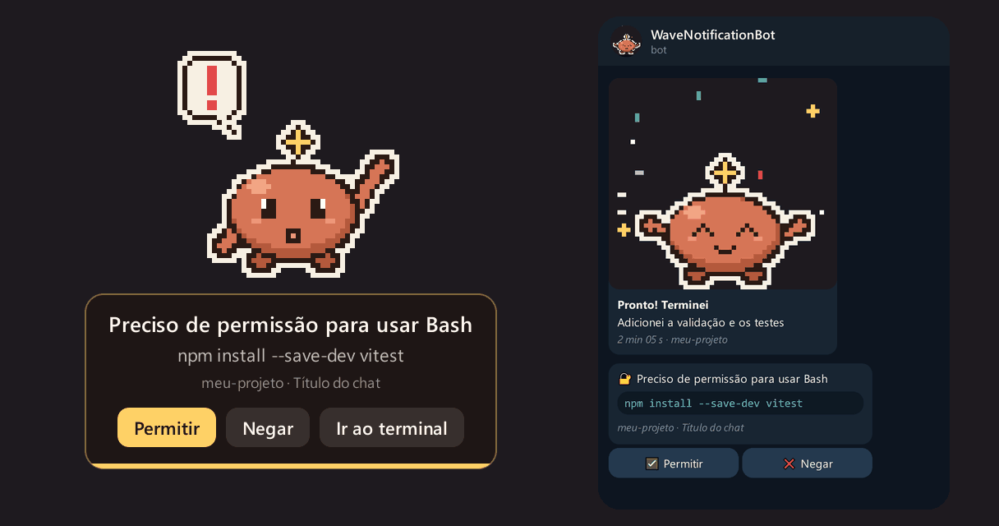
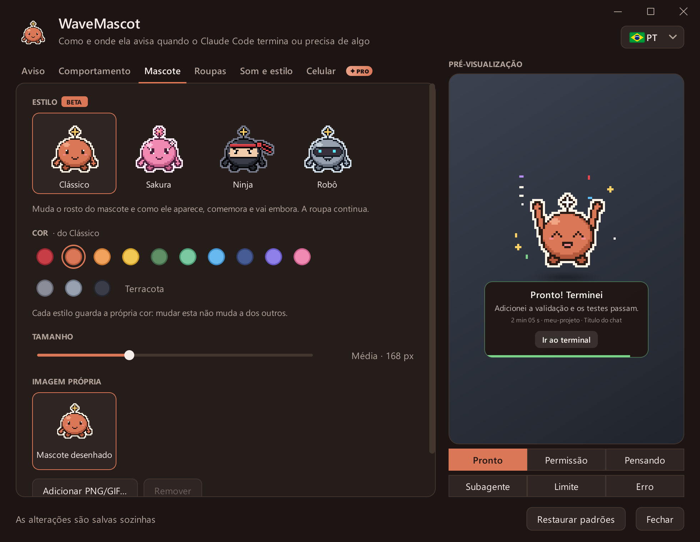

[English](README.md) · [Español](README.es.md) · **Português**

 

# WaveMascot

**Um mascote de desktop em pixel art que avisa quando o Claude Code termina, ou precisa de você.**

 

Wave aparece pela borda da tela quando o **Claude Code** termina, pede permissão ou fica sem uso, diz de qual chat e
projeto se trata e vai embora sozinho. Se você não estiver no computador, ele manda mensagem no seu celular pelo
Telegram, e de lá você pode **permitir ou negar**.

## O que faz

- **Um aviso para cada momento**: terminou, precisa de permissão, está pensando, um subagente terminou, limite de uso
  e erros da API, cada um com sua animação e seu som.
- **Permitir ou negar sem ir ao terminal**, pelos botões do Wave ou pelo celular.
- **O contexto certo**: chat, projeto, quanto demorou e um resumo de uma linha. Avisos de várias sessões entram na fila.
- **Não atrapalha**: horário de não perturbe, nada sobre apps em tela cheia nem se você já está olhando o terminal.
- **Do seu jeito**: quatro estilos (Clássico, Sakura, Ninja, Robô), cores, roupas, sua própria imagem e sons.
- **Modo companheira**: o Wave fica pequeno na barra de tarefas ou no Dock, passeia e dorme quando o uso acaba.
- **Inglês, espanhol e português**, vários monitores e atualizações automáticas no Windows.

  
   
  <a href="docs/README.pt.md"><b>Ver a galeria →</b></a>

## Instalação

Precisa do [Claude Code](https://docs.claude.com/en/docs/claude-code) (CLI, extensão ou app de desktop).

**Windows 10 / 11**: baixe o [`WaveMascot-Setup.exe`](../../releases/latest/download/WaveMascot-Setup.exe), abra e
clique em **Sim**. Não precisa de administrador nem de Python. Se aparecer o SmartScreen, escolha
**Mais informações → Executar assim mesmo**.

**macOS 13 ou mais recente**: baixe o `.dmg` do seu Mac
([chip Apple](../../releases/latest/download/WaveMascot-Mac-AppleSilicon.dmg) ·
[Intel](../../releases/latest/download/WaveMascot-Mac-Intel.dmg)), arraste o WaveMascot para Aplicativos e abra. Na
primeira vez o macOS pede confirmação porque o app não é notarizado: [veja como](docs/install.pt.md#mac).

Pronto: na próxima vez que o Claude Code terminar, o Wave aparece. Não precisa reiniciar nada.

O [guia de instalação](docs/install.pt.md) explica como instalar pelo código-fonte, o que o instalador muda, como
desinstalar e os problemas frequentes.

## Configurações

Clique no **ícone do Wave** (ao lado do relógio no Windows, na barra de menus no Mac) ou digite **`/wavemascot`** no
Claude Code. As mudanças são salvas sozinhas e a pré-visualização mostra o aviso exatamente como vai aparecer.

  

<b>O que tem em cada aba</b>

| Aba | O que você muda |
|---|---|
| Aviso | Canto, tempo na tela, o que o aviso mostra e as mensagens |
| Comportamento | Modo aviso ou companheira, quais eventos avisam, não perturbe, duração mínima, Permitir/Negar |
| Mascote | Estilo, cor, tom de pele, tamanho e sua própria imagem |
| Roupas | Cabeça, roupas e acessórios |
| Som e estilo | Volume, som por evento, tema, ícone ao lado do relógio, atualizações |
| Celular | Telegram: quando mandar, quais avisos, Permitir/Negar pelo celular |

Tudo fica em `~/.wavemascot/config.json`. Dica: desligue as notificações do próprio Claude Code para não receber duas.

## No seu celular

Abra a aba **Celular**, toque em **Conectar com o Telegram** e depois em **Começar** no chat com o
[@WaveNotificationBot](https://t.me/WaveNotificationBot). Não há nada para criar nem colar.

Por padrão ele só escreve se faz 3 minutos que você não está no computador. Pedidos de permissão chegam com
**Permitir** e **Negar**, e vale a primeira resposta: o celular, o Wave ou o terminal.

## Privacidade

Tudo roda no seu computador. O resumo é lido localmente do transcript que o Claude Code já guarda no seu disco. O
WaveMascot só se conecta à internet para procurar no GitHub uma versão nova (no máximo uma vez por dia) e, se você
conectar, para mandar avisos ao Telegram. Dá para desligar as duas coisas.

No Telegram, a chave do bot fica só num pequeno [Worker da Cloudflare](servidor/) que repassa cada mensagem sem
guardá-la, e cada instalação tem sua própria chave, que só pode escrever para o chat que vinculou. É enviado o que o
aviso mostra (mensagem, resumo, projeto, título do chat, comando a aprovar). Mande `/stop` ao bot ou toque em
**Desconectar** para parar.

## Contribuir

Perguntas e ideias vão para as [Discussions](../../discussions) e erros para as [Issues](../../issues/new/choose).
Pull requests são bem-vindos, em português, inglês ou espanhol: veja o [CONTRIBUTING.md](CONTRIBUTING.md).

## Licença

[MIT](LICENSE). Os instaladores incluem o PyQt6 (GPL v3) e outras bibliotecas; veja [THIRD_PARTY.md](THIRD_PARTY.md).

O WaveMascot é um projeto não oficial: não é feito, endossado nem mantido pela Anthropic. O mascote, o ícone e os
sons são originais e gerados por código.
