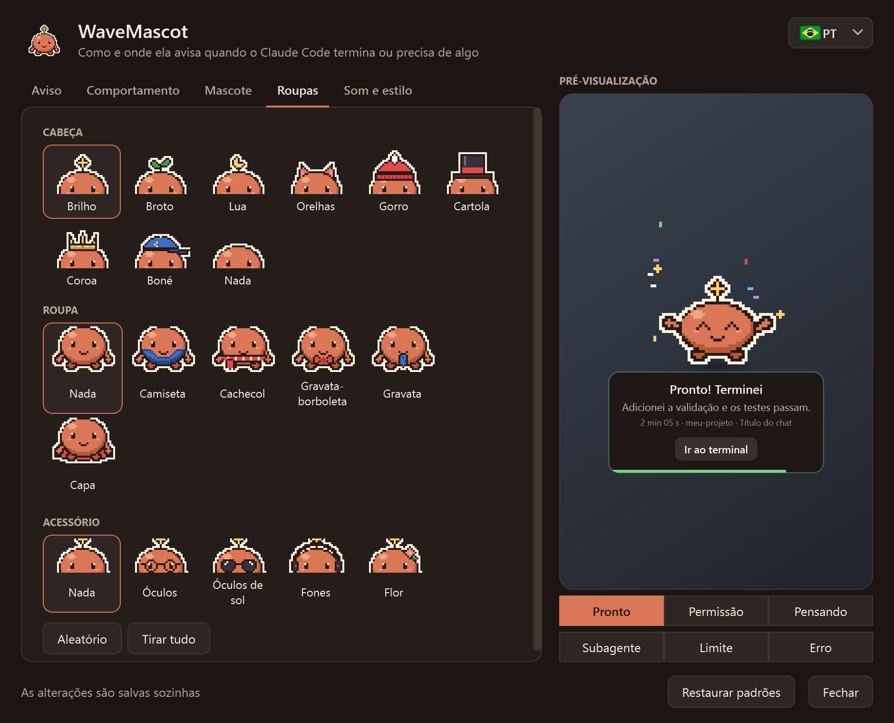

# WaveMascot

[English](README.md) · [Español](README.es.md) · **Português**

<p align="center">
  
</p>

**Wave** é um mascote de área de trabalho em pixel art para Windows e macOS que avisa quando o **Claude Code**
termina, precisa da sua permissão ou fica sem uso disponível, no lugar da notificação do sistema. Ele aparece pela
borda da tela, diz de qual chat e projeto vem o aviso e vai embora sozinho.

<p align="center">
  <a href="../../releases/latest/download/WaveMascot-Setup.exe"><b>⬇ Baixar para Windows</b></a>
  &nbsp;·&nbsp; <a href="../../releases/latest/download/WaveMascot-Mac-AppleSilicon.dmg"><b>⬇ Mac (chip Apple)</b></a>
  &nbsp;·&nbsp; <a href="../../releases/latest/download/WaveMascot-Mac-Intel.dmg"><b>⬇ Mac (Intel)</b></a>
  <br>
  <a href="#instalação">Instalação</a>
  &nbsp;·&nbsp; <a href="../../discussions">Perguntas e ideias</a>
  &nbsp;·&nbsp; <a href="../../issues/new/choose">Relatar um problema</a>
</p>

> **Projeto não oficial.** Não é feito, endossado nem mantido pela Anthropic. Não usa logos, imagens, sons nem nenhum
> outro asset da Anthropic: o mascote, o ícone e os sons são originais e gerados por código
> (veja [THIRD_PARTY.md](THIRD_PARTY.md)).
>
> **Tudo roda no seu computador.** O mascote não se conecta à internet nem envia dados para lugar nenhum. O resumo da
> última mensagem é montado lendo localmente o transcript que o Claude Code já guarda no seu disco, e não sai dali.

## O que faz

- **Avisa quando o Claude termina** (`pronto`), **pede permissão**, está **pensando**, um **subagente** terminou,
  você chegou ao **limite de uso** ou houve um **erro**: cada estado tem sua animação e seu som.
- **Permitir / Negar pelo mascote** (hook `PermissionRequest`): responda sem ir ao terminal. Se você não escolher a
  tempo, decide o diálogo de sempre.
- **Mostra o contexto certo**: título do chat, projeto, quanto demorou e um resumo curto da resposta.
  Com **várias sessões ao mesmo tempo**, cada aviso diz de qual projeto vem e os avisos entram na fila em vez de se
  sobrepor.
- **Não incomoda**: horário de não perturbe, nada sobre aplicativos em tela cheia, nada se você já está olhando o
  terminal, duração mínima e silêncio rápido pelo ícone dele (ao lado do relógio no Windows, na barra de menus no
  Mac).
- **Modo companheira**: em vez de aparecer e sumir, fica pequena sobre a barra de tarefas (ou o Dock), passeia um
  pouco e dorme quando o uso acaba, até ser renovado.
- **Personalizável**: cores, chapéus, roupas e acessórios, sua própria imagem (PNG/GIF), tamanho, canto, temas
  escuro/claro/destaque e um som por evento.
- **No seu idioma**: inglês, espanhol e português. Vem em inglês; mude com a bandeirinha no topo das configurações.
- **Vários monitores**: o aviso aparece no monitor onde está a janela do Claude Code.
- **Nunca atrasa o Claude Code**: o hook volta em milissegundos, nunca sai com erro e, se algo falhar (sem áudio,
  configuração quebrada, sem tela), registra no log e segue.

## Instalação

Você precisa do [Claude Code](https://docs.claude.com/en/docs/claude-code) (CLI, extensão ou app de desktop) e do
Windows 10 ou 11, ou do macOS 13 (Ventura) ou mais recente.

### Windows

#### Opção A: instalador (recomendada, não precisa de Python)

1. **[Baixe o `WaveMascot-Setup.exe`](../../releases/latest/download/WaveMascot-Setup.exe)** (sempre a última
   versão; também está em [Releases](../../releases/latest)).
2. Abra e clique em **Sim**. Ele é instalado em `%LOCALAPPDATA%\Programs\WaveMascot`, sem permissões de
   administrador.
3. Pronto: na próxima vez que o Claude Code terminar, o mascote aparece. Se o Claude Code já estava aberto, não precisa
   reiniciá-lo. Para usar em português, abra as configurações e escolha a bandeirinha.

> O Windows SmartScreen pode mostrar "O Windows protegeu o computador". Escolha **Mais informações → Executar assim
> mesmo**, ou use a opção B se preferir instalar pelo código-fonte. Você pode verificar o arquivo com o
> `SHA256SUMS.txt` do release.

#### Opção B: pelo código-fonte (Python 3.10 ou mais recente)

1. Baixe o código: [ZIP](../../archive/refs/heads/main.zip) (descompacte) ou
   `git clone https://github.com/Marescaa/wavemascot.git`.
2. Abra o PowerShell nessa pasta e execute:

   ```powershell
   powershell -ExecutionPolicy Bypass -File .\install.ps1
   ```

O `install.ps1` instala PyQt6 e Pillow só se estiverem faltando. Opções: `-Python <caminho do python.exe>`,
`-Destination <pasta>`, `-NoStartup` (sem ícone ao iniciar o Windows).

### Mac

#### Opção A: o app (recomendada, não precisa de Python)

Você precisa do macOS 13 (Ventura) ou mais recente, em qualquer Mac.

1. **Baixe o arquivo do seu Mac.** Para saber qual: menu Apple → **Sobre Este Mac**.
   - Diz **Chip: Apple M1, M2, M3, M4…** → **[`WaveMascot-Mac-AppleSilicon.dmg`](../../releases/latest/download/WaveMascot-Mac-AppleSilicon.dmg)**
   - Diz **Processador: Intel** → **[`WaveMascot-Mac-Intel.dmg`](../../releases/latest/download/WaveMascot-Mac-Intel.dmg)**
2. **Abra o `.dmg`** (clique duas vezes em Downloads). Abre uma janela com o WaveMascot e a pasta Aplicativos:
   **arraste o WaveMascot para Aplicativos**. Depois você pode ejetar o disco WaveMascot na barra lateral do Finder.
3. **Abra o WaveMascot** em Aplicativos (ou pelo Spotlight: <kbd>⌘</kbd> <kbd>Espaço</kbd> e digite *WaveMascot*).
   Na primeira vez o macOS o bloqueia porque o app não é notarizado pela Apple (isso exige uma conta paga de
   desenvolvedor):
   - **macOS 15 (Sequoia) ou mais recente**: aparece *"A Apple não pôde verificar se o 'WaveMascot' está livre de
     malware…"*. Clique em **OK**, abra **Ajustes do Sistema → Privacidade e Segurança**, role até **Segurança** e
     clique em **Abrir Mesmo Assim** ao lado de *"O 'WaveMascot' foi bloqueado…"*. Confirme com **Abrir Mesmo Assim**
     e sua senha ou Touch ID.
   - **macOS 13 ou 14**: clique com o botão direito (ou <kbd>Control</kbd> + clique) no WaveMascot em Aplicativos →
     **Abrir**, e **Abrir** de novo.

   Só é preciso uma vez; as atualizações e os hooks não pedem de novo.
4. O WaveMascot pergunta **"Instalar o WaveMascot?"**: clique em **Sim**. Ele se conecta ao Claude Code e conta
   o que fez.
5. Pronto: o ícone do Wave aparece na **barra de menus** (no canto superior direito). Clique nele → **Testar aviso**
   para vê-lo. A partir de agora ele aparece sempre que o Claude Code termina ou precisa de algo, no terminal, no
   VS Code ou no app do Claude. Se o Claude Code já estava aberto, não precisa reiniciá-lo. Para usar em português,
   abra as configurações e escolha a bandeirinha.

Bom saber:

- **Não pede nenhuma permissão** (nem Acessibilidade, nem Gravação de Tela, nem notificações).
- Se você abri-lo direto do `.dmg` sem arrastar, ele se copia sozinho para Aplicativos.
- **Configurações**: ícone da barra de menus → **Abrir configurações**, `/wavemascot` no Claude Code, ou abrindo o
  WaveMascot de novo em Aplicativos.
- **Atualizar**: baixe o `.dmg` novo, arraste o WaveMascot para Aplicativos (**Substituir**) e abra-o uma vez.
- Na primeira vez o macOS mostra *"Itens em Segundo Plano Adicionados"*: é o ícone da barra de menus que abre ao
  iniciar a sessão. Dá para desligar nas configurações do WaveMascot ou em **Ajustes do Sistema → Geral → Itens de
  Início**.
- Para verificar o download: `shasum -a 256 ~/Downloads/WaveMascot-Mac-*.dmg` deve coincidir com o
  `SHA256SUMS.txt` do release.

#### Opção B: pelo código-fonte (Python 3.10 ou mais recente)

```bash
git clone https://github.com/Marescaa/wavemascot.git
cd wavemascot
./install.sh
```

O `install.sh` cria um ambiente Python próprio com PyQt6 e Pillow (o seu Python não é alterado). Opções:
`--python <caminho do python3>`, `--destination <pasta>`, `--no-startup` (sem ícone na barra de menus ao iniciar a
sessão).

### O que o instalador faz no seu computador

- **Copia o programa** para `%LOCALAPPDATA%\Programs\WaveMascot` (Windows) ou deixa o app em **Aplicativos** (Mac;
  se você abri-lo direto do `.dmg`, ele se copia para lá sozinho).
- **Conecta o Wave ao Claude Code**: adiciona algumas linhas (os *hooks*) em `~/.claude/settings.json` para que o
  Claude Code o chame quando termina ou precisa de algo. O que você já tinha nesse arquivo não é alterado, e antes de
  mudá-lo é salva uma cópia de segurança.
- **Cria o comando `/wavemascot`**, que abre as configurações pelo Claude Code.
- **Coloca o ícone do Wave ao lado do relógio** (Windows) ou **na barra de menus** (Mac, como item de início) toda vez
  que você liga o computador.

Não pede permissões de administrador e, se você desinstalar, tudo volta a ficar como estava.

## Configurações

Abra as configurações clicando no **ícone do Wave** (ao lado do relógio no Windows, na barra de menus no Mac), com
**`/wavemascot`** no Claude Code ou, no Mac, abrindo o WaveMascot em Aplicativos. As alterações são salvas sozinhas e
valem a partir do próximo aviso; a pré-visualização mostra como vai ficar. A **bandeirinha** no canto superior direito
muda o idioma.

<p align="center">
  
</p>

| Aba | O que dá para ajustar |
|---|---|
| Aviso | Canto, tempo na tela, o que mostrar no aviso (resumo, chat, projeto, duração) e as mensagens |
| Comportamento | Modo aviso ou companheira (passeios, animações em repouso, olhar), quais eventos avisam, não perturbe (horário, tela cheia, terminal em foco), duração mínima, Permitir/Negar pelo mascote |
| Mascote | Cor, tamanho e imagem própria |
| Roupas | Cabeça, roupa e acessórios (ou aleatório) |
| Som e estilo | Volume, som de cada evento, tema escuro / claro / destaque, ícone ao lado do relógio / na barra de menus |

Tudo fica em `~/.wavemascot/config.json`. Se o arquivo não existir ou tiver um erro, o mascote usa os valores
padrão. Pelo ícone do Wave você também pode silenciar os avisos por uma hora ou até reativá-los.

> Para que o mascote substitua a notificação do sistema, desative as notificações do próprio Claude Code (nas
> configurações do app de desktop ou do seu terminal), assim você não recebe dois avisos.

## Desinstalação

- **Windows, instalado com o `.exe`**: menu Iniciar → *WaveMascot* → **Desinstalar WaveMascot**.
- **Windows, instalado com o `install.ps1`** (ou de qualquer forma):

  ```powershell
  powershell -ExecutionPolicy Bypass -File .\uninstall.ps1
  ```

- **Mac**: ícone do Wave na barra de menus → **Desinstalar WaveMascot…** (ou `./uninstall.sh`, de qualquer forma). Se
  você só arrastar o app para o Lixo, o Claude Code continua funcionando normalmente: os hooks não fazem nada enquanto
  o app não estiver lá.

A desinstalação fecha o mascote, remove **só os hooks dele** de `~/.claude/settings.json` (com backup antes; os seus
ficam exatamente como estavam) e apaga o `/wavemascot`, os atalhos e o programa. Suas configurações em
`~/.wavemascot` são mantidas; para apagá-las também: `uninstall.ps1 -DeleteSettings` ou
`uninstall.sh --delete-settings`.

## Problemas frequentes

- **Não aparece**: veja `~/.wavemascot/mascota.log`; cada evento diz se avisou ou por que não (tela cheia, não
  perturbe, terminal em foco, evento desligado...). Ícone do Wave → *Testar aviso* força um.
- **Os hooks não rodam**: confira no Claude Code com `/hooks` se os do mascote estão lá.
- **Permitir/Negar**: no app de desktop o diálogo próprio continua aparecendo; vale a primeira resposta.
- **Mac: "Não é possível abrir o WaveMascot" ou "A Apple não pôde verificar…"**: veja o passo 3 de
  [Instalação → Mac](#mac).
- **Mac: não vejo o ícone na barra de menus**: nos Macs com notch, os ícones que não cabem ficam escondidos; feche
  algum outro app da barra ou abra as configurações com `/wavemascot`. Se você o fechou, abra o WaveMascot em
  Aplicativos.
- **Mac: recebo dois avisos**: desligue as notificações do seu terminal ou do app do Claude em **Ajustes do Sistema →
  Notificações**, assim só o Wave avisa.

## Perguntas, ideias e relatos

- **Tem uma pergunta ou uma ideia?** Escreva em [Discussions](../../discussions): lá se conversa, se propõem roupas
  ou estados novos e se compartilham configurações.
- **Algo não funciona?** Abra uma [issue](../../issues/new/choose) com o modelo de erro (inclua as últimas linhas do
  log, sem dados privados).
- **Quer propor algo concreto?** Use o modelo de ideia em [issues](../../issues/new/choose).

Pode escrever em português, inglês ou espanhol. Pull requests são bem-vindos: antes de enviar um, rode os testes
(`python -m unittest discover tests`).

## Desenvolvimento

```powershell
python -m unittest discover tests          # testes do instalador (merge de hooks), das traduções e dos sistemas
powershell -ExecutionPolicy Bypass -File .\build.ps1   # gera dist\WaveMascot-Setup.exe (no Windows)
./build-mac.sh                             # gera dist/WaveMascot-Mac-<chip>.dmg (num Mac)
```

Ao enviar uma tag `v*` (por exemplo `v1.2.0`), o GitHub Actions gera o instalador do Windows e os dois `.dmg` do Mac e
os anexa ao release. Cada push para a `main` roda os testes no Windows e no macOS.

| Arquivo | O que é |
|---|---|
| `mascota.py` | O hook e a janela do mascote |
| `ajustes.py` | A janela de configurações |
| `bandeja.py` | O ícone ao lado do relógio / na barra de menus |
| `sprites.py` | O pixel art, os ícones e os sons (tudo gerado por código) |
| `idiomas.py` | Os textos em inglês, espanhol e português |
| `ventanas.py` | Janelas do Windows e do macOS: terminal anfitrião, foco, tela cheia, monitores |
| `instalador.py` | Instalar / desinstalar (merge de hooks com backup); também é o instalador `.exe` e a primeira abertura do app do Mac |
| `principal.py` | Ponto de entrada do `WaveMascot.exe` e do `WaveMascot.app` |

**Adicionar um idioma**: inclua-o em `IDIOMAS` no `idiomas.py` com uma tradução por texto; o `tests/test_idiomas.py`
avisa se faltar alguma.

## Licença

[MIT](LICENSE). O `.exe` e o app do Mac incluem PyQt6 (GPL v3) e outras bibliotecas; veja
[THIRD_PARTY.md](THIRD_PARTY.md).
