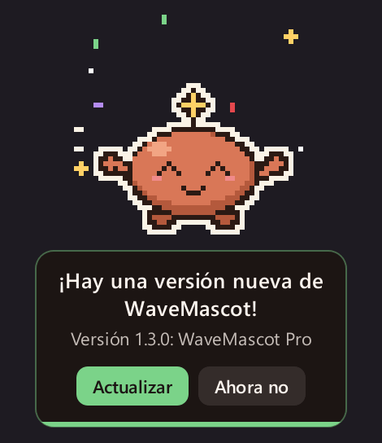
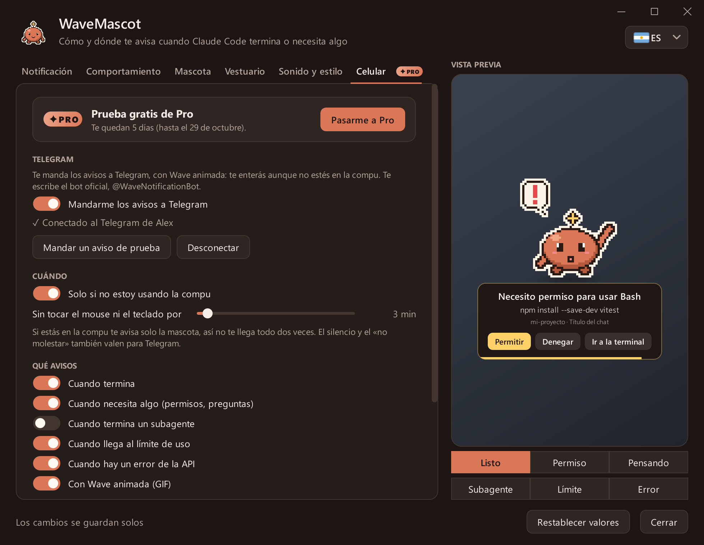
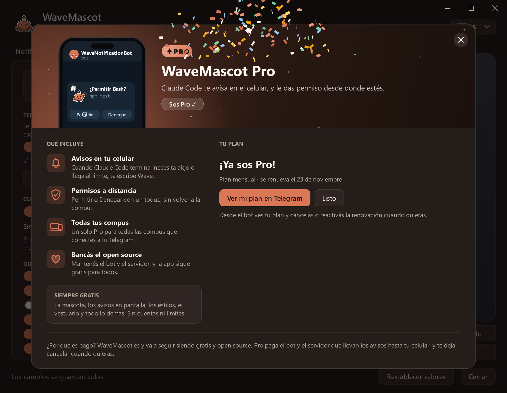
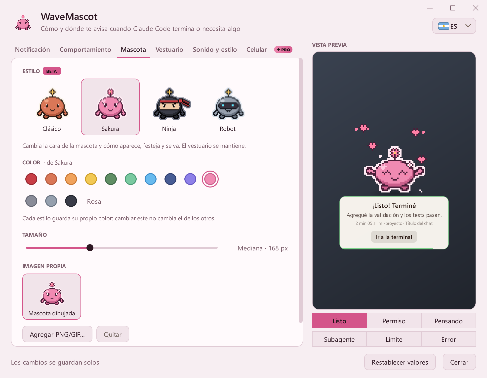

# Galería

[← Volver al README](../README.es.md) · [English](README.md) · **Español** · [Português](README.pt.md)

Todo lo de acá lo dibuja la app misma ([`tools/capturas.py`](../tools/capturas.py)): el pixel art, el aviso y la
ventana de ajustes reales.

**Contenido:** [Avisos](#avisos) · [Estilos](#estilos) · [Vestuario](#vestuario) · [En tu celular](#en-tu-celular) ·
[WaveMascot Pro](#wavemascot-pro) · [Ajustes](#ajustes) · [Tema claro](#tema-claro)

## Avisos

Cada estado tiene su animación, su sonido y sus botones.

| | | |
|:---:|:---:|:---:|
|  **Listo** |  **Necesita permiso** |  **Pensando** |
|  **Subagente** |  **Límite de uso** |  **Error** |

### Aviso de versión nueva

Cuando sale una versión nueva, Wave te lo dice una vez. En Windows, **Actualizar** la baja, la verifica y la instala
sin tocar tus ajustes; en Mac abre la página de descarga.

### Todos los estados juntos

## Estilos

El estilo cambia la cara de Wave y cómo aparece, festeja y se va.

| | |
|:---:|:---:|
|  **Clásico**: se desliza desde el borde |  **Sakura**: llega flotando entre pétalos |
|  **Ninja**: llega rodando escondido en humo |  **Robot**: llega volando con botas cohete |

## Vestuario

Las cabezas, la ropa y los accesorios funcionan con todos los estilos.

## En tu celular

Con [WaveMascot Pro](#wavemascot-pro), los avisos llegan a Telegram con Wave animada, y los pedidos de permiso traen
**Permitir** y **Denegar**.

Ilustración: el aspecto de Telegram está recreado; el GIF de Wave y los textos son los reales.

## WaveMascot Pro

Tocá el cartel **PRO** de la pestaña Celular y se abre la guía: qué incluye, qué sigue gratis y tres pasos para
desbloquearlo. Se da cuenta sola cuando llega el pago.

| | |
|:---:|:---:|
|  **Antes de conectar**: probalo gratis 7 días |  **Durante la prueba**: los días que quedan y todas las opciones |
|  **Después de pagar**: tu plan, con papelitos | |

## Ajustes

| | |
|:---:|:---:|
|  **Aviso** |  **Comportamiento** |
|  **Mascota** |  **Vestuario** |
|  **Sonido y estilo** |  **Celular** |

## Tema claro

Elegí tema claro u oscuro en **Sonido y estilo**: lo usan el aviso y la ventana de ajustes, teñidos con el color de tu
estilo.

