# Galería

[← Volver al README](../README.es.md) · [English](README.md) · **Español** · [Português](README.pt.md)

Todo lo de acá lo dibuja la app misma ([`tools/capturas.py`](../tools/capturas.py)): el pixel art, el aviso, la
Dynamic Island y la ventana de ajustes reales. Las sesiones y los números de uso son inventados.

**Contenido:** [Avisos](#avisos) · [Dynamic Island](#dynamic-island) · [Estilos](#estilos) · [Vestuario](#vestuario) ·
[En tu celular](#en-tu-celular) · [Conectar Telegram](#conectar-telegram) · [Ajustes](#ajustes) ·
[Tema claro](#tema-claro)

## Avisos

Cada estado tiene su animación, su sonido y sus botones.

| | | |
|:---:|:---:|:---:|
| 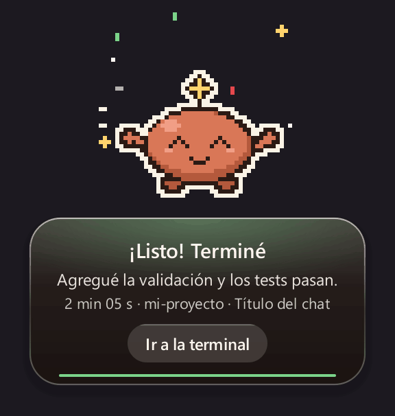 **Listo** | 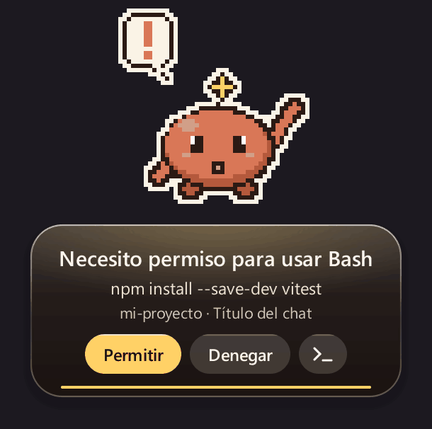 **Necesita permiso** |  **Pensando** |
| 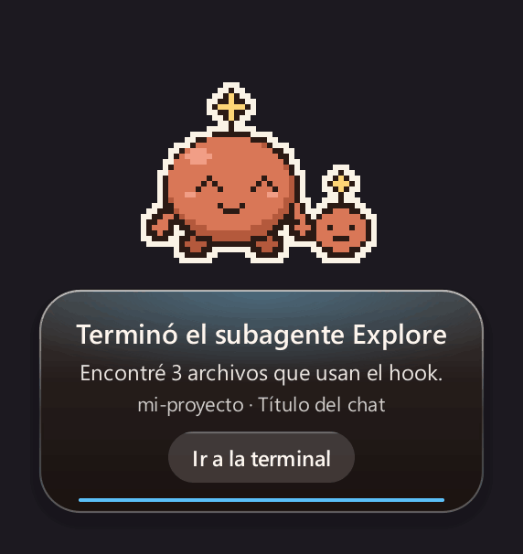 **Subagente** | 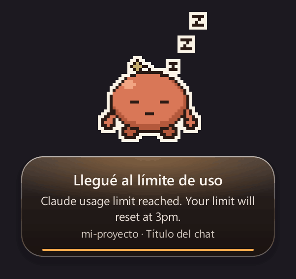 **Límite de uso** | 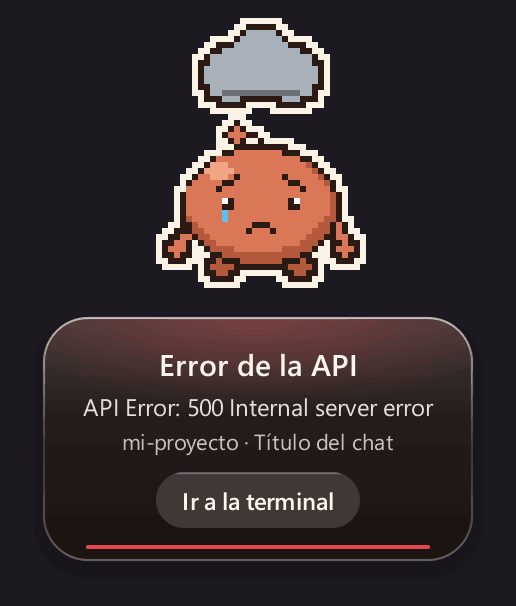 **Error** |

### Aviso de versión nueva

Cuando sale una versión nueva, Wave te lo dice una vez. En Windows, **Actualizar** la baja, la verifica y la instala
sin tocar tus ajustes; en Mac abre la página de descarga.

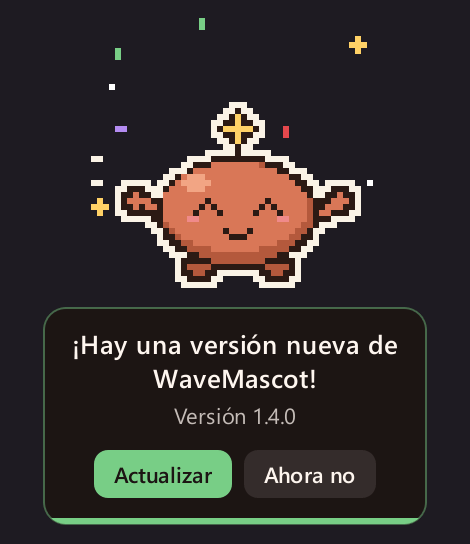

### Todos los estados juntos

## Dynamic Island

La pastilla de vidrio de arriba de la pantalla. Le pasás el mouse y se estira con todas las sesiones de Claude Code.

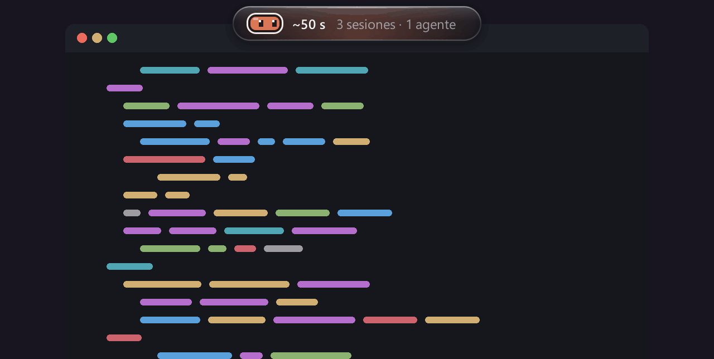

| | |
|:---:|:---:|
| 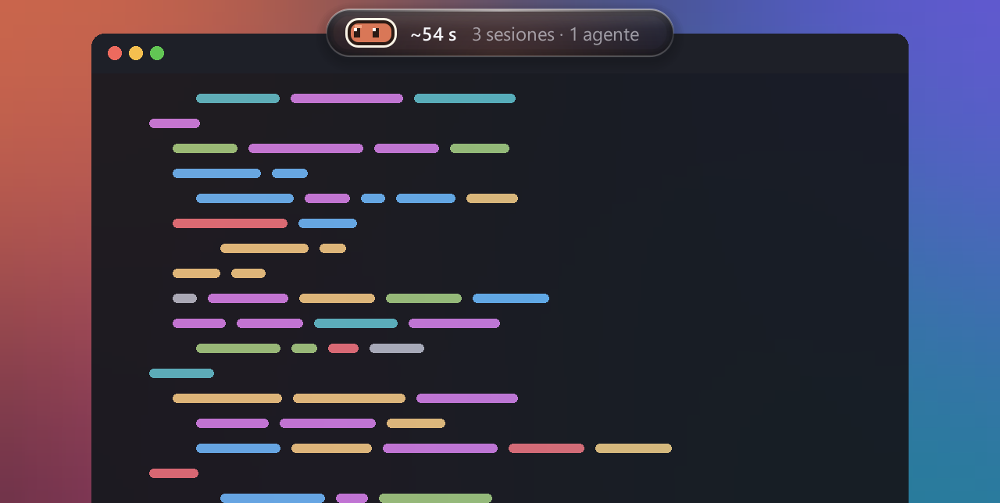 **Cerrada**: los ojos, lo que falta, sesiones y agentes | 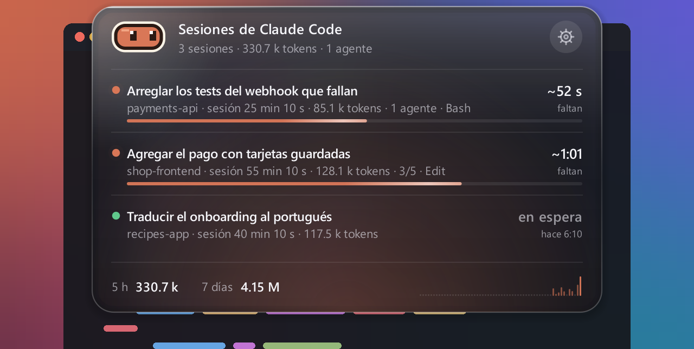 **Abierta**: cada sesión, cómo va y tu uso |

El escritorio de atrás, el desenfoque y las sesiones son inventados para la imagen; la isla es la real, dibujada por la app. En Windows el desenfoque es real; en Mac el vidrio es teñido.

## Estilos

El estilo cambia la cara de Wave y cómo aparece, festeja y se va.

| | |
|:---:|:---:|
| 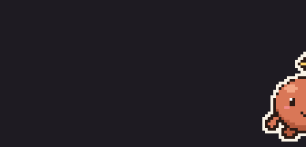 **Clásico**: se desliza desde el borde |  **Sakura**: llega flotando entre pétalos |
| 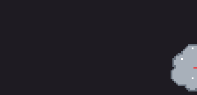 **Ninja**: llega rodando escondido en humo | 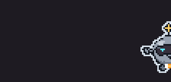 **Robot**: llega volando con botas cohete |
| 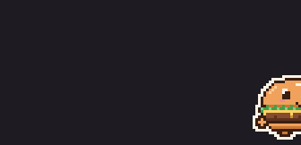 **Hamburguesa** (nueva): llega dando saltitos, con la tapa del pan rebotando | |

## Vestuario

Las cabezas, la ropa y los accesorios funcionan con todos los estilos.

## En tu celular

Los avisos llegan a Telegram con Wave animada, y los pedidos de permiso traen **Permitir** y **Denegar**. Gratis
para todos.

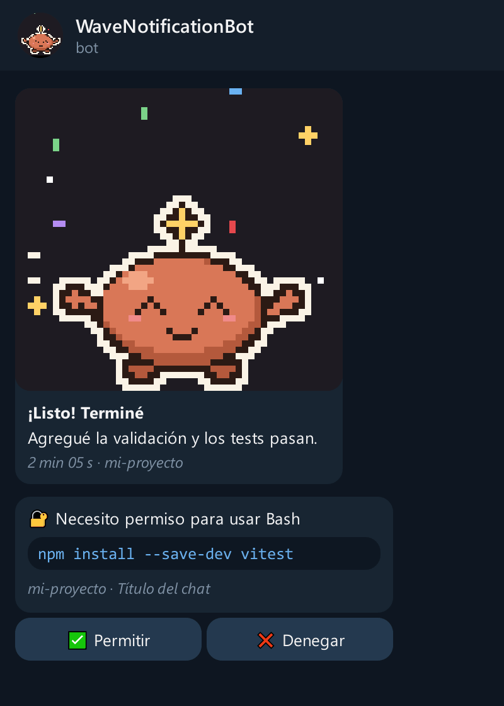

Ilustración: el aspecto de Telegram está recreado; el GIF de Wave y los textos son los reales.

## Conectar Telegram

| | |
|:---:|:---:|
| 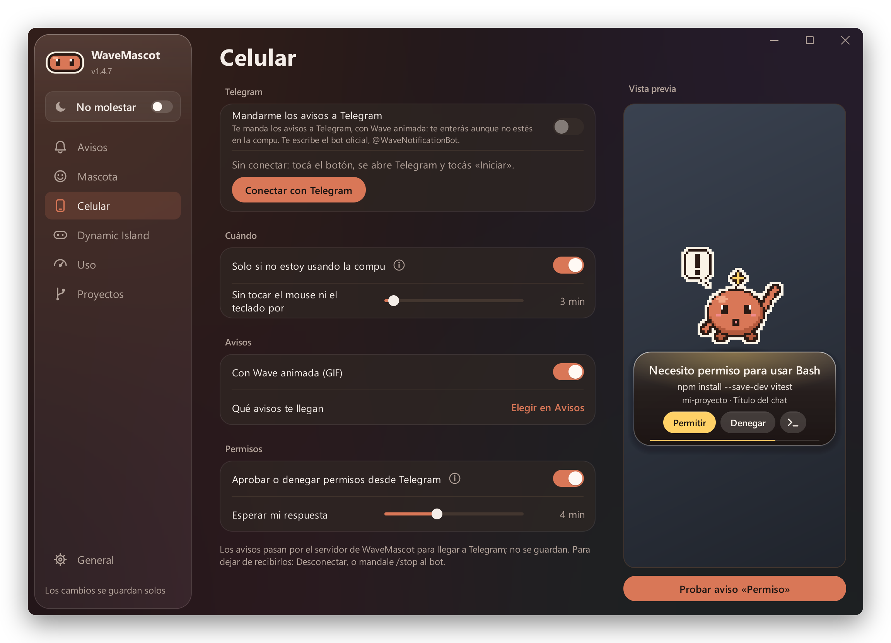 **Antes de conectar**: un botón y tocás Iniciar en el bot | 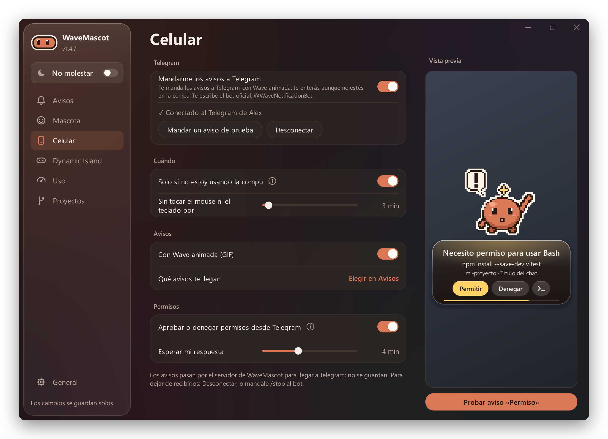 **Conectado**: cuándo mandar, qué avisos, Permitir/Denegar |

## Ajustes

| | |
|:---:|:---:|
| 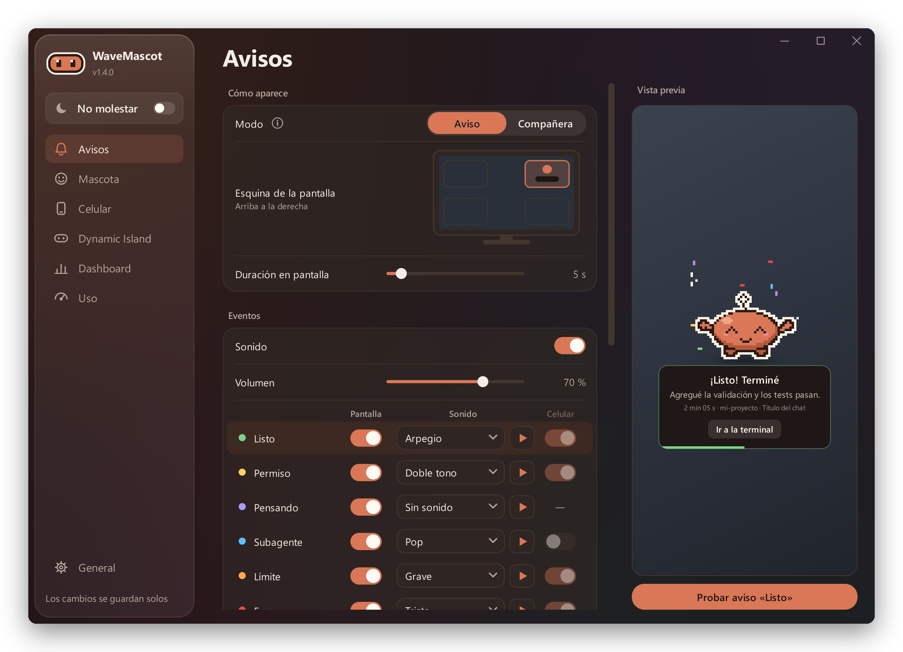 **Avisos** | 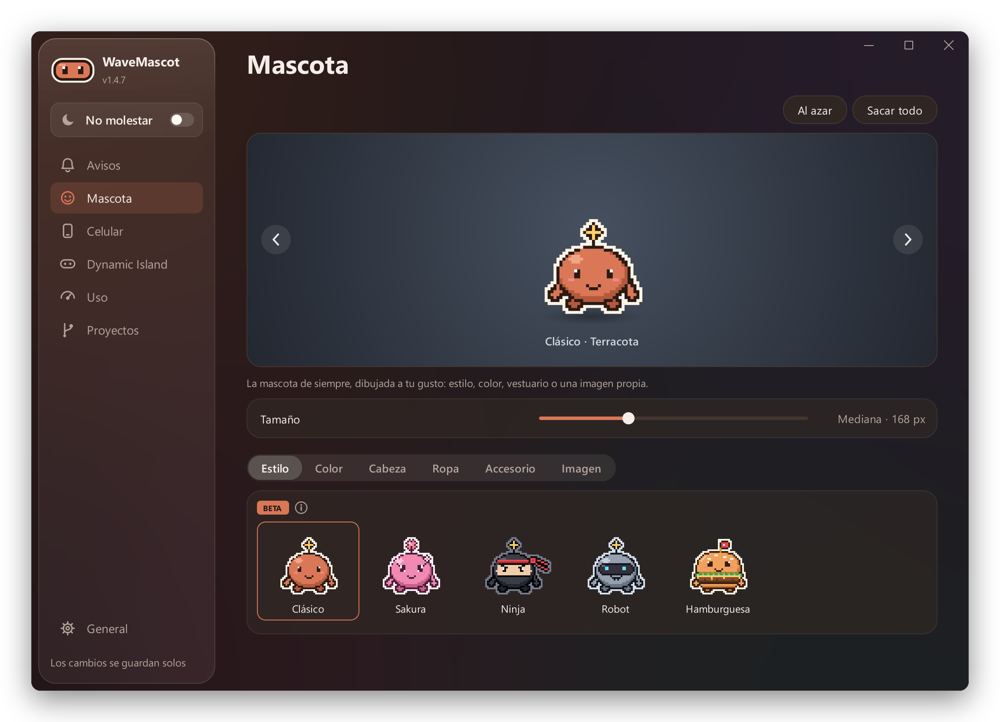 **Mascota** |
|  **Celular** | 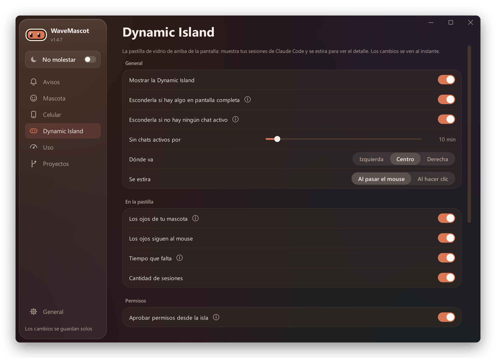 **Dynamic Island** |
| 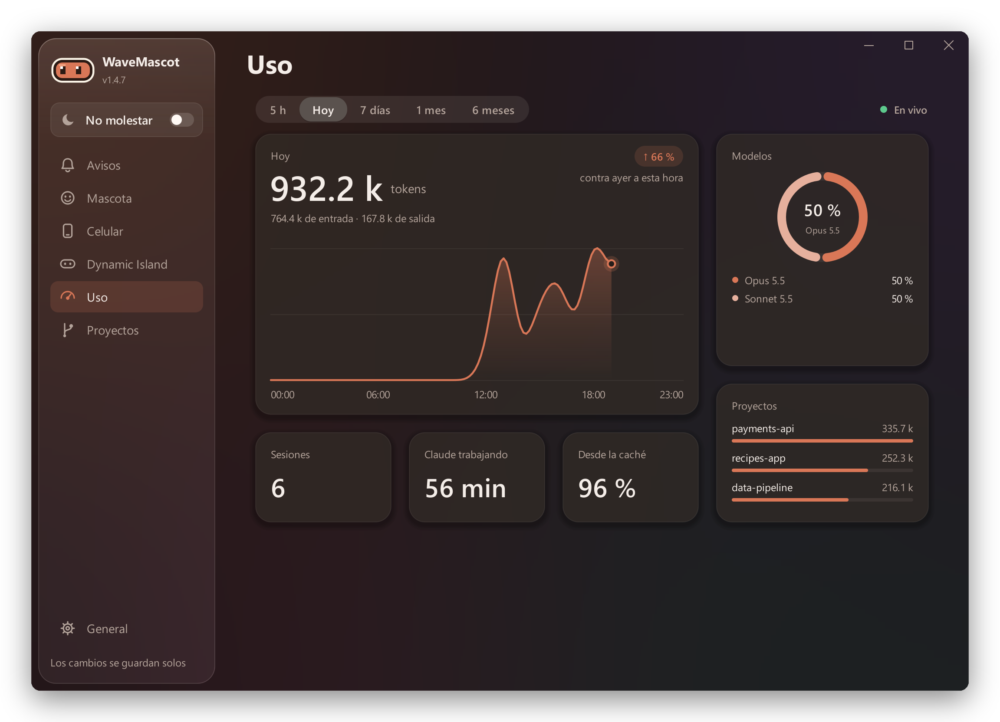 **Uso** | 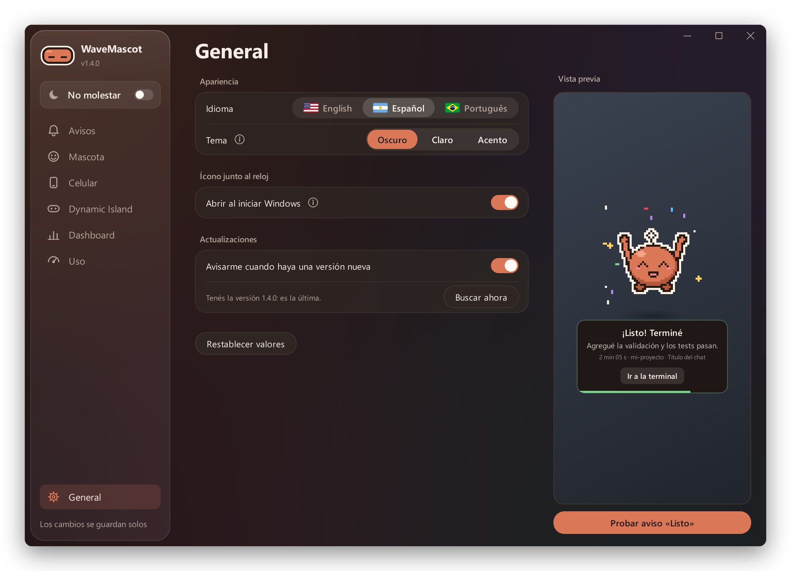 **General** |

La ventana es la real; el escritorio desenfocado de atrás, las esquinas redondeadas, la sombra y los números de uso son recreados.

## Tema claro

Elegí tema oscuro, claro o acento en **General**: lo usan el aviso, la ventana de ajustes y la Dynamic Island,
teñidos con el color de tu estilo.

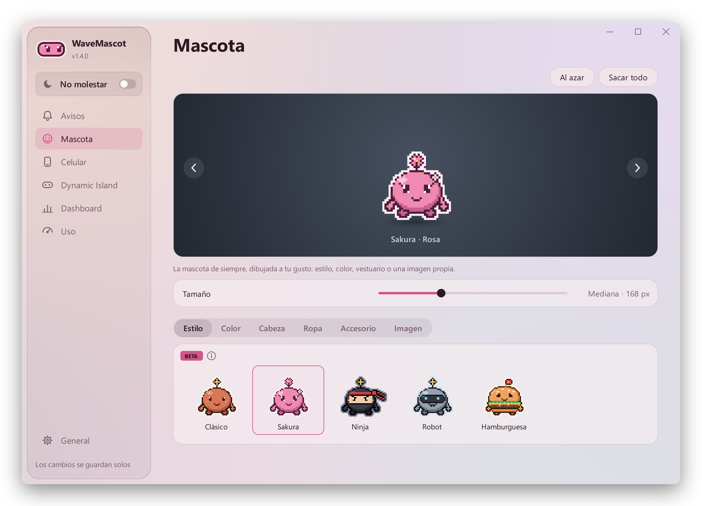
