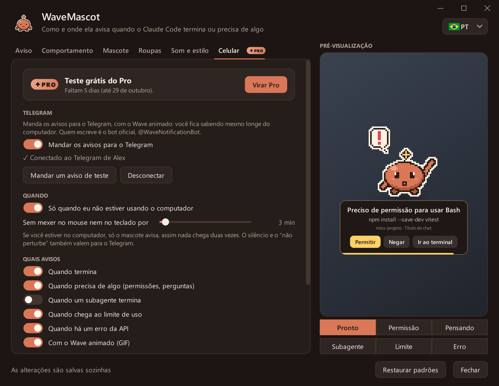
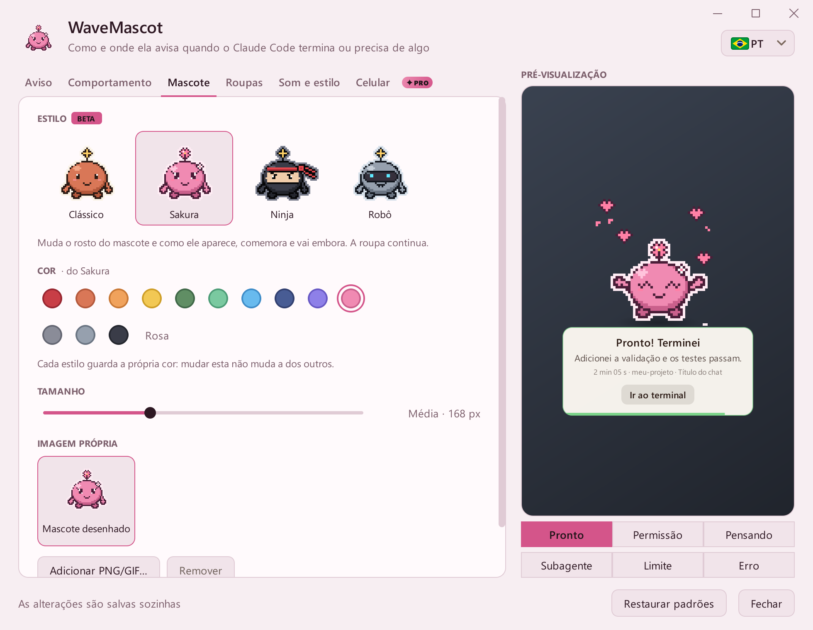

# Galeria

[← Voltar ao README](../README.pt.md) · [English](README.md) · [Español](README.es.md) · **Português**

Tudo aqui é desenhado pelo próprio app ([`tools/capturas.py`](../tools/capturas.py)): o pixel art, o aviso e a janela
de configurações reais.

**Conteúdo:** [Avisos](#avisos) · [Estilos](#estilos) · [Roupas](#roupas) · [No seu celular](#no-seu-celular) ·
[WaveMascot Pro](#wavemascot-pro) · [Configurações](#configurações) · [Tema claro](#tema-claro)

## Avisos

Cada estado tem sua animação, seu som e seus botões.

| | | |
|:---:|:---:|:---:|
|  **Pronto** |  **Precisa de permissão** |  **Pensando** |
|  **Subagente** |  **Limite de uso** |  **Erro** |

### Aviso de versão nova

Quando sai uma versão nova, o Wave avisa uma vez. No Windows, **Atualizar** baixa, verifica e instala mantendo as suas
configurações; no Mac abre a página de download.

### Todos os estados juntos

## Estilos

O estilo muda o rosto do Wave e como ele aparece, comemora e vai embora.

| | |
|:---:|:---:|
|  **Clássico**: desliza pela borda |  **Sakura**: chega flutuando entre pétalas |
|  **Ninja**: chega rolando escondido na fumaça |  **Robô**: chega voando com botas-foguete |

## Roupas

Cabeças, roupas e acessórios funcionam com todos os estilos.

## No seu celular

Com o [WaveMascot Pro](#wavemascot-pro), os avisos chegam ao Telegram com o Wave animado, e os pedidos de permissão
trazem **Permitir** e **Negar**.

Ilustração: o visual do Telegram é recriado; o GIF do Wave e os textos são os reais.

## WaveMascot Pro

Toque no selo **PRO** da aba Celular para abrir o guia: o que inclui, o que continua grátis e três passos para
desbloquear. Ele percebe o pagamento sozinho.

| | |
|:---:|:---:|
|  **Antes de conectar**: teste grátis por 7 dias |  **Durante o teste**: os dias que faltam e todas as opções |
|  **Depois de pagar**: o seu plano, com confete | |

## Configurações

| | |
|:---:|:---:|
|  **Aviso** |  **Comportamento** |
|  **Mascote** |  **Roupas** |
|  **Som e estilo** |  **Celular** |

## Tema claro

Escolha tema claro ou escuro em **Som e estilo**: o aviso e a janela de configurações usam esse tema, com a cor do seu
estilo.

